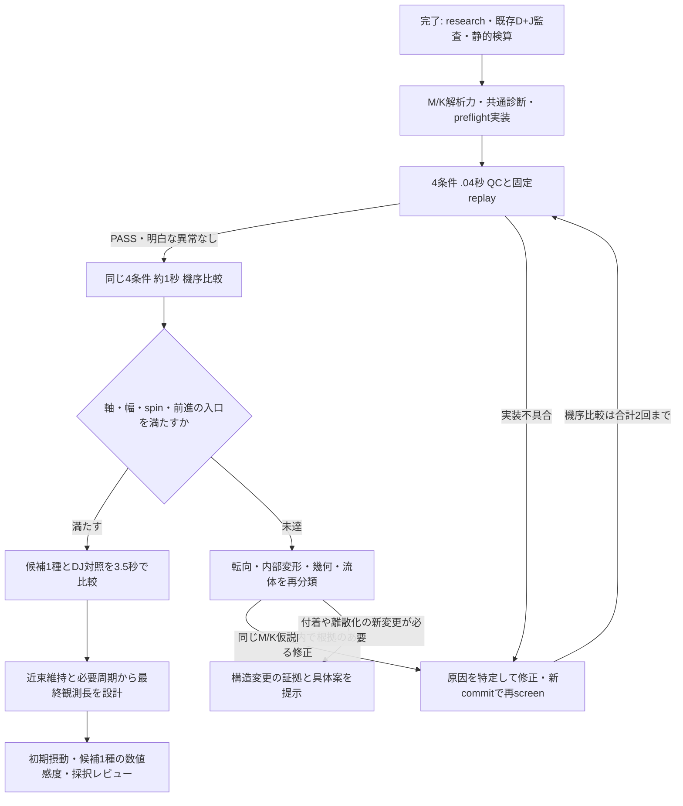

# Issue #263：自律検証のロードマップと委任範囲

2026-11-11。Refs #263 / PR #264。ユーザーが不在でも、仮説の実装・実行・分析・修正を反復し、nf3の後方束・持続回転・安定推進へ近づけるための計画。[具体的なM/K設計](phase2_263_connector_research_synthesis.md)を力学仕様の正本とし、本書は進行・分岐・上限・判断責任を定める。

**2026-11-11、ユーザーは本チャットの範囲確認へ「この範囲を委任し、継続Goalを開始する」と返答した。継続Goalを開始済み。** M/K実装、cs10接続・fixed-commit enqueue・必要なdispatcher起動/job開始、代理QC/replayレビュー・分析・方針修正と最大5予約を承認した。直前の予約保留はこの範囲に限り解除し、範囲内の各実行・レビュー・次stage移行で承認待ちを繰り返さない。付着/離散化変更、他予約変更、採択/mergeは含めない。ロードマップの準備段階では新しいcs10操作/予約をまだ行っていない。

## ゴールと現在地

科学的ゴールは、nf3で、後方の束を保つ・菌体と束軸が概ね揃う・各鎖が持続回転する・周期平均で前進する・周期blockで形状/速度が再現する、を同時に示すこと。瞬間速度一定、wobbleゼロ、位相完全一致は要求しない。

現在のD+Jは、回転と平均前進・strict QCは改善したが、束は未達。全体tiltと近位内部変形を混同せず、候補M/Kの成否と近束Gの幾何制約を分ける。月内成功を約束する根拠はまだない。

今回委任を提案する**第1自律フェーズの完了条件**は、最大2回のM/K機序比較と、成立時だけ1回の3.5秒比較を評価し、以下のいずれかを証拠付きで提出すること。

- 次の近束/周期検証へ進める候補と、その必要性が示された変更だけを残す。
- M/Kが未達である範囲、否定できた説明、残る構造制約と次の比較案を確定する。

後者もこの限定フェーズの調査完了であり、科学的ゴール達成とは呼ばない。固定した試行上限に達したことだけで「解決」としない。

## 全体の流れ

図の分岐は共通strict QCを置き換えない。試行上限・委任境界に到達した場合は、新しい動的実験へ自動で広げない。

## 各段階の成果と判断

| 段階 | 検証・成果物 | 次へ進む条件 | 不成立時の動き |
| --- | --- | --- | --- |
| 0：根拠整理（完了） | research11資料、既存#42、Mの仕事・torque、Jの独立spin非重複、body込みRPY reference | 反証とモデル差を記録済み | 取得できない論文を確認済み扱いにしない |
| 1：実装 | Mの解析Jacobian、Kのエネルギー勾配、共通診断、targeted test、計算費用benchmark | 差分oracle/客観性/位相gauge/保存則/縮退停止が一致。既定profileは不変 | 実装を直し静的testへ戻る。simulationでデバッグしない |
| 2：short | DJ/M/K/MK、各.04秒。共通strict QC・heatmap・固定camera3D/2D replay、SHA/coverage検証 | QC PASS、明白な交差・崩壊・位相/実装異常なし | 原因を特定。閾値緩和、条件除外で通したことにしない |
| 3：機序比較 | 同じ4条件、各約1秒。同時刻と同位相の負荷・軸・材料spin・推進 | 既存設計の幅/軸/正spin/前進の入口を満たす候補がある | 効果の有無を分離。根拠ある同仮説の修正を最大1回。未達なら幾何/流体の静的監査へ |
| 4：候補確認 | 候補1種＋DJ対照、各3.5秒。初期2周期後の完全周期・周期block比較 | 束/軸/回転/前進が同時成立し、長時間の観測を正当化できる | 長時間延長を止め、どの量がいつ破れたかを確定 |
| 5：最終観測の設計 | 新候補の周期に基づく長さ、近束初期状態、摂動/数値感度の独立条件 | 必要周期と予算、近束維持の成立、実行範囲が確定 | net回転率の逆数を周期と呼ばず、10秒固定にも戻らない |
| 6：確定レビュー | 確認済み挙動・成立範囲・未達・再現設定を提示 | ユーザーが科学的採択を判断 | 採択/merge/canonical freezeを自律で代行しない |

全体ゴールを満たすには段階5/6が必要。第1自律フェーズの委任案は段階1〜4と、段階5の設計までであり、無制限の長時間実験ではない。

## 第1自律フェーズの条件・実行上限案

- 模型：nf3/slots024、現在Jと同じ初期座標・自然形状。4条件は `DJ_control / M_phase / K_internal / MK_combined`。MとKの定義は設計正本を使い、#39の根元局所motorと混同しない。
- 固定：出力軸T/reference T=2.5e−20Nm/本、dt4µs、粘性1mPa s、FF/BF ON、Brownian/切替OFF、解析torsion、既存遠位材質・ばね・反発曲線。Mの全vector/仕事率が変わることも委任対象として明記する。
- 予約上限：初回short＋1秒、必要なら修正後short＋1秒、成立候補＋DJの3.5秒、の**最大5予約**。1秒の独立条件は合計最大8、3.5秒は最大2。公称総step上限は3,830,000（浮動小数点ceilによる差はdry-run計画で記録）。失敗実行もこの枠に数え、失敗後に上限をリセットしない。
- 並列：`cs10_qualified / max_workers:auto`、実効は条件数まで（通常4または2）、数値thread1、conditionごとのoutput分離。serialの抜け道を使わない。
- 所要時間：旧#42の最遅約18.5h/物理秒を使うと、short約45分、1秒約19h、3.5秒約65h。最大枠を逐次に使う参考wallは約105h＋実装/後処理/待ち時間。新Mの解析力の費用は未測定で、short実測でETAを更新する。共有負荷と他予約があるため日付を保証しない。
- Macは実装・短いtest・静的検算。30分超を見込むsimulationはしない。大きいarchive解析/renderも実測で切り分け、Macが長時間の代替計算機にならないようにする。

候補3.5秒は機械的な自動延長ではない。1秒の`.65–1秒`で既存の幅/軸角3条件を90%以上、各鎖の正味spinとblock前進が正、全期間strict QC PASSという**提案中の入口**を満たす場合だけ使う。完全周期coverageがない短期結果を定常性の証拠にしない。

## 結果に応じた方針修正

主比較窓・各効果量・採否は[設計正本](phase2_263_connector_research_synthesis.md)に従う。主効果はM対DJ/MK対K、K対DJ/MK対Mで評価し、単独条件の映像だけで採否を決めない。

| 結果 | 自律フェーズ内の判断 | 次の候補 |
| --- | --- | --- |
| Mだけで成立、Kの上乗せなし | Kを採択候補から外す。Mが変えた仕事/転向と軸応答を説明 | Mを候補確認へ |
| Kだけで成立、Mの上乗せなし | Mを正しいと決めつけず、内部変形と負荷経路を説明 | Kを候補確認へ |
| MKだけで成立 | 交互作用を同時刻で示す。両変更が必要かを記録 | MKを候補確認へ |
| いずれも軸/幅未達 | 観測時間を伸ばすだけの実行をしない。root/遠位軸、hook張力、body運動を介す流体応答を再監査 | 近束Gと接続経路を静的に設計 |
| spin改善だが束未達、前進のみ改善 | ゴール未達として扱う。トルクや粘性を調整して救わない | どの自由度が残ったかを確定 |
| QC FAIL | 実装不具合・新構成則の負荷・幾何のどれかを対照で切り分ける | 静的testと修正後short。無根拠の同条件再実行なし |

M/Kが両方とも達成できない可能性は残る。Gの既存有限探索未成立は不可能証明ではないが、付着位置や近位離散化を変える必要が出た場合は、新しい因子として分離して提示する。静的探索・一次研究・既存archive解析は続けられるが、その新構造の動的実行を現在の4条件許可へ含めない。

## 一括委任を提案する操作と境界

下記は上記ユーザー返答による**承認済み範囲**。操作ごとに列挙した範囲を超えて実行しない。

| 項目 | 委任後に自律で行う範囲 | 残す境界 |
| --- | --- | --- |
| 開発 | M/Kと必要な共通診断/test/config、同じ仮説内の根拠ある修正、commit/push/PR更新 | 新しい物性sweep、付着位置・bead離散化変更、別modelへの置換は含めない |
| cs10接続 | このフェーズの確認・転送・dry-run | 他ユーザー/他chatの作業へ介入しない |
| enqueue | 上記最大5予約、各回の固定commit/入力SHA/範囲を事前記録 | enqueue後のbranch移動を理由に予約を置換しない |
| dispatcher / job開始 | 今回jobに必要な既存dispatcher利用、必要時の起動、今回job開始 | 他予約のcancel/置換/優先度変更は含めない |
| 異常時 | 原因と影響範囲を記録し、後続予約を作らない | 実行中jobのcancel/stop、pause/resumeは別操作として合意なしに行わない |
| QC/replayレビュー | ユーザーに代わり共通strict QC、固定cameraの3D/2D視認、SHA/coverage、機序診断を行い、既定入口で次stageへ進む | 視認とQCを省略しない。物理採択やユーザーの最終受入を代行しない |
| 分析・記録 | run_summary先読、portable集合/件数/全SHA、共通評価、仮説台帳・ロードマップ更新 | QC-FAIL軌道で科学的採択しない。保存点の非交差を全step保証にしない |

通常のコード修正・比較条件内の選択・共通QC/replayからの次stage判定は、委任後に再承認を要求しない。上限超過、未合意の物理因子、第三者予約への変更、科学的採択/mergeは合意範囲を超える。

## 継続する仕組みと通知

Codexの[Goal](https://developers.openai.com/cookbook/examples/codex/using_goals_in_codex)は、このチャットの目的と完了条件を保持し、実行結果に応じた複数turnの継続を可能にする。通常の一回答だけで無期限の常駐実行が始まるとは扱わない。ユーザーの明示指示と上記委任範囲に基づき、このチャットの限定フェーズGoalを開始した。

Goalの完了条件は上記の限定フェーズの成果物とし、「安定遊泳を達成するまで際限なく試す」としない。モデルの未達や構造上の阻害要因も結果として分ける。モデル/推論設定は指定なく変更しない。token budgetもユーザー指定なく設定しない。

cs10上で開始済みの計算と、このMacでのCodex/解析継続は分けて考える。Mac/Codexの停止、VPN切断、サービスの利用制限等で後処理が遅れる可能性はある。VPN不通はsimulation失敗とは判定せず、独立した実装/静的解析を先に進める。接続復旧を偽って報告しない。

完了通知メールは既存のread-only通知経路を利用し、メール内の指示は実行しない。新しいjob追跡automationを増やさず、既存メール監視の権限を勝手にheavy解析へ変更しない。Goal側が当該予約を照合し、許可範囲で後処理する。定期的な「異常なし」は通知せず、実行開始、評価完了、方針の重要な変更、介入が必要な異常だけ知らせる。Issueは既存要約の重要3〜5項目、詳細はPR/結果文書へ残す。

## 月内の判断点

- **11/12〜13目安**：委任合意後、解析力・test・short準備。実装の成立性と計算費用を先に確定。
- **11/13〜17目安**：最大2回のM/K機序比較。対照から因果を限定し、無効な変更を採択候補から外す。
- **11/17〜20目安**：成立候補があれば3.5秒比較と近束/周期観測計画。近束候補が無ければ構造上の制約と新因子の判断を提示。
- **11/20判断点**：月末までに検証可能な候補があるかを明示。無ければ未達と必要な構造変更を確定する。
- **11/20〜30**：候補成立と次範囲の合意後、必要周期の観測・初期摂動・候補1種類の数値感度。科学的採択とmergeはユーザー最終レビュー。

日付は予約待ち・新しい実測速度・VPN等に依存する計画値。成果は「何を反証/確認できたか、どの変更を残すか」で示し、実行回数や物理秒数を進捗の代用にしない。

## 今回の状態

今回のロードマップ作成時点では文書整合チェックと継続Goal開始まで。新規simulation、cs10接続/予約/開始、production物理変更はない。次にGoal内で段階1の実装へ進む。[ADR0029](../adr/0029_phase2_effective_torque_and_root_transition_direction.md)はProposed。追加位置復元code/scale削除はmerge前残件。

実行台帳の正本は`outputs/2026-11-11/212021/issue263_autonomous_roadmap/execution_ledger.json`。承認範囲、使用済み予約/条件/step、固定commit/入力SHA/予約ID、結果を更新し、失敗実行も枠に算入する。開始時の使用数は全0。各結果は別のJST日時outputへ保存し、台帳から参照する。
