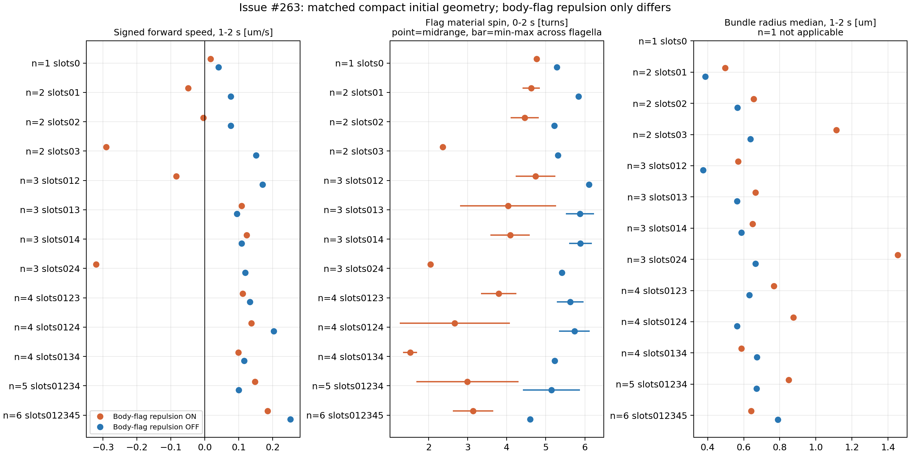
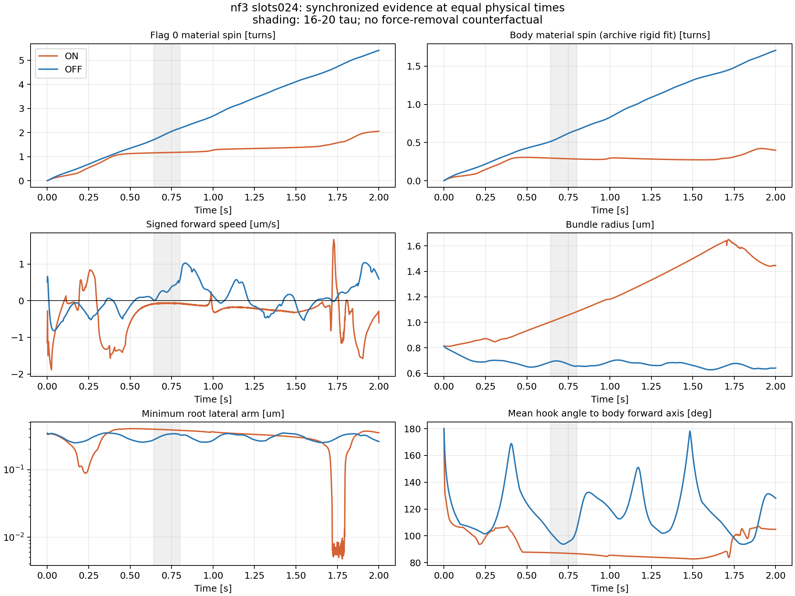

# Issue #263：従来compact・26条件×2秒の定量評価

## 結果の要約

- 予約#35は**26/26条件完走、共通strict QC 26/26 PASS**。固定commit・入力SHAとportable全件の集合/ハッシュを照合した。
- 同一初期配置の13対で菌体–べん毛反発だけを変えた。ONは全13対でべん毛平均積算spinと菌体材料点のnet自転がOFFより小さい。後半平均前進速度は10/13対でONがOFFより小さく、ONの5配置は負だった。OFFは13配置とも後半平均が正だが、全配置に後退区間が残る。
- ONの5配置はreference flag0のbest-fit位相が非単調で、共通の完全周期比較を適用できない。回転していないという意味ではなく、位相を補修して周期を作らない扱いである。
- 代表nf3 slots024はONで回転鈍化・束の広がり・後退が顕著。OFFでも周期的な前進/後退と菌体–べん毛の重なりを許しており、どちらも目的の遊泳成立として採択しない。

## 実行・成果物照合

cs10予約 **#35**、固定commit `71ed7529d362474235b931494af6cafcf3fe2edf`、`compact_count13_contact_2s_job.yaml`。2026-10-21 09:17 JST開始、**2026-10-25 17:03:47 JST**終了（約103.77時間）。26条件のjob集約completed、failed 0。最大8 workers・数値thread各1。短期#34と同じ初期座標・力学・dt・保存間隔を使い、時間のみ2秒へ延長した。

portable **291ファイル・236,782,129 bytes**をローカル同期し、ファイル集合・SHA-256全件一致を確認した。全`run_summary.json`を詳細分析より先に読み、全条件の完走・step連続性・全internal stepのfinite/body/nonbodyにFAIL履歴がないことを確認した。job SHA-256 `b00213f1e03c9148be752675798b9c33b674fe77150654726fd26497f38e9792`、campaign SHA-256 `5ebfef81d872a41b945d6f263aa0bb2b957bfaf72dc0fd32ccda89d0b5ae0d87`と26 IDが契約に一致。

公称500,000 stepに対し、現行runtimeは`ceil(duration_star/dt_star)`の浮動小数点値から500,001 stepを計画し、全条件がその計画どおり完走した。実終端は**2.000004秒**。保存1 ms間隔のうち2.0秒までの2001状態を主な定量窓に使い、追加の4 µsを比較窓へ含めない。実行中のコード・条件は変更していない。

共通strict QCの全条件最大値：hook長相対誤差0.12261、flag結合長相対誤差0.09060、曲げ誤差35.56°、torsion誤差41.31°。motor総力/総トルク残差比の最大は3.59e-15/4.41e-15。既存閾値とhook角の診断除外は維持し、QC PASSを非貫通や遊泳成立の保証とはしない。

## 全26条件の定量表

回転は0〜2秒の各べん毛の積算best-fit spinの最小〜最大。菌体自転はlabel付きbody全体の共通rigid-fitによる軸方向spinを1 ms保存間隔で積分したnet値。PCA横基底の位相跳びを含むonline rollとは区別する。柔らかい菌体のbest-fit診断であり、最大fit残差は約0.0160 µm。速度・後退率・束指標は**後半1〜2秒**。後退率は瞬時菌体前方軸への速度射影が負の時間割合（保存速度を線形補間）。任意の「停止閾値」は追加していない。

| nf / slots | 菌体–べん毛反発 | flag回転 [回] | 菌体自転 [回] | 平均前進 [µm/s] | 後退時間 [%] | 束半径 [µm] | べん毛間軸角 [°] |
|---|---|---:|---:|---:|---:|---:|---:|
| 1 / 0 | ON | 4.76 | 0.447 | +0.016 | 43.2 | — | — |
| 1 / 0 | OFF | 5.28 | 0.650 | +0.040 | 23.5 | — | — |
| 2 / 01 | ON | 4.41–4.85 | 0.411 | -0.050 | 56.3 | 0.496 | 21.6 |
| 2 / 01 | OFF | 5.83–5.85 | 1.121 | +0.076 | 33.2 | 0.387 | 9.9 |
| 2 / 02 | ON | 4.10–4.82 | 0.540 | -0.004 | 50.4 | 0.655 | 41.2 |
| 2 / 02 | OFF | 5.17–5.27 | 1.203 | +0.077 | 30.2 | 0.565 | 19.6 |
| 2 / 03 | ON | 2.36–2.37 | 0.333 | -0.291 | 96.2 | 1.113 | 58.6 |
| 2 / 03 | OFF | 5.31 | 1.275 | +0.151 | 26.1 | 0.638 | 24.4 |
| 3 / 012 | ON | 4.23–5.24 | 0.302 | -0.085 | 54.9 | 0.568 | 26.4 |
| 3 / 012 | OFF | 6.05–6.16 | 1.507 | +0.170 | 11.8 | 0.375 | 14.5 |
| 3 / 013 | ON | 2.80–5.26 | 0.567 | +0.109 | 48.4 | 0.666 | 38.7 |
| 3 / 013 | OFF | 5.52–6.23 | 1.599 | +0.095 | 25.3 | 0.562 | 24.1 |
| 3 / 014 | ON | 3.59–4.59 | 0.598 | +0.123 | 44.2 | 0.649 | 37.2 |
| 3 / 014 | OFF | 5.59–6.18 | 1.641 | +0.109 | 21.6 | 0.587 | 27.5 |
| 3 / 024 | ON | 2.05 | 0.398 | -0.320 | 95.7 | 1.454 | 33.4 |
| 3 / 024 | OFF | 5.41 | 1.707 | +0.119 | 39.9 | 0.665 | 27.9 |
| 4 / 0123 | ON | 3.35–4.25 | 0.588 | +0.111 | 36.3 | 0.767 | 35.1 |
| 4 / 0123 | OFF | 5.28–5.97 | 1.911 | +0.133 | 47.0 | 0.630 | 21.0 |
| 4 / 0124 | ON | 1.26–4.08 | 0.484 | +0.138 | 20.1 | 0.876 | 37.7 |
| 4 / 0124 | OFF | 5.34–6.13 | 1.834 | +0.203 | 27.4 | 0.563 | 20.7 |
| 4 / 0134 | ON | 1.35–1.70 | 0.565 | +0.099 | 23.4 | 0.587 | 33.9 |
| 4 / 0134 | OFF | 5.20–5.25 | 2.037 | +0.116 | 48.3 | 0.673 | 18.6 |
| 5 / 01234 | ON | 1.68–4.30 | 0.494 | +0.148 | 27.9 | 0.850 | 36.1 |
| 5 / 01234 | OFF | 4.42–5.88 | 1.550 | +0.100 | 41.8 | 0.670 | 25.2 |
| 6 / 012345 | ON | 2.62–3.66 | 1.202 | +0.186 | 37.0 | 0.640 | 21.5 |
| 6 / 012345 | OFF | 4.57–4.63 | 2.031 | +0.253 | 51.7 | 0.789 | 26.9 |

nf1の束・べん毛間指標は該当なし。束半径は接続部を含む既存の全鎖指標で、直径やhard-core接触判定ではない。ON/OFFを同じ付着配置内で対比較する。本数間では付着位置・総motorトルクも変わる。

## 周期比較・旧16τ窓

OFF全13配置でflag0基準の完全周期が4〜6件。先頭2完全周期を除く比較窓は2〜4周期で、長時間定常性にはまだ短い。ONでは5配置（nf2 slots03、nf4 slots0123/0124/0134、nf5 slots01234）でreference位相の逆行があり完全周期表は利用不可。nf3 slots024 ONとnf6 ONは完全周期2件のみで、先頭2周期を除くと比較可能な完全周期が残らない。その他ONでは2〜3周期を比較できるが、それだけで束遊泳成立としない。

各条件のperiod平均/CV、周期ごとの前方変位、同位相の束幅変化、0.64〜0.80秒の同時刻指標を`condition_diagnostics.json`、`window_diagnostics.csv`、共通`bundle_rotation_cycles.csv`へ保存した。位相をunwrap・逆行除去・補間補修して周期を捏造しない。

## nf3 slots024の機序を同時刻で比較

| 指標 | ON | OFF |
|---|---:|---:|
| flag0積算回転 | 2.051回 | 5.414回 |
| 菌体材料点net自転 | 0.400回程度 | 1.71回程度 |
| 0〜2秒の符号付き前方変位 | −0.658 µm | ＋0.152 µm |
| 0.64〜0.80秒の平均前進 | −0.0733 µm/s | ＋0.2807 µm/s |
| 1〜2秒の平均前進 | −0.3203 µm/s | ＋0.1187 µm/s |
| 1〜2秒の後退時間割合 | 95.7% | 39.9% |
| 1〜2秒の最長連続後退 | 0.717秒 | 0.209秒 |
| 1〜2秒の束半径中央値 | 1.454 µm | 0.665 µm |
| 根元横腕の全区間最小 | 0.00476 µm（1.780秒） | 0.24958 µm（0.171秒） |
| 根元横腕が最小の時の3D結合長 | 0.61626 µm | 0.56580 µm |
| motor駆動力ノルムの全internal step最大 | 2.074 pN | 0.1027 pN |

ONでは0.5秒前後からべん毛spinと菌体自転の増加が鈍り、束が広がる。一方、根元横腕が極端に小さい事象は約1.78秒であり、この極小だけを0.5秒付近の鈍化の原因とは説明できない。最小横腕の時点でも3D結合長は約0.616 µmで、結合が0.00476 µmへ縮んだわけではない。motor軸への投影の幾何と駆動力増大は今後の機序候補だが、力を除去した動的対照ではなく、因果の上流は未確定である。表の全時間最大値どうしは同時刻とは限らない。

同じ1〜2秒窓で非付着のbody/flag bead間の最小中心距離はON約0.2009 µm、OFF約0.0668 µm（bead直径0.20 µm）。OFFは幾何学的な重なりを許す設定であり、前進が大きいことだけを物理妥当性の根拠にはしない。この距離は各flagの付着body beadを除いた保存bead間の診断で、真の全segment間gapや新しいQCゲートではない。

nf3 slots012 OFFは同じ本数の中で後半束半径0.375 µm・べん毛間軸角14.5°・後退時間11.8%と相対的に良いが、先頭2周期を除いた周期長CVは約15.9%で、安定遊泳として採択するには未達。完全対称配置で軸一定・回転一致が残ることや、ONで微小誤差から非対称化する可能性も、摂動耐性・自発同期の証拠にはしない。

## replay・再現性・次の判断

- 共通評価の標準固定camera3D/2D：14本、各41 frame・25 fps。
- 定性評価用の共通視野3D/2D：14本、各201 frame・50 fps、平均べん毛軸を表示。全26条件を含み、nf3は6+2 panelの2ページ。
- 全28本の実frame数・fps・全条件coverage・SHA-256を検証。1 ms保存状態から共通replay CLIで再標本化した表示で、動画補間を新しいsimulation状態と扱わない。定性動画は物理2秒を約4.02秒で再生する。
- nf3 slots024の0.64秒・終端、nf6終端の3Dを目視し、ON/OFFの幾何差と広がりを確認した。2D像は菌体が支配的であり、べん毛形状は3Dで確認する。

ローカル正本：`outputs/2026-10-25/201900/issue263_compact_count_contact_2s/manifest.json`。全26条件の定量は`condition_diagnostics.csv/json`、固定時間窓は`window_diagnostics.csv`、周期別は`bundle_rotation/`、動画は`evaluation/replay/`と`qualitative_replay/`、source archiveと全件ハッシュは`source/`・`sync_verification.json`にある。解析script・source SHA・figure PNG/PDFを保存した。

今回のPASSは成果物照合・QC・定量評価・描画作業の完了であり、モデル採択や定常遊泳成立ではない。#271の密集・同位相検証とは独立で、対象モデル保留を維持する。torsion追加比較・新規simulation・追加予約・mergeは行っていない。追加位置復元処理とscaleの削除は合意済みマージ前作業として残る。結果をレビューした上で、body–flag接触とhook/motorの整合を次の仮説として切り分ける。監視は完了によりPAUSEDとする。
