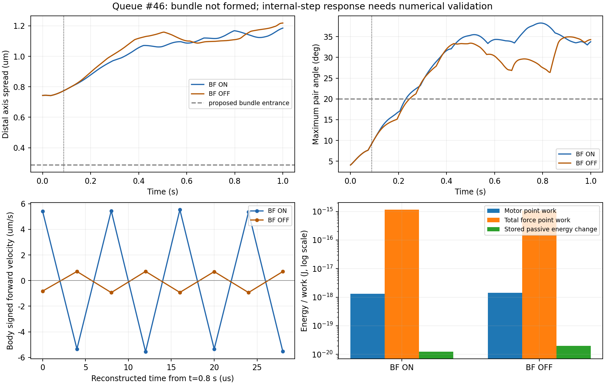

# Issue #263：接触対照1秒の結果と、次の検証の入口

2026-11-14。Refs #263 / PR #264。[承認済み実行手順](phase2_263_connector_execution_runbook.md)の#45 shortを経て、#46の現J・BF ON/OFFを完走・評価した。**両条件とも共通strict QCとreplayの生成・表示確認はPASSだが、束形成は未達。さらに内部stepの数値応答に問題が見つかったため、今回の速度・回転を物理的に妥当な遊泳として採択しない。追加予約は行っていない。**

## 固定条件と成果物

simulation / analysis sourceは`823f81873aa601e7a12ad026c80234db16f7fc2d`。nf3/slots024、同じJ座標・固定自然参照、D drive、Kなし、FF ON、BFだけON/OFF。T/refT=2.5e−20Nm/本、dt=4µs、η=1mPa s、Brownian/切替OFF、解析torsionを維持。cs10_qualified実効2workers、数値thread各1。モデル採択、物理定数の調整、他予約の変更はない。

- job：`conf/phase2_parallel/issue263_initial_bundle/nf3_connector_contact_1s_job.yaml`
- job SHA-256：`c4b1a9b841d528909938e5013b1e65041e4b7cf0753a74c54c39b30bcef0c863`
- campaign SHA-256：`f7d8beea326db711f28972273125d33ec0417adb033c37b04e89013666869b6f`
- IDs：`nf03__slots024__J_bfon_control` / `nf03__slots024__J_bfoff_control`
- 各250001連続step、実終端1.0000039999982029秒。既存ceilによる公称250000との差1stepを保持し、定量窓は1.0秒まで。
- 11/13 19:07 JST開始、OFFは同日23:38、ONは11/14 10:29完了。child wallはOFF16267.45秒、ON55317.81秒。10:35にqueue・固定commit・入力・全条件の完走を照合した。

ローカル正本：`outputs/2026-11-14/103501/issue263_contact_main46_review/`。portable **21files / 5,588,151bytes**の集合・件数・SHA-256をremote前後とlocalで照合し、最終レビュー時にも全件再検証した。各`run_summary.json`を詳細分析前に読んだ。共通`development_evaluation` strict QC・heatmap・標準固定camera 3D/2D replay、共通`bundle_rotation`を実施。旧距離バグの軌道、moving PR head、旧M/Kの証拠を今回の実行sourceと混ぜていない。

replayは両視点とも41frame / 25fps、動画長1.64秒、物理時刻0–1.000004秒。coverage・ffprobe・SHAを照合し、3D/2Dの0/20/40frameを視認した。広い初期Jから扇状に開き、明白な描画崩壊はない。2Dは菌体投影であり、束形状は3Dで確認する。保存点から未保存内部stepの非貫通は保証しない。replayのPASSは表示・再現の確認であり、数値精度・束遊泳の合格ではない。

## 定量比較：反発OFFだけでは束を作れなかった

以下は当該数値軌道の診断値。共通QCは両方PASSだが、後述の精度上の制約があるため、差をそのまま物理効果量として採択しない。符号付き前進は保存1ms間隔の重心差分を長軸へ射影、菌体自転はlabel付き材料点から求めた。online PCA frameのroll跳びとは区別した。

| 後半0.65–1.0秒 | BF ON | BF OFF |
| --- | ---: | ---: |
| 遠位軸の広がり・平均 [µm] | 1.138760 | 1.138699 |
| 最大相互軸角・平均 [°] | 35.448 | 30.869 |
| 束平均軸と後方軸の角・平均 [°] | 4.553 | 3.309 |
| 根元内部曲げRMS・平均 [°] | 8.365 | 8.927 |
| 符号付き前進速度・平均 [µm/s] | +.102245 | +.103507 |
| 保存点で後退した割合 | 21.65% | 22.51% |
| 各鎖の材料spin・正味 [回] | .797 / .784 / .893 | .678 / .670 / .704 |
| 菌体材料点の自転・正味 [回] | .07268 | .07973 |
| 既存の束幾何入口を同時に満たす保存点割合 | 0% | 0% |

正常らせん半径は.286543µm。既存の入口案（広がり≤同半径・最大相互角≤20°・後方軸角≤15°）に対して両方未達。0.2–0.65秒の平均前進はON−.095112 / OFF−.102868µm/sで、後半平均が正でも安定前進とはしない。後方整列した平均軸だけで各べん毛の束化を判断しない。

全内部stepの実線分接触診断では、ONのBF初作動は**.088008秒**、cutoff内時間.868264秒、最短.161131µm、最大pair力.0558494pN。ONのinterFFは最短.426462µmで未作動。OFFではBF pairは対象外（−1はsentinel）で、interFFが.430012秒から作動、cutoff内時間.532212秒、最短.0958294µm。selfFFは両方未作動。soft反発のcutoff内進入と中心線の交差は同一視しない。

ON/OFFは.088秒までの保存座標がbit一致し、最初の差は.089秒。BF作動前にも相互軸角は約4.09→9.18°へ変わっている。従ってBFは初動の必要条件ではなく、作動後の姿勢・位相差には影響する。ただし「BFが無関係」「OFFを採用すればよい」とは結論しない。

図右下の`Total force point work`は各明示Euler stepの`F(q_n)·Δq`総和であり、厳密な時間積分済みの物理散逸とは区別する。その近似が大きく破綻していること自体が、以下の精度上の問題である。

## 根元の速い弾性モードと時間積分

現sourceは`q[n+1]=q[n]+dt M(q[n])F(q[n])`の明示Euler。`velocity_um_s`は最後の内部4µs stepの菌体速度であり、1ms保存点の重心差分とは異なる。ONの.8秒では最後の内部stepが約−5.50µm/s、保存状態で再計算する次stepが約+5.41µm/s。同じsource・同じdtで8stepだけ再構成すると、全ビーズ速度の隣接step間cosineは約−.999となり、符号反転を繰り返した。

これはBF作動後だけの現象ではない。.06秒でも隣接速度cosineが約−.91となった。ON/OFFが同一でBFもFFも作動していない時点に既に存在するため、排除体積だけでは説明できない。

凍結状態の弾性Hessianについて、反転方向`w`のRayleigh商を

\[
\lambda_w=\frac{w^T H_\mathrm{elastic} w}{w^T M^{-1}w}
\]

で検算した。.06秒のONは`dt λw=1.997615`、そのうち根元側quad（鎖1、局所bead0–3）だけで1.974311を占めた。隣接bondの曲げ正弦は.07058で、ほぼ直線に近い根元の幾何二面角が強い応答を作る。.2秒OFFでは弾性商が2.001199だった。位置差分幅1e−13 / 3e−13 / 1e−12mで商が一致し、反発やばねではなく既存torsionがほぼ全てを占めた。

局所の線形受動緩和`x'=-λx`なら厳密解の1step倍率は`exp(-dt λ)`、明示Eulerは`1-dt λ`。`dt λ≈2`では前者約.135に対して後者約−1となり、速い変形を減衰させず反転させる。一般的な安定性条件は[Cambridge数値解析講義](https://www.damtp.cam.ac.uk/user/na/PartIB/Lect10.pdf)とも整合する。凍結局所商から動く系全体の固有値や大域安定性を証明したとは扱わない。

**解析torsionの力の式が誤っているという検出ではない。** 全受動力とエネルギー勾配の相対誤差は調べた6状態で最大3.56e−9、全力の成分和も一致した。旧有限差分torsionとの再比較はしていない。正しい力でも時間更新が十分な精度で積分できるとは限らない。

## 仕事収支による独立確認

全受動potential（菌体/flag/hookのFENE・曲げ・幾何torsion・片側hook・実active線分反発）を含め、調べた状態にFENE clampがないことを確認。Brownian/切替OFFの連続系は`ΔU = W_motor − ∫vᵀM⁻¹v dt`を満たす。現在のEuler左端点仕事`W_total=ΣF(q_n)·Δq`を対応させ、離散収支差`ΔU+W_total−W_motor`を評価した。

| 全250001stepの記録 | BF ON | BF OFF |
| --- | ---: | ---: |
| motor左端点仕事 [J] | 1.31939e−18 | 1.40577e−18 |
| total force左端点仕事 [J] | 1.15748e−15 | 1.07104e−15 |
| 受動potential増加 [J] | 1.23464e−20 | 1.98744e−20 |
| 離散収支差 / motor仕事 | 876.29 | 760.91 |

左端点評価には離散誤差があるため差を機械的にゼロとは要求しないが、入力仕事の約760–876倍の差を物理散逸として解釈することはできない。.2秒ONの保存状態からmotorを外した受動4µs仮想更新でも、potentialが.256682→.256819Tと一時増加し、線形の予測散逸.063180Tと一致しない。束指標とは独立した数値精度上の制約である。

再構成は計80step（主監査48＋早期24＋quad局在8）の短いMacチェックのみ。受動仮想更新・静的force差分を含めても長時間simulationやdt sweepではない。単純な陰的EulerをKrylov法で解く局所試作は25反復で収束せず、位置残差約1.17e−11mを残した。この試作を候補実装や解決済みの証拠にはしない。収束失敗から陰的方法全体が不可能とも判断しない。ログとscriptをoutputに保存した。

同日後続の静的設計では、全速度Jacobianを前処理に使うと、ON .2秒の受動仮想1stepについて陰的Euler・陰的midpointとも3反復で収束した。最大位置残差はそれぞれ1.59e−20 / 1.07e−20m、potentialは.256682→.242426 / .240725Tへ低下した。ただし全Jacobianの構築を含む1状態の検算に47.55秒を要した。局所要素のJacobianへ置き換えた安価な前処理では連続8stepの検算を完了できず、productionで使える解法や費用はまだ確定していない。1step成功を長時間の安定性へ拡大しない。`preconditioned_passive_single_snapshot/`と`batched_*_probe_*/summary.json`に成功・未収束を区別して保存した。追加のMac長時間計算やcs10予約はない。

共通strict QCの閾値は変更していない。**QC PASSは従来の形状・finite等の要件を満たすという意味であり、今回の仕事収支・速いmodeの数値精度を保証していなかった。** `review_result.json:PASS`は照合・分析・報告作業のPASS、`next_stage_decision:HOLD`、`scientific_acceptance:false`を別々に記録した。

## 次の修正案と検証条件

今は3.5秒へ単純延長せず、予約枠を2/7使用のまま保つ。[G1初期近束](phase2_263_g1_static_feasibility.md)は成立しているが、固定自然形状での全1回転・連続clearance・仕事の入口は未達。今回の数値的問題をG1静的な高い回転障壁と同じ原因だと断定しない。

| 優先 | 具体案 | 固定事項と判定 |
| --- | --- | --- |
| 1 | 同じ受動力・RPYを固定dtで扱う安定な時間更新を局所設計。Hessianによる前処理と全残差の収束判定を用い、力clipや係数低減で隠さない | T/dt/η・配置・自然参照・解析force固定。凍結modeの厳密線形緩和、受動potential減少、客観性/力・トルク収支、仕事評価時点、solver残差と費用を先に確認。単純Krylov試作はproduction化しない |
| 2 | 根元の材料twistと中心線の幾何二面角を分ける有限接続の静的設計 | 直線/屈曲を許しても材料twistを定義できる構成則、端力/端moment、対向反作用、回転mobilityを一組で定義。G2の新物理をG1や積分変更へ混ぜない。C/回転抗力は未較正、動的採用は別の具体判断 |
| 3 | 数値応答が成立した候補で接続位置・近束G1を再評価 | 同じ点数/長さの初期案を活用。固定自然参照の連続spin/tilt・仕事・全active pair clearanceが先。初期重なりを除くだけで回転可能とはしない |

有限接続では材料frame `Q_i∈SO(3)`の相対回転から歪み`κ_i=log(Q_iᵀQ_{i+1})/ℓ_i`を定義し、`E=Σℓ_i[B|κ_perp−κ0_perp|²+C(κ_parallel−κ0_parallel)²]/2`のように曲げとtwistを分離する案。ただし位置tangentとの整合拘束、対応する散逸・端反作用が必要。spin変数を1つ追加するだけでは既存の位相仕事driveへ還元される。係数・離散化・runtime profileは未採択。

次の**予約候補**は、数値更新Nが局所検算に通った場合だけ、同じJ / D / BF・FF ON / T・dt・ηで`Euler対照`と`N更新`の2条件。shortは.04秒では.06秒以降の異常を見落とすため、少なくとも**.12秒（30000step）**を設計窓とする。これは未実装・未dry-run・未予約の案であり、承認済み実行に見せない。

shortの共通QC/replayに加え、内部stepの受動緩和・仕事収支・反転mode・solver収束を代理レビューしてから同じ2条件の1秒を判断。精度が成立しても束が未達なら、初めてG1/有限接続の物理仮説を比較する。新構成則や複数の物理変更を同時採用せず、未達を長時間化で救わない。3.5秒は束入口を満たした候補＋対照だけ。追加予約・採択・mergeは行っていない。

## レビューと残件

結果source823は不変。変更は結果文書・実行手順への導線・図・報告reviewのみ。`docs/codex-runs/20261114_issue263_contact_main46_review/review_result.json`とローカル同名JSONを正本とする。ADR0029はProposed。追加位置復元処理/scale削除はmerge前残件。VPN障害はsimulation失敗と混同せず、macOS既存サービス操作と復旧後のSSH確認を台帳に記録した。科学的採択・canonical freeze・Issue完了は未実施。
