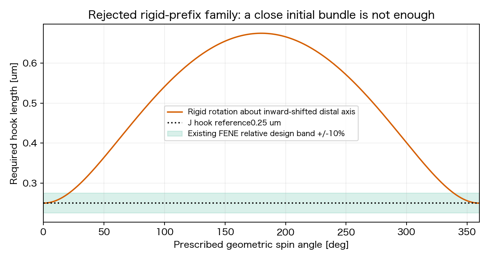

# Issue #263：M/K未達の原因整理と接続経路の次案

2026-11-12。Refs #263 / PR #264。[#44のM/K結果](phase2_263_mk_1s_result.md)を受けた**設計提案**。ユーザー依頼は原因・具体案・次条件の整理までで、実装・simulation・cs10接続/予約/開始は行わない。本書を次段の計画正本とし、以前のG/K比較案は当時の仮説として保持する。新候補の成立・採択は未確認。

## 結論：解決した対象と残った対象が異なる

Mは駆動の仕事/転向成分、Kは近位の内部曲げ応答を変えた。しかし、どちらも**離れた根元から後方の近束へ至る経路そのもの**を作っていない。現在の証拠は「M/Kで束形成は達成できなかった」までであり、菌体接触やhookが唯一の原因と確定したわけではない。

後半.65–1秒、全4条件strict QC PASS：

| 条件 | 近位角偏差RMS° | 軸間最大角の時間平均° | 軸のRMS広がりµm | 前進µm/s |
| --- | ---: | ---: | ---: | ---: |
| DJ対照 | 8.36 | 35.45 | 1.139 | +.1022 |
| M | 9.30 | 44.97 | .862 | +.1167 |
| K | 6.49 | 37.54 | 1.153 | +.0904 |
| MK | 8.24 | 46.02 | .870 | +.0693 |

幅は同じ遠位bead3以降の軸を共通区間で比較した値。通常らせん半径.286543µm、既存の束入口は幅≤半径・相互角≤20°・後方軸角≤15°。後半の同時合格率は全条件0%。平均軸だけは後方と約3–5°に揃うが、3本は開いている。

- **Mは無効ではなく、目標への効果が片寄った。** 幅と早期の前進は改善するが、後半の軸間角を悪化させた。軸投影・仕事・保存則の成立だけでは、接続系の束状態が安定になる保証はない。χの正の仕事と材料spinも別の量である。
- **Kは内部変形へ効いたが、全体転向を戻さない。** K/DJの根元RMSは約22%低下。鎖全体を剛体回転すれば内部角は変わらず、Kはその運動への復元momentを作らない。Kをさらに強める案には進まない。
- **初期状態は束から離れていた。** 初期軸広がり.743µmは幅基準の約2.6倍。全条件の自然形状・初期座標が同じなので、この因子は今回未検証だった。1秒で束にならないことを、柔軟な全配置で束が不可能という証明にはしない。

## 原因候補を証拠の強さで分ける

| 対象 | 確認できた事実 | 現在の判断 |
| --- | --- | --- |
| 根元から後方束への幾何 | 付着半径.5µm、hook長.25µm、J根元半径.7462µm。離れた平行鎖から開始する | **優先1**：近束へ至る接続の成立性を先に示す。初期軸角だけの整列では不足 |
| 菌体–べん毛接触 | 実線分反発の保存点初作動はDJ .094/M .078/K .094/MK .086秒。軸間角20°超の.229–.297秒より先行 | **優先2**：荷重が転向を誘発/抑制する可能性。20°閾値越えより早いだけで、開きの開始より早いとは言えない。同一モデル・座標のON/OFFが必要 |
| hookの片側曲げ抵抗 | 保存点初作動はDJ .650/K .696/MK .933秒、Mは1秒まで無し。それ以前に軸が開く | 初期の開きの単独原因という説明は弱い。ただしhook長拘束・端力moment・付着部の運動は残る |
| 近直線の根元曲げ | root0自然角173.30°、全条件で実角は約176°まで変化。単独cos型曲げの直線化側barrierは小さい | 接線応答だけのKでは全角度域を等価にできない。ただし全rodのbarrierを証明したわけではなく、新energyを直ちに採用しない |
| べん毛間反発 | DJ/Kの全保存点で非接触。M/MKは.746/.704秒から実反発 | 初期の開きに必須ではない。M/MK後半の揺れには寄与し得る。FFはONを維持 |
| 流体を介する相互作用 | 全RPYの保存状態会計でbody/他鎖のforce blockも寄与する | 反発OFFでも流体結合は残る。瞬間会計を動的因果の証明にせず、body並進/自転/wobbleを自由に保つ |

保存点での接触順序を追加照合すると、初回BF接触の直前には、軸間角は初期4.09°からDJ9.69/M5.73/K9.73/MK6.05°へ既に変化していた。したがって「菌体接触が開きを始めた」とは言えない。接触が増幅するのか、転向の結果として接触したのかを切り分ける。PCAの位相揺れと未保存stepの接触も残る。

**反発の評価は実線分を使う。** 旧`flag_flag_repulsion_force_*`はビーズ距離proxyであり、その0を実反発0と扱った推論は訂正済み。#44の実線分監査ではBF最短.161–.175µm、M/MKの鎖間最短約.19995µm（cutoff/2a=.20µm）。soft圧縮があり、保存点の正の距離から未保存stepの非貫通を保証しない。

## 具体案G：後方をかわす経路と、回転できる接続を同時に設計する

### G1：最初に検討する最小変更

既存のGの有限探索では全3本を満たす配置はまだ成立していない。以下は用意済み座標ではなく、既存探索の制約不足と回転成立性を監査する設計仕様である。同じ探索を無制限に繰り返さず、経路長/自由度不足が確認されたらG2の設計判断へ移る。

body・中央layerのslots024・hook自然長.25µm・各鎖11 bead・元の各bond長・遠位の通常らせんを保持する。motorはDに固定し、Kは使わない。変更対象を**根元bead0–2と、遠位らせん全体の位置**に限定する。

1. 付着点aから最初のbead p0までは、既存hook長の球面上で、菌体外側に置く。初期の付着側方向を変更する場合もGの差分へ明記する。
2. p0→p1→p2→p3の3 linkを、菌体側面を避けて後端を回り込む経路として解く。まず同じbead数・bond長での成立性を問う。
3. p3以降の8 beadは元の通常らせんの形状/長さ/半径/局所位相を保ち、後方の平行な3軸へ配置する。共通区間で幅≤.286543µm・軸間角≤20°・後方軸角≤15°を初期から同時に満たすことを要求する。3軸を同一線へ重ねる指定ではない。
4. 近位自然角/dihedralは一度だけ固定する。各回転位相に合わせて自然形状を更新し、弾性負荷を消す処理は行わない。遠位の自然参照は変更しない。
5. 通常の局所位相offset各0を維持する。同位相化、軸方向の相対ずらしによる実効位相合わせ、付着移動を黙って加えない。それが必要なら別因子として報告する。

これは**接続の自然形状も変えるモデル変更**で、「初期位置だけの改善」ではない。同じcos型係数でも自然角の変更により接線応答が変わるので、受動Hessian/曲げmoment曲線を比較する。J/G差から幾何だけの単独因果を主張しない。

### 重要な落とし穴：曲がったprefixを剛体のまま回さない

根元を外側に残し、螺旋軸だけを内側に寄せた曲がった鎖を**全体で剛体spin**すると、根元が遠位軸を周回しhook長が変わる。軸に垂直な根元offsetをu、付着点offsetをv、軸方向差をhとすると、初期に両offsetが同じ径方向を向く参照族では

`L(φ)² = h² + u² + v² − 2uv cosφ`。

現Jの根元を保ち、対称3軸の半径を幅基準と同じ.286543µmまで内側へ移す**説明用の剛体回転族**では、Lは**.250→.675µm**に変わる。既存FENEの相対設計域上端.275µmを大幅に超える。解析式と直接座標回転が一致することを確認した。これはG候補のsimulationではなく、単純な剛体経路案の反例である。柔軟/関節を持つ接続全体の不可能証明ではない。

したがってG1では、**近位が変形して根元の周回を逃がしながら、遠位が1回転できる連続な形状列**まで静的に調べる。完成した初期座標1枚だけでは実行へ送らない。

### G1が成立しない場合のG2

静的に不足するのが経路長・曲げ自由度なら、付着はそのままで、近位接続区間の長さ/離散化・有限hookの構成を再設計する。遠位の通常らせんは保持し、回転する遠位と変形する接続部を明確に分ける。曲げ・torsion・端力によるmomentとmotor仕事を一つの接続系で釣り合わせる。

bead追加は抗力・RPY相互作用と曲げ/torsionの離散応答も変えるため、単なる描画上の細分化とは扱わない。対応する長さあたりの受動応答・流体負荷・motor反作用の再検算が必要。現Dは全鎖beadのPCA軸を使うため、近位だけbeadを増やすとPCAの重みも変わり、driveの対象軸まで変わり得る。G2では物理的な評価点/軸の定義と比較対照を再確定する必要があり、下記4条件へ自動で差し替えない。数値を先に決めて実行しない。付着位置を後方へ移す案はさらに別の対照とし、G2へ混ぜない。#271の密集同位相/rigid-bundle案の自動採用もしない。

## simulation前に確定する静的チェック

- **幾何**：同じ物理的な遠位区間で束幅/角度、hook/bond自然長、全active線分clearance≥2a。残留初期応力を成分別に記録。G1不成立なら、制約の不足と探索範囲を示し、全配置で不可能と断言しない。
- **回転成立性**：遠位の1回転に対し、接続の連続な形状列・hook長・受動energy/moment・接触を評価。自然参照は固定し、遠位spinをhook伸長で代替しない。実装で位相同期を強制しない。
- **位相の扱い**：現Jの「任意の独立全位相で非接触」という広い配置の証明を、密束へそのまま要求しない。まず現初期位相からの共回転族と相対位相の許容域を報告し、任意独立spinでの接触と実際の束回転を区別する。位相許容域不足なら未達とし、同位相化を後付けしない。
- **力学**：解析力とenergyの仕事一致、客観性、合力/合torque、driveの入力/出力・接続端力momentの釣合い、受動応答、数値縮退の停止。静的な剛体tiltの自由度と、内部曲げを分ける。初期位置や束軸へ引き戻す力は加えない。
- **観測**：実segmentのBF/異鎖間/自己非隣接を分け、内部stepのfirst-contact/極値/時間占有/最近点witnessをcompactに記録できる共通診断を用意する。合計のproduction反発力との一致を検算。ビーズproxyや保存画像で代用せず、strict QC閾値は変えない。

## 次の動的比較案：接続モデル×菌体反発の4条件

G1の静的成立後に限る。G2が必要になった場合は、離散化とdrive軸の対応を設計してから条件を再確定する。**比較対象は4条件、まず各.04秒short、そのQC/replay後に各1秒。今回予約はしない。**

| ID案 | 接続 | 菌体–べん毛反発BF | 問う内容 |
| --- | --- | --- | --- |
| J_ON | 現J | ON | 現DJの再現対照 |
| J_OFF | 現J | OFF | 現Jでの菌体接触の寄与 |
| G_ON | 成立を確認したG1の1案 | ON | 物理的な接触を保った候補が束を維持できるか |
| G_OFF | G_ONと同じ座標・自然参照 | OFF | Gによる改善が接触の軽減/回避に依存するか |

共通：nf3/slots024、D drive、Kなし、FF ON、T/reference T2.5e−20Nm/本、dt4µs、η1mPa s、Brownian/切替OFF、解析torsion。ばね・遠位材質・反発曲線は固定。Gで離散化が変わる場合は、その接続モデル差と物性対応を事前に明示する。BF OFFは原因診断で、採択候補はON。全体の並進・自転・wobbleは自由。

実装時にfixed commit・入力SHA・実step数・費用見積り・独立4条件の`cs10_qualified` planを確定する。`max_workers:auto`、thread各1、条件別output。旧バグarchiveを対照に使わず、既存#44を再利用する場合もsource/物理設定の同等性検証を必要とする。

### 測定と分岐を先に固定する

窓は従来と同じ`.04–.20 / .20–.65 / .65–1.00秒`。実接触/力/端力moment、hook長、近位内部角と全体転向、遠位幅/相互角/後方軸角、各鎖材料spin、菌体材料点自転、符号付き前進を同時刻で測る。G2でbead数を変えた場合は同じ**物理的な通常らせん区間**で軸を比較し、機械的にbead3以降を使い続けない。

| 結果 | 次の判断 |
| --- | --- |
| J_OFFでJ_ONより改善 | 菌体接触は現Jの有力な寄与。G_ONで接触経路を直して改善を再現できるかを問う。OFF採用で終えない |
| G_ON/G_OFFとも改善 | Gという接続モデルの効果を支持。自然参照や応答も変わるため、幾何だけに帰属しない |
| G_ONのみ改善 | 接触が安定化に寄与する可能性も残す。反発を障害と決めつけない |
| OFF群だけ改善しG_ONも失敗 | 接触負荷/経路/モデルを次の1因子として再検討。未達候補の時間延長はしない |
| 全4条件が束未達 | 初期幅だけでは説明できない。有限hookの運動自由度とmoment伝達・近直線構成則へ戻る。M/Kの係数sweepを繰り返さない |
| QC FAIL | 幾何/力実装/負荷の不適格を先に解消し、束形成の比較結果として採用しない |

Gは初期近束での**維持可能性**を問う試験であり、これだけで広い配置からの自発形成を示したことにはならない。候補成立後は同じモデルで初期の開き/位相の小摂動からの回復も調べる。

次stageの入口は既存案どおり、strict QC PASS・replay正常、後半で幅/角度3条件を90%以上、全鎖の正味spinとblock平均前進が正。1秒は機序screenで定常性の採択ではない。入口を満たした候補だけ必要周期数に応じて次の観測長を決め、10秒を既定にしない。今回の計画から3.5秒や追加jobを自動予約しない。

## 文献との関係・保留

[Riley/Das/Lauga 2018](https://www.damtp.cam.ac.uk/user/lauga/papers/151.pdf)はhookの柔軟性と流体のcouplingが整列を生む模型を示す。[Bianchiら2023](https://journals.aps.org/prxlife/abstract/10.1103/PRXLife.1.013016)は曲がったhookを介するvector torqueと菌体wobbleの重要性を示す。これは接続自由度とmoment伝達を重視する根拠だが、今回のGの成功証明でも、各論文の剛性値・自然角・成功時間を現モデルへ移す根拠でもない。単なるhook全体の硬化やbody軸固定は採らない。

cutoff連続化はM/MKの後半接触の滑らかさの残仮説として保留する。初期の開きより接触が遅いため最初の修正へ同時採用しない。追加位置復元code/scale削除はmerge前残件。ADR0029 Proposed、モデル採択/merge/canonical freezeは行わない。
