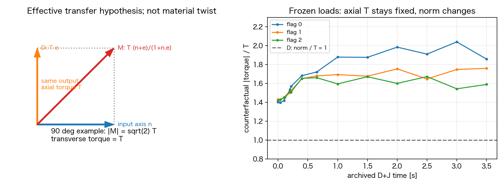

# Issue #263：接続researchの統合、修正候補と次の比較条件

不在中の進め方・段階別成果・実行上限・自律判断の境界は[自律検証ロードマップ](phase2_263_autonomous_roadmap.md)に整理した。M/Kの力学仕様は本書を正本とする。2026-11-11の後続ユーザー返答で、同ロードマップの限定フェーズ実装・cs10操作・最大5予約・代理レビューと継続Goal開始が承認された。以下の予約保留/未採択の記述はresearch完了時点の履歴であり、科学的採択は引き続き未実施。

2026-11-11。Refs #263 / PR #264。**第一候補を「相対回転への仕事から導く有効motor伝達 M」、第二因子を「近位内部曲げ応答 K」に絞る。D+Jを対照にした2×2比較を提案する。** 新規の時間積分・cs10接続/予約/開始・production物理source/config変更・モデル採択は行っていない。

別researchチャットの11文献・現行code照合を受領し、親チャット側で式・既存archive・静的prototypeを照合した。本書を次の実装設計の正本とし、[前段の調査方針](phase2_263_research_execution_strategy.md)と[K/G案](phase2_263_dj_bundle_cause_and_november_plan.md)は経緯として保持する。**以下は具体的な未採択提案で、実行可能なYAMLや承認済み新モデルではない。**

## 目標と、既存修正から分かったこと

目標は、後方束・概ねの軸整列・持続回転・周期平均での前進を同時に満たすこと。瞬時速度一定、wobbleゼロ、全鎖の位相完全一致は要求しない。Issueが求める近束からの維持と、広がった配置からの整列を区別する。

| 段階 | 成果 | 残った問題・扱い |
| --- | --- | --- |
| #255 / PR #261 | 全vector反作用、frame依存エネルギーの反作用、解析torsion | 数値保存則だけでは束遊泳を保証しない。torsion追加比較は不要という合意を維持 |
| #263：線分距離修正・非重複preflight | 単位依存の距離計算と初期root/body-edge重複を修正 | バグを含む旧軌道は新モデルの因果対照へ混在させない |
| D：指定全vectorの有効駆動 | 旧segment力対の過大な横トルク/局所力を回避 | 出力軸に沿う駆動であり、曲がった接続の伝達機構ではない |
| J：軸上根元と近位自然形状 | 根元の偏心競合を抑制。Dと併用して回転・平均前進が改善 | 自然角を変更するとcos型曲げの接線応答も変わる。初期は完成した密束ではない |
| #42のD+J | 3.5秒で各鎖7.75–9.86回、正味前進+.229µm、strict QC PASS | 後半の遠位軸間角約42.6°、広がり約1.27µm。束維持・定常遊泳は未達 |

既存保存点では軸間角20°超が.217秒、hook片側抵抗の初作動が.650秒。hook抵抗を最初の軸逸脱の主因とする根拠は弱い。Kを加えても鎖全体の剛体tiltでは受動力が丸め誤差であり、K単独は全体の向きを戻さない。べん毛間反発ONでもD+Jの全内部stepでその最大力は0だったため、「反発力が回転を止めた」とする説明も支持されない。これは反発をOFFにする理由ではない。

## 文献調査をどう設計へ使うか

[Bianchiら2023](https://doi.org/10.1103/PRXLife.1.013016)は、曲がったhookによるvector torqueと菌体wobbleを含めて束配置を検討している。同実験では並進拘束のみでは束化が消えず、wobble拘束との違いがあった。現モデルへ数値や成功時間を移植せず、菌体固定/軸固定を修正案にしない根拠として使う。

[同論文の補足§3・式(3)](https://journals.aps.org/prxlife/supplemental/10.1103/PRXLife.1.013016/SupplementalInformation.pdf)は、hookの抗力と端力によるmomentを無視する近似で、入力軸nと出力軸eに対して `T_m(n+e)/(1+n·e)` 型の駆動成分を導く。**現行の有限長hook全体をこの近似で置換しない。** 既存のFENE・hook曲げ力を残し、駆動の仕事を定義する比較仮説へ限定する。自然角77°や測定剛性を採用しない。

researchの第一案は局所spin/tilt frameを備える接続模型だった。ここでは、いきなり局所状態・材料twist・engine更新を同時追加せず、現行Dと同じbead支持範囲で成立する**有効接続の比較案 M_phase**へ絞った。全鎖frameを使う限界は残る。M_phaseの成否だけで局所材料模型一般を肯定/否定しない。

## M_phase：力を先に選ばず、相対回転の仕事から導く

### 入出力と式

各べん毛について、body側は現在Dで反作用を受ける付着点＋隣接one-ring **5 bead**、flag側はDと同じ全11 beadを使う。六角環全6点という意味ではない。次を定義する。

1. body frame `B(q)`：固定templateから現在のlabel付き5 beadへのproper rigid fit。初期z軸は付着部の外向き法線n₀。現在の入力軸は `n=B z`。
2. flag frame `F(q)`：label付き全鎖のproper rigid fitを得て、その初期主軸を現在Dと同じ向き付きPCA軸eへ最小回転で合わせる。横方向の位相基準はこの回転で運ぶ。PCA軸だけを回転位相として使わない。
3. 相対姿勢 `Q=BᵀF` のunit quaternionを `(w,x,y,z)` として、相対spin位相を局所的に `χ=2 atan2(z,w)` とする。実装では符号不変な `exp(iχ)=(w+iz)²/(w²+z²)` と局所差分を使い、±πの表示跳びを力にしない。
4. motorの仮想仕事を `δW_m=T δχ` とし、全支持点への力を **`F_m=T ∇_qχ`** から導く。既存の受動力は別に `−∇U` として足す。

剛体の許容変位では、flag/bodyへ作用するcoupleは

```text
τ_M = T (n+e)/(1+n·e),       τ_body = −τ_M
τ_M·e = T,                   τ_M·n = T
|τ_M|/T = 1/cos(β/2),        |τ_perp e|/T = tan(β/2)
β = angle(n,e)
δχ = ((n+e)/(1+n·e))·(δθ_flag−δθ_body)
```

となる。入力側のTも独立に強制したのではなく、この**理想化した接続の位相定義から導かれる投影**である。出力軸方向Tは2.5e−20Nm/本のまま。**全vectorの大きさとmotor仕事率はDと変わる。** 横成分を追加したのに「総トルクも同じ」とは報告しない。



変形したbead配置では、`τ_M`を現在の最小ノルムwrenchへ入れるだけでは `T∇χ` と一致する保証がない。frame/PCA/最小回転の微分を含めた力を使う。回転数診断は既存の材料点spinを保持し、新しいχを材料twistやべん毛自転そのものと呼ばない。χはspinとprecessionの両方の仕事を含む有効接続位相である。

### 実装範囲・必須test

- 変更はopt-inの駆動方式と必要な共通診断。初期座標、hook長、自然角、弾性、反発曲線、RPY、body支持点は固定。位相を元へ戻すenergyや追加位置復元力はない。T=0ならこの駆動力は0。
- prototypeの位置差分力は独立したtest oracleに限定する。productionは解析Jacobian/adjointで導き、差分oracle・任意方向の仮想仕事・全力/全torqueを照合する。新しい自動微分dependencyや内部stepごとの多数の差分評価を既定にしない。
- 剛体回転/並進の客観性、横方向位相基準の変更による力の不変性、出力spin・入力spin・純tilt、360°の位相連続性、非剛体変位での仕事をtestする。templateは姿勢を測る参照であり、初期位置への復元を作らない。
- PCA縮退、proper fitの非一意性、最小回転/相対姿勢の反平行を検出して停止する。横torqueのclip・ゼロ化・別modeへのfallbackで通過させない。数値conditioning guardと物理的採択閾値を区別する。
- 共通QCのmotor合力/合torque残差を維持する。既存Dの「全vector=Te」誤差metricをMへそのまま適用しない。共通診断に指定vector残差、出力軸投影誤差、入力/出力角、gain、χの仕事を明示し、旧Dのmetric意味も保持する。意図した横成分は診断であり、それを除くためにQC閾値を緩和しない。
- 有限hookの端力momentと既存弾性の仕事を別に記録し、motor coupleとの二重計上を防ぐ。新しい材料twist輸送や局所hook構成則を再現したと主張しない。

## K：近位内部変形だけを対照にする

Jと同じ近位自然角θ₀を保ち、開始bead0/1/2の曲げ区間だけを

```text
U_Ki = K_ref (cos θ_i − cos θ₀i)² / (2 sin²θ₀i)
K_ref = k_b sin²(142°)
```

へ置き換える。自然形状での角度接線値を通常区間へ揃える仮説で、係数は実行結果へfitしない。遠位は変更せず、保存力の位置勾配を使う。近位3区間の係数倍率は元のkbに対して約27.9 / 2.18 / .594。単に全てを硬くする変更ではない。sinθ₀の縮退ではこの表現を使わない。

Kの既存静的差分/Hessian監査はPASSだが、全体tiltを安定化する力は増えない。Kが改善すべき対象は近位角の変形と負荷伝達。hookのFENE上限/接触負荷へ移るだけ、あるいはspin/推進を悪化させるだけなら、解決策として採用しない。

## 今回の静的検算：成立したことと反証

固定source `59890c05460ba3032d50813afaa488ed3440f271` と同一のsrc/conf/testsを使用。各run_summaryを先読後、#42 portable37件の集合/件数/全SHAを再照合した。

| 検算 | 結果 | 限界 |
| --- | --- | --- |
| Mの13保存状態×3鎖 | 指定coupleとの誤差最大約1.83e−8 T、独立方向の仮想仕事差最大約9.8e−9（T/µmで正規化） | 差分prototypeの検算。production解析力は未実装 |
| 剛体変換・位相gauge | 力の共変性と位相差不変性PASS。横位相基準を変えても力は不変 | 強い未観測変形や縮退域までは保証しない |
| 3鎖×73位相 | 360°位相誤差最大約7.1e−15 rad、入力/出力spinと純tiltの仕事一致、反平行は拒否 | この位相test単独を非重複証明に使わない |
| 同じJの連続独立軸spin幾何 | runtime-active全pair classの距離下界≥.210912µm > 2a=.20µm。hook長固定、内部形状不変 | 固定rear軸での剛体回転族。動的tilt/変形、密束Gを保証しない |
| 保存D+J状態でのM反実仮想負荷 | 全vector gain1.398–2.041、横成分/T=.977–1.779、flag力ノルム.0307–.0339pN | Mの軌道・成功予測ではない。13時刻の標本範囲 |
| bodyを含む拘束RPY reference | 4剛体群・hook長の瞬間拘束、全RPY block、自由なbody並進/wobbleで、正の散逸と仕事一致 | 鎖の変形を省いた瞬間応答。実軌道/同期の証拠ではない |

RPY referenceの初期相対首振りrateはDJの.778/.604/.693rad/sに対しMで.364/.090/.403へ減った。一方1.5秒の保存状態では.157/.391/.669に対し1.305/1.183/.229で、2鎖は増えた。**全保存状態で首振りrateが小さくなるという強い予測は、このreferenceでは支持されない。** rateの大きさだけで整列方向や実軌道の成否は判定できない。改善の可能性と、M単独では不十分な可能性を同じ根拠に残し、初期の前進rateの微増だけを成功判定に使わない。

## 次の比較条件：最大4条件の因子分離

すべて現在D+JのJ配置・自然形状・局所位相0で座標完全一致とする。Gの接続経路や#271の密集同位相案を混ぜない。新Mは#39の「根元3 beadへ局所化したmotor」とは別方式で、再利用しない。

| ID案 | 駆動 | 近位曲げ | 判定したい仮説 |
| --- | --- | --- | --- |
| DJ_control | 現D | 現J | 修正後実装との基準再現 |
| M_phase | 相対位相の仕事から導くM | 現J | 転向・precessionを含む駆動が全体姿勢を変えるか |
| K_internal | 現D | 正規化K | 近位内部変形の偏りが負荷/回転/軸逸脱を支配するか |
| MK_combined | M | K | 転向作用と内部変形の結合が必要か。両単独との因子交互作用 |

共通固定：nf3/slots024、出力軸T/reference T=2.5e−20Nm/本、dt4µs、粘性1mPa s、FF/BF ON、Brownian/切替OFF、解析torsion、通常のばね/遠位材質/反発/QC閾値。腕重み、追加位置復元、恣意的な軸固定は加えない。

**実装後の入口**：解析Jacobianと差分oracle・共通preflight・固定幾何SHA・短い力計算benchmarkを通す。Macは静的/targeted checkのみ（今回prototypeは数秒規模）。2条件以上の動的実行は`cs10_qualified`、max_workers:auto（4条件なら実効4）、数値thread1、条件別output、dry-runを必要とする。予約commitやSHAは実装後に固定し、今回の資料HEADを実行commitと呼ばない。

**short**：.04秒=1τ、各10000 step。common development_evaluation strict QC・本数別heatmap・固定camera共通視野3D/2D replay。閾値を緩めず、明白な交差/崩壊/位相特異性がないことを確認する。

**機序比較**：shortレビュー後、各約1秒（公称250000 step、runtime計画の浮動小数点ceilも照合）。初期〜.2秒、.2〜.65秒、.65〜1秒の共通時刻と、緩和後の同位相blockで比較する。1秒で定常性を宣言せず、自動的に3.5/10秒へ延長しない。旧#42の最遅約18.5h/秒から、1秒4並列の参考wallは約19h、.04秒約45分。新しい解析力の費用・共有負荷・待ち時間は未測定で、short実測から更新する。

測定は、各鎖材料点spin、菌体材料点自転、束幅/軸間角/後方軸角、符号付き前進と周期block変動、近位角、hook長/張力・端力moment、motor投影/全vector/仕事、FF/BF接触witnessを同時刻で残す。spinとprecessionを区別する。saved-stateの非交差だけで内部stepの非貫通保証としない。

主比較窓を`.04–.20 / .20–.65 / .65–1.00秒`とし、同じ遠位bead3以降・共通軸方向区間で、(a)軸間角20°超過量の時間平均、(b)後方軸角15°超過量、(c)幅の通常らせん半径超過量、(d)符号付き前進の平均/負区間、(e)近位3角の自然角からのRMS偏差をそれぞれ報告する。単位の異なる量を足して成功scoreを作らない。Mの主仮説は(a)、Kは(e)とhook負荷の組、組合せは二因子の交互作用とする。全time seriesと固定replayも確認し、都合のよい時刻だけを選ばない。1実行/条件なので一般化した統計的有意差とは呼ばない。

候補を次の周期観測へ送る入口は、全期間strict QC PASS、replayに明白な異常なし、最後の`.65–1秒`で既存の幅/軸角3条件を90%以上で満たし、各鎖の正味spinとblock平均前進が正であることを**提案**する。完全周期のcoverageが無ければ「正のspin/平均」以上は主張せず、定常性は後続で確認する。これを満たさない候補を時間延長だけで救わない。近束を満たす候補が無ければGの構造制約へ戻る。以上の入口はユーザーレビュー対象であり、今回common strict QC自体の新gateとして実装しない。

## 採否、幾何の残件、打切りの判断

| 仮説 | 支持を強める結果 | 採らない/優先度を下げる結果 |
| --- | --- | --- |
| M | 位相/仕事gateを満たし、M対DJとMK対Kの両方で、周期blockの軸逸脱・長い停滞が減る | 瞬間前進だけ改善、角度/幅の逸脱は同じ、反平行へ接近、負荷を増やすだけ |
| K | K対DJとMK対Mで近位の過大変形が減り、hook/contactへ負荷を移さず回転/推進を保つ | global tiltだけに期待した説明、FENE上限化、spin/推進の悪化 |
| 相互作用 | MKだけで改善し、単独2条件では同程度の改善がない | MKだけの映像を提示してM/Kのどちらが必要かを曖昧にする |
| 幾何 | 近束形状で長さ/自然形状/clearance/全spinの同時成立を示す | 初期だけ近づけ、回転中のhook長競合を見落とす |

4条件とも初期の軸間隔は広い。従ってこのmatrixは**機序診断**であり、Issueの「近束から維持」を直接採択する試験ではない。上流の接続が改善しても、近束初期形状から維持する試験が別途必要である。逆に広い初期配置から束を作れなかっただけで、近束維持模型の可能性までは棄却しない。

近束Gは全3本の経路が有限探索では未成立。構造変更をMの中へ隠さない。現slots024・hook長を固定して成立しなければ、付着位置か近位離散化のどちらを次に変えるかを根拠付きで判断する。多数の物性sweepへ戻さない。

成功候補の最終レビューには、既存の受入案（広がり≤通常らせん半径、相互角≤20°、後方軸角≤15°を緩和後90%以上、各鎖6完全周期・菌体2完全自転、周期長CV≤10%、周期blockで正の平均前進/形状再現）を保持する。これは未凍結のproject案であり、今回緩和/採択しない。Mの機序効果に科学的なPASS閾値を後付けせず、比較窓・効果量と許容変動を実行前レビューで確定する。

月内にできることは、まずこの2因子の因果を限定し、近束を維持する候補1種類を残すこと。長時間の観測長は新候補の遅い周期から決め、10秒を既定にしない。11/20に近束候補が無ければ月内確定は高リスクと報告し、未達と必要な構造変更を確定する。期限のために成功基準を変えない。

## 証拠・未実施

research受領：`outputs/2026-11-11/201003/issue263_connector_research/` のreport/sources、11資料。report SHA256 `7ad6aab1c162eed012d159526ea9f86197aed021d8ae71650ec78382710572c7`。主な新情報はBianchi本文/補足で親側も原文照合。他文献の仮定・取得限界は[前段の比較表](phase2_263_research_execution_strategy.md)とsources.jsonに残す。

親側の静的証拠：`outputs/2026-11-11/205148/issue263_research_integration/`。`phase_drive_static.json`、`shared_J_geometry.json`、`phase_fluid_reference.json`、再現script・run.log・manifest・review_resultを保存。新しいIssue固有acceptance evaluatorは作っていない。共通QC/replayの再実行は、新規軌道がないため行わず既存の検証済み結果を再利用した。

未実施：production解析Jacobian、candidate config/YAML、simulation、cs10操作/予約、長時間・摂動・数値収束、モデル採択/merge。**予約保留を維持する。** [ADR0029](../adr/0029_phase2_effective_torque_and_root_transition_direction.md)はProposed。追加位置復元code/scale削除はmerge前残件で、今回のmotor仮説と混ぜない。
