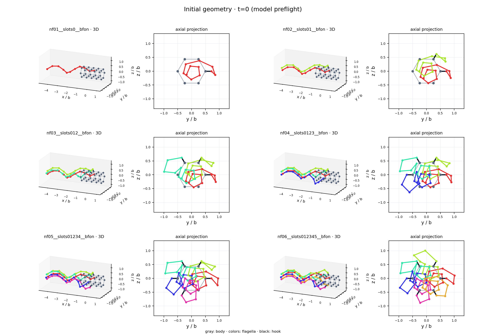

# Issue #263：同位相の初期束・13付着配置と菌体–べん毛反発の対比較

## 実行範囲

ユーザーは2026-10-20、現行モデルで本数1〜6の回転対称性を考慮した13付着配置と、菌体–べん毛反発ON/OFFの**26条件・各2秒**を指定した。初期状態は新しい密集・同位相配置を先に設計し、短期QC・replayを確認してから26条件の2秒へ進む方針を選択した。本スレッドでcs10接続・予約・開始を許可済み。旧#257/#262の実行結果や承認を流用しない。

| nf | 中央layerの付着slots |
|---|---|
| 1 | 0 |
| 2 | 01、02、03 |
| 3 | 012、013、014、024 |
| 4 | 0123、0124、0134 |
| 5 | 01234 |
| 6 | 012345 |

六角環の回転のみを同一視し、反射を区別した既存の13代表を使う。本数と付着配置は組合せ条件である。同一配置のON/OFFは初期座標・位相・motor・弾性・流体・刻みが完全一致し、`potentials.spring_spring_repulsion.body_flagella_enabled`だけを変える。べん毛間の既存反発はONを維持する。1本条件の束・べん毛間指標は該当なしとして扱う。

共通の力学はC：実トルクの全ベクトルを局所one-ringへ返すmotor反作用、拡散segment重み、横トルク補正なし、腕重みなし、解析torsion、追加frame位置復元なし。T=2.5e-20 N m/本、dt*=1e-4（4 µs）、τ=0.04秒、Brownian・motor切替OFF。位置復元scaleの指定は既存profileとの差分を無効化する互換指定として残っており、その処理と設定自体の削除は既に合意したマージ前作業である。

## 初期配置

従来のcompactは、らせん位相が付着部の局所方位に追従し、slots024では空間的に120°ずつずれる。新候補は**後方のらせん部分を同じ向き・同じ位相へ揃え、各軸を近接配置する**。付着点は中央layer・半径0.5 µm、hook長0.25 µmのままなので、根元から全長を菌体中心へ平行移動する配置は使えない。最初の4本のshaft bondを接続部とし、index 4〜10の7 bead（6 bond、輪郭長3.48 µm）を同位相の後方らせんとして維持する。

- hookは半径方向の外向きから後方へ30°、長さ0.25 µm。結合長は全shaftで0.58 µmを維持する。
- 近接する軸の間隔0.30 µm、共通位相60°を全13配置で使う。位相60°は採用した共通座標系での幾何方位であり、motor駆動位相を拘束する値ではない。
- らせんは従来のnormal鎖から取り、遠位部分の曲げ・二面角と形状を維持する。全13配置の遠位らせん軸は共通で、後方軸に対する角度は約3.73°。有限長PCA軸と真の螺旋軸を区別する。
- 接続部は既存の曲げ・torsion・hookエネルギーの和を最小化し、結合長、菌体外部、bead・segment非重複を制約とした静的SLSQPで設計した。時間発展は使っていない。
- 13配置すべてで異なるべん毛のsegment間距離は0.21 µm以上、非共有の菌体segmentとの距離は最小0.2129 µm。直径・反発cutoffの0.20 µmを上回り、初期反発力はON/OFFとも0。
- 全鎖の既存束半径指標は0.343〜0.496 µm。nf3 slots024では従来compactの0.813から0.441 µmへ減る。遠位らせんだけの軸中心の広がりと、接続部を含む全鎖の指標は別に記録する。

**接続部には初期弾性応力が残る。**曲げ誤差は最大46.3°、二面角誤差は最大87.1°で、既存strict flag QCの60°/120°以内。初期弾性力のbead最大は2.27e-12 N。hook力は初期0だが、元のhook中立化処理は実行しないため、設定上の`initial_hook_force_neutral`はfalseとする。shaftの自然長や曲げ・torsionの基準値を新配置へ変更して無応力化しない。元の自然長を使ったまま、短期screenで応力解放時の形状・束維持・QCを確認する。

`initial_geometry_summary.json`にある従来の「ほぼ無応力なnormal鎖」判定は接続部の曲げ・二面角でFAILとなり得る。この診断を消さず、prestressedな初期状態として明示する。共通`development_evaluation`のfinite/body/hook length/flag/motorのゲートと閾値は維持する。

## 凍結した座標とprovenance

`flagella.initial_bundle_mode: phase_aligned_rear`はopt-in。`conf/phase2_initial/2010_hex_phase_aligned_bundle_v1.json`に13配置の正規化座標を保存し、`initial_bundle_state_path`と`initial_bundle_state_sha256`で固定する。実行時はoptimizerを走らせない。loaderはbody形状、基準角、直径、bead数、hook/shaft長、遠位の同位相・同形状、beadと真の有限segment間の非重複を検証する。不整合は明示エラーとする。

springの自然長は読み込み前のnominalモデルから保持する。共通preflight、runtimeの初期geometry summaryとimplementation manifestへ座標ファイルのSHA-256・遠位範囲・実位相・距離を残す。既定profileと旧compact/Cの座標・結果は変えない。静的設計script・試行ログ・最終preflight・preview・hashは`outputs/2026-10-20/200230/issue263_dense_geometry/`へ保管する。実行再現にはcommit済み座標とSHA-256を正本とする。

## stageと実行条件

| stage | multi-run | parallel job | 条件数・step |
|---|---|---|---|
| short screen | `2010_hex_dense_count13_body_contact_1tau_issue263.yaml` | `dense_count13_contact_1tau_job.yaml` | 26×10,000 step、0.04秒 |
| 2秒 | `2010_hex_dense_count13_body_contact_2s_issue263.yaml` | `dense_count13_contact_2s_job.yaml` | 26×500,000 step、2秒 |

campaignは`conf/phase2_multi_run/`、jobは`conf/phase2_parallel/issue263_initial_bundle/`に置く。2stageはdurationと対応する評価stageだけが異なる。`cs10_qualified`、`max_workers: auto`（最大8 workers）、BLAS各thread 1、26条件の独立output、全条件geometry preflightを使う。Macではtargeted test・2 internal stepのcheckとsimulationなしdry-runだけを行う。2秒26条件はMacで30分超のため実行しない。

1τのwallは約1〜3時間を粗い計画枠とし、新配置と反発ONの実測で更新する。2秒本番は13,000,000 internal stepで、26条件・8 workersの数日規模を想定するが、短期screenの条件別速度から見積もり直す。反発ONの追加計算や共有機負荷を旧nf3の実測だけで正確に外挿しない。

short完走時は固定commit、26 ID、座標hash、portable件数・SHA-256を照合し、run_summaryを先に読む。共通strict QC、本数別heatmap、固定camera 3D/2D replay、初期応力解放・束幅・回転・符号付き推進を記録する。FAILがあれば原因を報告し、閾値を緩めたり条件を黙って除いたりして本番へ進めない。short QC・replayのレビュー後に2秒を予約・開始する。本番では各ON/OFF対の同時刻・同位相、周期平均の前進、自転・首振り・束維持と接近を比較し、完全対称条件だけの同期や、与えた束が維持されたことを自発的束形成と解釈しない。
