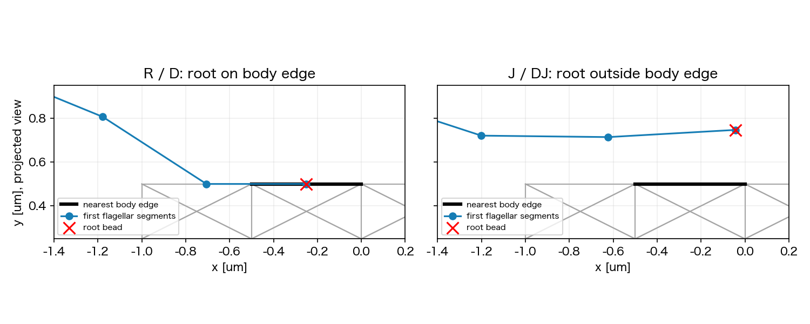

# Issue #263：D/J 1τ screenの結果と長期予約の停止

2026-11-04追記：ユーザーはR/Dの非重複修正と4条件維持、short QC/replay後の3.5秒予約を承認した。現行の修正/実行手順は[非重複再実行runbook](phase2_263_dj_clearance_runbook.md)を参照。以下の旧結果・判断は当時の固定条件として保持する。

2026-11-03。予約#40は4/4条件が19:28 JSTごろ完走した。**共通strict QCは4/4 PASSだが、R/Dの初期geometryに非隣接菌体線分との重なりを確認したため、3.5秒4条件は予約していない。** QC閾値・物理設定・既存予約は変更していない。

## 来歴と共通評価

固定実行commitは`51e03231d7c552c992a18616aaec9b2646413aaa`。nf3/slots024、R/D/J/DJの4条件、各10000連続step、実終端0.03999999999999624秒。FF/BF ON、T=2.5e−20 N m/本、dt4 µs、粘性1 mPa s、Brownian/切替OFF。4 workers/数値thread各1。

- job SHA256：`44c459c1cc4c39e20bc3f95a1c070ee2f449efba313e267c3c6acb9272f09f72`
- campaign SHA256：`2f11fff1d98463dff5db0c3e2a76d21aaa8076a41c272233ab02cc33fc6b97be`
- portable 37 files・928941 bytesの集合/件数/全SHA一致。operational logやpartial archiveは同期しない。各run_summaryを先読し、全10000内部stepのfinite/body/nonbodyにFAIL履歴なし。
- 共通development_evaluation strict QC 4/4 PASS、heatmap、標準固定camera・共通視野3D/2D replay各41frame/25fps。全4条件0〜0.04秒coverage、frame/fps/SHAを照合し、中間/終端を視認。2Dは従来通り菌体投影。通常視野の見た目だけでは根元重複を判定できない。

## 初期過渡の定量

| 条件 | べん毛0の菌体相対回転 [回] | 菌体材料点自転 [回] | 符号付き前方変位 [µm] | 終端束半径指標 [µm] | 最大flag torsion偏差 [°] |
| --- | ---: | ---: | ---: | ---: | ---: |
| R 現行 | 0.10669 | 0.03806 | −0.05733 | 0.81359 | 4.961 |
| D 有効motor | 0.13736 | 0.04749 | −0.05028 | 0.82893 | 2.308 |
| J 根元移行部 | 0.12083 | 0.05913 | −0.00276 | 0.74812 | 59.122 |
| D+J | 0.18497 | 0.05478 | +0.00120 | 0.75805 | 0.598 |

べん毛spinは内部step積分したlabel付き鎖の剛体fitから菌体運動を除いた値。菌体材料点自転は保存1 msごとのlabel付き菌体fitを前状態の長軸へ投影して積算した別診断で、PCA方位角のjumpではない。両者の軸向きの定義は異なり、符号をそのまま加算しない。菌体fitの最大保存間回転は0.25 rad未満。1τでは全条件とも完全1回転未満で、初期2周期除外後の同位相比較は成立しない。

D/DJの全step最大motor横トルク比は丸め誤差（それぞれ約5e−15/6e−15）。一方、Rは1.36 T、Jは88.8 Tで、軸上根元へ従来segment motorをそのまま適用したJには大きい不要横トルクがある。J単独の最大torsion偏差は59°で、strict QC範囲内だが重要な過渡として保持する。D+Jの短期前方変位は微小で、定常前進・束維持の成功とはしない。束指標は初期近束の診断であり、完成した密束の受入を示していない。

## 長期へ進めない根拠

保存された初期状態のR/Dでは、べん毛0先頭bead30が`(-0.25, 0.50, 0.00) µm`にあり、**別の菌体結合bead6→12**の`(-0.50, 0.50, 0.00)→(0.00, 0.50, 0.00) µm`の中点に一致する。修正済みproduction線分距離は0。独立した点→線分への射影でも距離0、線分上の係数0.5となる。slot2/4の根元にも同じ関係がある。これは投影像だけの交差でも、線分距離計算の再不具合でもなく、従来compactのhook中立化後の配置を引き継いだ結果である。

新J/DJの初期root→菌体edge距離は0.246202 µm。保存41状態で調べた非隣接body–flag segment最小距離は、Jが0.200133 µm、DJが0.213832 µmで、比較距離2a=0.20 µmを上回る。**1 ms保存点の監査であり、未保存内部stepの非貫通保証ではない。** FF間最短距離も記録したが、今回の停止理由はR/Dの初期body重複である。

共通strict QCは有限性・形状偏差・motor balance等を判定し、すべての線分交差は判定しない。準備preflightのbead間距離/初期力だけでも、このroot対body-edgeの重複を排除できなかった。初期body反発1.039 pNは既に記録していたが、それを「非重複成立」と読み替えることはできない。**準備の幾何確認には不足があった**。

「明白な貫通/実装異常があればlongへ進まない」という[runbook](phase2_263_dj_runbook.md)・ユーザー承認範囲に従い、4条件長期のenqueueを見送った。T/dt/粘性やQC閾値を変えて通さず、R/Dを勝手に除外した2条件予約もしていない。

## 次の判断と証拠

まず共通preflightでruntimeと同じ非隣接線分集合を確認し、rootを含む重なりを予約前に検出できるようにする必要がある。その上で、(a) R/Dの初期geometryを非重複に修正して4条件を組み直す、または(b) J/DJだけの限定比較へ範囲を変更する、のどちらかをユーザーと決める。前者は修正後の初期配置が新しい因子になるため、元R/Dと同じ対照とは呼ばない。後者だけではJの独立効果は判定できない。どちらも既存jobの固定条件をそのまま成功扱いにしない。

モデル採択、3.5秒実行、merge、canonical freezeは未実施。追加位置復元処理/scale削除はmerge前残件。別Issue#271の密集同位相を代用しない。

ローカル正本：`outputs/2026-11-03/200133/issue263_dj_short_review/`。portable_index、run_summary_first、共通evaluation/replay、bundle_rotation、short_diagnostics、initial_geometry_blocker（独立射影とproduction距離）、replay_verification、再現script、manifest/review_result/run.logを保全する。
