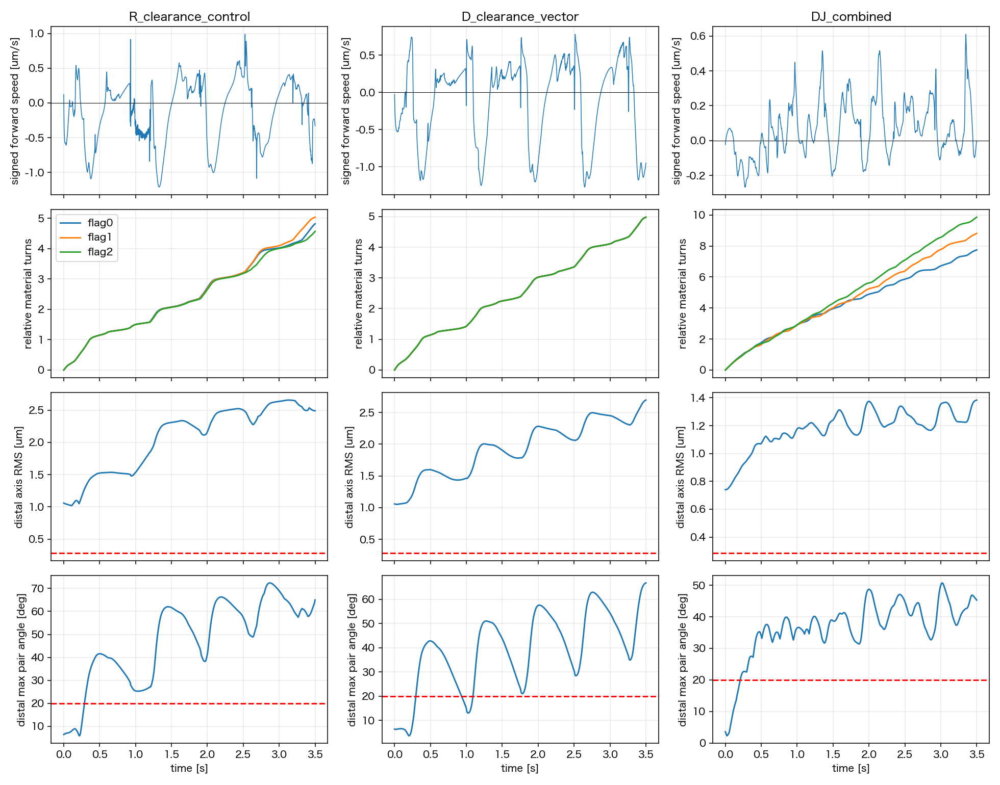

# Issue #263：非重複D/J 4条件・3.5秒の結果

2026-11-11評価。**予約#42は11/7 10:26 JSTに4/4完走したが、共通strict QCはR/D/DJの3条件PASS、JはFAIL。D+Jは回転と平均前進が改善した一方、遠位べん毛軸が開き、束形成・定常遊泳の採択条件を満たさなかった。** 新しい予約・物理変更・モデル採択・mergeは行わない。

## 実行と証拠の照合

- 固定simulation commit `59890c05460ba3032d50813afaa488ed3440f271`。解析checkoutの`src/conf/tests`は同commitと同一。nf3/slots024、4条件各875000連続step、実終端3.5000000000712457秒（積算丸め誤差）。11/4 17:40:50 JST開始、全体wall約64時間46分。短期外挿の11/6 20:20予想より遅かったが、遅延原因を共有負荷だけに断定しない。
- job `conf/phase2_parallel/issue263_initial_bundle/nf3_dj_3p5s_job.yaml`、SHA256 `12f8176e93ddade147c45555e79d1c7ca7f87bf6bf663f15cee52022b5f25b58`。campaign SHA256 `a71a51c4aec35716b31aa80189e6ee78197cecd8bc525a396b38555e4372056d`。4ID/入力/固定commitを照合済み。
- portable **37 files / 36447637 bytes**の集合・件数・全SHA一致。各`run_summary.json`を詳細解析より先に確認し、共通`development_evaluation`のlong-duration strict QC/heatmap/replayを実施。旧距離バグを含む実行結果は混ぜていない。
- T=2.5e−20 N m/本、dt4 µs、粘性1 mPa s、FF/BF ON、Brownian/切替OFF。4workers・数値thread各1。R/Dは初期座標一致、J/DJも初期座標/固定自然形状一致。比較因子の定義は[runbook](phase2_263_dj_clearance_runbook.md)。Dは有効vector出力であり、材料twist輸送の再現ではない。

## 目標ごとの定量評価

べん毛回転は菌体運動を除いたlabel付き各鎖材料点の積分位相。前方速度は菌体重心速度をその時点の向き付き長軸へ投影した値で、位置座標の単純差ではない。菌体自転はlabel付き菌体fitの回転を長軸へ投影し、PCA方位角は使わない。

| 条件 | strict QC | 各鎖の相対回転 [回/3.5秒] | 菌体材料点自転 [回] | 符号付き前方変位 [µm] | 後半1.5–3.5秒の平均前方速度 [µm/s] |
| --- | --- | ---: | ---: | ---: | ---: |
| R 非重複compact・従来motor | PASS | 4.82 / 5.04 / 4.57 | .482 | −.437 | −.0081 |
| D 同配置・有効vector motor | PASS | 4.98 / 4.98 / 4.98 | .510 | −.361 | −.0642 |
| J 根元移行部・従来motor | **FAIL** | 採択用診断から除外 | — | — | — |
| D+J | PASS | 7.75 / 8.81 / 9.86 | .902 | +.229 | +.1020 |

Jは**0.185秒、step46249からflag QC FAIL**（最初のtorsion偏差147.25°）。全期間最大はtorsion178.04°、bend71.60°、bond相対誤差.289、hook長相対誤差.411。数値完走と物理QC合格を区別し、Jのreplayはdiagnostic-onlyと明示した。

| QC-PASS条件 | 遠位軸RMS広がりの後半中央値 [µm] | 遠位べん毛間最大軸角の後半中央値 | 後半の瞬時後退sample割合 | 6周期要件 |
| --- | ---: | ---: | ---: | --- |
| R | 2.490 | 60.34° | 37.3% | 初期位相逆行があり単調完全周期の比較不可 |
| D | 2.262 | 47.69° | 36.4% | 初期2周期除外後は各2周期のみ |
| D+J | 1.248 | 41.18° | 28.5% | 各5/6/7周期、全鎖6周期は未達 |

遠位は近位3beadを除いた共通の通常らせん部分。各軸を共通軸方向21断面へ投影し、3軸交点のRMS広がりの最大値を測った。通常らせん半径.286543 µm以下・相互軸角20°以下・後方軸整列15°以下を緩和後90%以上で満たす[既存受入案](phase2_263_model_repair_direction.md)に対し、後半1.5–3.5秒では**全3条件ともRMS/相互軸角の各合格率0%**。閾値は共通strict QCへ追加・緩和していない。

Dの初期2周期除外後の周期CVは.31–.37%だが2周期だけで、十分な定常性の証拠にならない。DJは8.91/6.54/5.83%で回転自体は改善した一方、鎖間の積算位相差が約1.07/2.11回へ広がり、位相同期は達成していない。菌体材料点の正味回転は全条件1回未満で、菌体の完全周期に揃えた2周期分の推進比較もできない。

## 機序の切り分けと次の焦点

1. **Dの駆動仕様改善には根拠がある。** 全内部stepの最大不要横トルク/TはR65.88、J2728.35に対しD/DJは約6e−14。最大べん毛motor力はR3.80 pN、J167.25 pN、D.0278 pN、DJ.0320 pN。従来力対の短い腕に伴う過大力/横トルクを抑えたが、D単独で束化・前進は成立しなかった。J単独のQC FAILも合わせ、駆動と根元形状の組合せが重要と考えられる。
2. **FF ONでも、合格3条件では直接のべん毛間反発が作動していない。** 全内部stepの`flag_flag_repulsion_force_max_N.max=0`。保存点での鎖間最短距離はR.641/D.672/DJ.308 µmでcutoff .20 µmより大きい。束化不成立を「べん毛間反発で押し広げられた」とは説明できない。流体相互作用まで無いという意味ではない。
3. **初期非重複を直しても、動的soft接触圧縮は残る。** 保存点BF最短距離はR.115/D.184/DJ.154 µm <2a=.20 µm。菌体中心凸包へのflag中心線侵入は全3501保存点で検出0（付着hook除外）。有限半径表面の非重複や未保存stepまで保証せず、表面距離圧縮と中心線貫通を混同しない。
4. **次は束軸を近づける仕組みに焦点を絞る。** DJを有望な比較基準として、付着位置・hook姿勢/復元力・遠位軸整列・菌体接触を同時刻で監査し、どこで内向きの整列が妨げられるかを切り分ける。これは次の設計提案であり、原因確定や新しいhook/相互作用の採択ではない。T/dt/粘性を変えた探索や、束化しない軌道の単純な延長を先行させない。

.64–.80秒の平均前方速度はR/D/DJ=+.0827/+.1609/+.0495 µm/s、.80–1.50秒では−.348/−.0878/+.0939 µm/s。R/Dは後退窓が残り、DJも瞬時前進が一定ではない。瞬時後退だけを新たなFAIL条件とせず、束・回転・周期平均推進を分けて判断する。

## replay・再現・残作業

標準固定camera共通視野3D/2Dは各41frame/25fps。定性評価用は各176frame/50fps、全0–3.5秒を共通視野で収録した。frame/fps/coverage/全動画SHAをffprobe/manifestで確認し、3D中間/終端・2D中間を視認した。JはQC FAILの診断表示。2Dは既存の菌体投影で、束形状の判断には3Dを用いる。

ローカル正本：`outputs/2026-11-11/181925/issue263_main42_review/`。`portable_index.json`、`run_summary_first.json`、`evaluation/`、`bundle_rotation/`、`quantitative_summary.json`、`all_step_contact_summary.json`、`body_hull_audit.json`、`mechanism_timeseries.csv`、`flag_cycles.csv`、`replay_verification.json`、再現script、manifest/run.log/review_resultを保存。追加診断は採択gateではなく、共通QC-PASS archiveの解釈に限った。未検証の瞬間力再構成は結論に用いない。

[結果review_result](../codex-runs/20261111_issue263_dj_3p5s_result/review_result.json)は**報告・再現性のPASS**であり、4条件全体の物理QC PASSやモデル採択を意味しない。[ADR0029](../adr/0029_phase2_effective_torque_and_root_transition_direction.md)はProposedのまま。次の物理設計・採否はユーザーレビュー後とし、新しい実行予約はしていない。追加位置復元処理/scale削除はmerge前残件、#271密集同位相は別Issueのまま。
