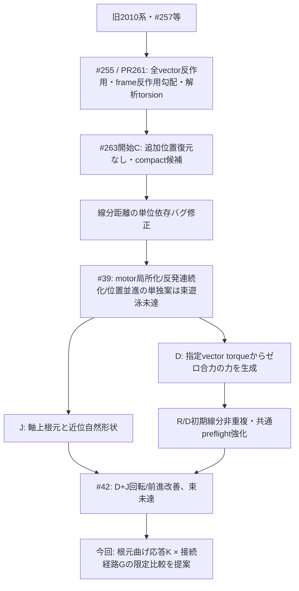
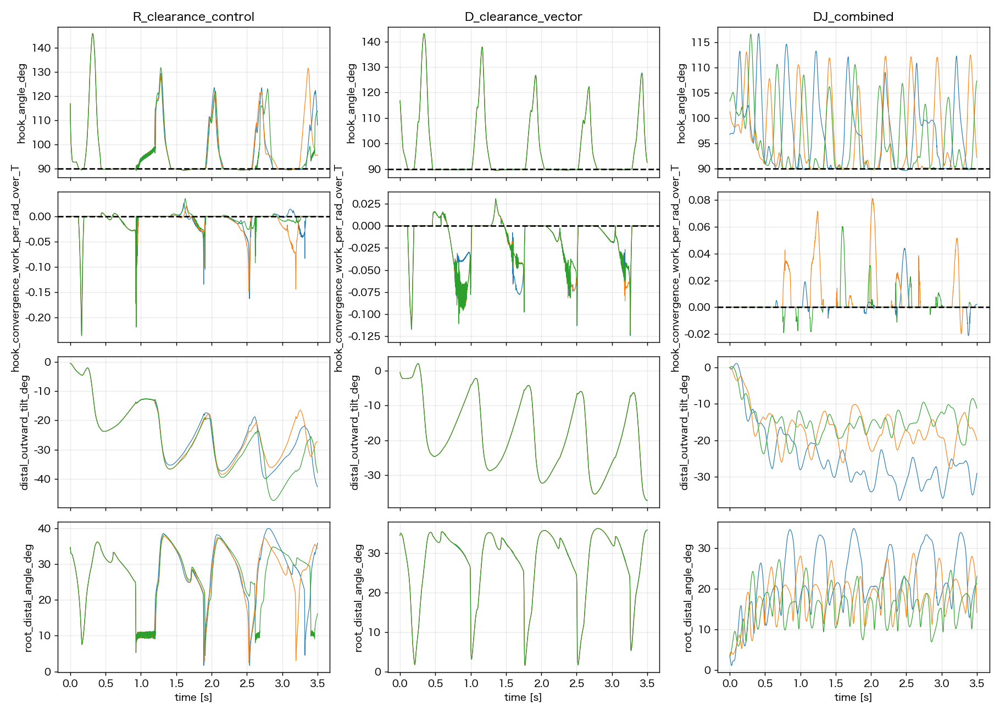
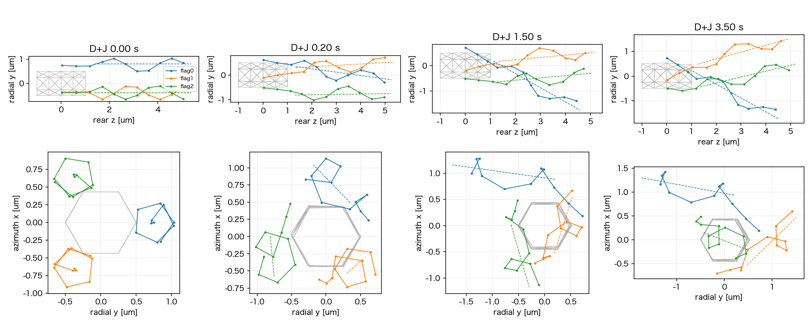

# Issue #263：D+Jの束形成阻害要因と11月の検証計画案

2026-11-11。ユーザー依頼に基づく既存結果の再解析・設計整理。**最優先の仮説は、Jの近位自然形状に伴う曲げ応答の不均一化と、初期軸間隔/接続経路である。hook抵抗だけを弱める案は優先しない。** 次の候補は未実装・未採択・未予約。トルク、dt、粘性、QC閾値は変更していない。

## 到達目標と月内達成の意味

[Issue #263](https://github.com/Kenta-morimori/prj-flagella-estimation/issues/263)は、nf3で後方束維持・菌体軸への概ねの整列・持続回転・周期平均での前進・初期摂動への再現性を示すことが目標。瞬間速度一定や完全な位相一致は要求しない。分離状態からの自発束形成、nf1〜6への一般化、canonical freezeは今回の完了条件に加えない。

月内目標は「nf3の有効模型1種類の成立範囲を示す」までに限定する。現時点で達成を保証する根拠はない。ただしDによる駆動の過大力は改善し、正の平均前進と複数回転は得られているため、次の行列を根元力学と幾何へ絞る合理性がある。11/20までに束を維持する候補が得られなければ、物性sweepや長時間延長を繰り返さず、月末の確定は「未達と必要な構造変更の確定」へ切り替える。

採択条件は[既存の受入案](phase2_263_model_repair_direction.md)を使う。strict QC全期間PASS、遠位軸の広がり≤通常らせん半径.286543µm/相互角≤20°/菌体後方軸との角≤15°を緩和後90%以上で満たすこと、初期2flag周期を除く各鎖6完全周期と菌体材料点2完全自転、周期長CV≤10%と周期blockごとの前進/形状再現を確認する。phaseの完全一致や瞬時後退0を追加gateにしない。測定/比較窓とモデル変更は実行前に確定する。

## これまでの修正は何を解決したか



| 項目 | 解決/確認済み | 残る制約 |
| --- | --- | --- |
| 全vector反作用・frameエネルギー勾配 | force/torque収支を検証。局所one-ringへ実全トルクを返す | 収支一致は正しい遊泳の証明ではない。追加位置復元はDJで無効、code/scale削除はmerge前残件 |
| 解析torsion | 同じエネルギーの勾配精度と保存則を改善 | torsion方式の追加比較はユーザー判断で不要。近位形状依存の応答まで採択した意味ではない |
| compactと初期hook中立化 | 初期応力/幅を可視化 | 完成した束ではない。初期並進だけで回転接続の構造は直らない |
| 距離計算修正・線分preflight | SI単位での近接見逃し、R/Dのroot-on-edge初期重複を修正 | 旧#32/#35の良好映像を採択根拠に戻せない。soft反発の動的圧縮は残る |
| Dの有効vector motor | 不要横トルク/過大局所力を低減、DJは7.75〜9.86回/3.5秒 | 全鎖SVD軸を使用する有効駆動。入力/転向トルクや材料twistの忠実再現ではない |
| Jの軸上根元移行部 | 規定剛体回転での偏心hook長競合を解消し、Dとの組合せで前進改善 | 自然形状も変えた。近位の実効曲げ応答と接続経路が未検証だった |
| #42の3.5秒4条件 | R/D/DJ strict QC PASS、J FAIL。DJ後半平均前進+.102µm/s | DJも束未達。周期不足だけを理由に全候補を自動延長しない |

詳しい数値は[3.5秒結果](phase2_263_dj_3p5s_result.md)。#39のCは反発連続化であり、開始基準Cとは別物。低優先の一般的な重み3方式比較、#271の密集同位相/rigid-bundle候補を今回の採択へ混ぜない。

## 再解析の範囲と軸定義の訂正

固定simulation source `59890c05460ba3032d50813afaa488ed3440f271`。前回照合済みportable37filesを再照合し、`run_summary.json`先読、QC-PASSのR/D/DJを各3501保存状態（1ms）で解析した。時間積分、cs10接続/予約、物理source/config変更はない。JのFAIL archiveを合格群へ混ぜない。

前回の追加軸診断は、helperが先頭beadを除く仕様に対して既に切った配列を渡したため、方向推定にbead4以降、中心位置にbead3以降を使う不一致があった。今回、**両方をbead3以降へ統一**して訂正した。共通strict QC、内部step材料点回転、前進の値には影響しない。

| 条件 | 訂正後PCA軸の後半最大相互角中央値 | 同RMS広がり中央値 |
| --- | ---: | ---: |
| R | 59.63° | 2.452µm |
| D | 45.47° | 2.268µm |
| DJ | 42.62° | 1.273µm |

全3条件とも後半のRMS/相互角の合格率は引き続き0%。PCAの位相依存も分けるため、遠位bead3以降の隣接点間のbest rigid stepから別途screw軸を推定した。DJの後半相互角中央値43.14°、最大RMS広がり1.247µmで、結論は変わらない。動的遠位は完全な一様らせんではなく、step fit残差の後半中央値.0273µm/95%点.0459µmを保持する。この軸も厳密な物理軸とはみなさない。軸の定義差を増悪/改善と解釈しない。

## hook：主原因とする根拠は弱まった

現行hookはbody付着点a・最初のflag bead0・次のbead1の三点角θに対して、実装上は

```text
U_hook = (k_hook/2) max(cosθ, 0)^2
|M_hook| = k_hook max(cosθ, 0) sinθ
```

となる。θ>90°では曲げ抵抗0、θ<90°では抵抗が働く。90°を保つ常時復元ばねではなく、菌体側へ折れ込むことへの片側抵抗である。基本の片側構成は[Watari & Larson 2010](https://pmc.ncbi.nlm.nih.gov/articles/PMC2800969/)にもある。今回、それを実装ミスとして削除する根拠はない。

- DJのscrew軸間角は**.217秒で20°超**。hook抵抗が初めて作動する保存点は**.650秒**。この保存点での順序は、hook抵抗が開き始めを作るという説明を支持しない。未保存stepの短い作動を除外した証明ではない。
- 後半1.5〜3.5秒のhook作動は鎖×時刻sampleの**22.8%**。moment/Tの平均.00803、最大.1393。閾値を下回る角度差自体は小さい。
- その保存形状で各鎖を根元周りに下流共通点へ傾ける仮想変位に対し、hookの一般化仕事は後半平均**+.00337T/rad**。負になるsampleは3.93%。この限定した方向には平均で助ける側だった。production forceとエネルギー差分の仕事一致を確認した。
- 以上はhookを完全に無関係とする証明ではない。保存間の接触や他の首振り方向、非線形軌道への作用は残る。ただし**hook OFF/単純軟化/硬化を最初の実行行列へ足す優先度は低い**。

[Rileyら2018](https://www.damtp.cam.ac.uk/user/lauga/papers/151.pdf)はhookの柔軟性と流体応答による整列を示すが、body法線に対する線形モーメント・回転速度指定等が現行と異なる。閾値/剛性値は移植しない。実験でもhook自由度の制限が束形成を妨げる[Brownら2012](https://pmc.ncbi.nlm.nih.gov/articles/PMC3434748/)ため、「束を保つため全部硬くする」は採らない。



## 根元：係数一定でも曲げ応答が同じではなかった

現行flag曲げエネルギーは、自然角θ0に対して

```text
U_bend = (kb/2) (cosθ − cosθ0)^2
K_angle = d²U/dθ² at θ0 = kb sin²θ0
```

である。これはproduction forceの微小角差分とも一致した。Jは近位の自然角だけを変えたため、kb=20Tを維持しても以下の角度応答になった。

| Jの曲げ点（flag local bead） | 自然角 | K_angle/T | 通常区間との比 |
| --- | ---: | ---: | ---: |
| 0–1–2 | 173.303° | .2720 | .0359（約1/28） |
| 1–2–3 | 155.328° | 3.4848 | .460 |
| 2–3–4 | 126.991° | 12.7594 | 1.683 |
| 通常らせん | 142° | 7.5808 | 1 |

この値は各曲げ項だけの局所接線剛性で、torsion/ばねを含む接続全体の剛性を1/28と測ったものではない。

**確認済みは「幾何とともに微小角の抵抗が大きく変わった」こと。これが束不成立の主因かは未検証。** 前回の「材料係数不変」を、実効曲げ剛性も不変と読むべきではなかった。

実軌道では近位0–1–2の後半平均絶対角度変形が各鎖4.34〜8.51°、最大12.31〜18.81°。1–2–3は平均8.74〜10.97°、最大17.80〜18.98°に達し、通常らせんへつなぐ向きが変わった。2–3–4の平均は1.03〜1.46°と小さい。root tangentと遠位screw軸の角度差も後半平均約19.65°で、根元が軸上でも遠位軸まで固定されたわけではない。

### 修正候補K：近位の角度応答を明示した曲げエネルギー

第一候補は、近位の自然角と形状は変えず、通常区間の小角応答`K_ref=kb sin²142°`へ近位の接線剛性を揃える案。

```text
U_K,i = K_ref / (2 sin²θ0,i) · (cosθi − cosθ0,i)^2
```

最初の曲げ点では係数が約27.9倍、次は約2.18倍、3番目は約.594倍になる。これは一律硬化sweepではなく、自然角による応答差を分離する**新しい構成則の対照候補**である。通常区間、hookの片側力、torsion、T/dt/粘性は維持する。実験的なhook/filament剛性を再現したという主張はしない。`sinθ0≈0`では式が縮退するため、黙ってclipせず不適格とする。角度二乗のrod energyは代替設計として残し、両方を同時に比較しない。

Kの上式だけを既存の初期受動力へ適用した数学的な試算では、Hessian/RPYのdt*lambda最大値はDJ .850131、K .850003。差分幅1/.5pmで一致、初期受動力は約2.64e-26N、Jacobian対称性残差は1e-9未満だった。時間積分や物理sourceへの実装は行っていない。この初期線形安定性は動的接触中の精度/安定性の保証ではない。

実装前に、力の解析勾配・ゼロ合力/合トルク・剛体回転不変性・長さ単位整合・初期応力・受動Hessian/RPYを確認する。初期位置へ引き戻すframe力、べん毛間の人工引力、軸を固定する拘束は加えない。rootを適度に変形できることと、根元方向が無制限に流れることを分ける。

## 付着・初期配置：束維持の初期条件に達していない

DJは中心layerのslots024へ付着し、body中心軸から付着点まで.5µm、hook長.25µm・後方傾き10°。根元半径は初期.7462µm。遠位の真の一様screw軸のRMS間隔は**.7382µm**で、幅の目安.2865µmの約2.6倍だった。最初は軸角0°でも、平行な3本が離れて配置されている。**軸角0°だけでは束ではない。**

後半でもscrew軸RMSの「共通断面中の最小値」の中央値は.7149µm。尾側だけが一つの焦点へ集まる状態にもなっていない。平均束軸のrear角中央値は7.61°だが、各軸の相互角は43.14°である。平均が菌体軸と揃うことと束形成は別。

体長2µmの中央側面から出るため、軸を真っ直ぐ内側へ傾けるだけでは菌体とのclearanceと競合する。後半のBF保存点最小距離.1543µm <2a=.20µmはsoft接触圧縮を示す。非貫通の保証にはしない。ただしこれを上流原因と断定せず、通れる接続経路があるかを静的に確認する。

全内部stepのhook link長は最大.273115µm、自然長.25µmに対し+9.246%。FENEの伸長域±10%へ近づいている。同じ長さを現行ばね式へ代入すると張力は約.159pNで、DJの各flag motor力ノルム最大.032pNより大きい。これは長さ拘束による負荷の根拠であり、異常力や原因の証明ではない。Kで曲げ応答を揃えた結果、負荷がhook伸長へ移るだけにならないかも監視する。

### 修正候補G：付着点を保つ、後方へ迂回する接続経路

hook長、付着点/slots024、bead数、結合長、遠位らせん、現行の局所位相を保ち、近位prefixの経路で菌体後端をかわしてから遠位軸を近づける候補を設計する。遠位部分は平行な軸で開始し、当該beadとactive segment pairの非重複・clearance・必要な束幅を同時に満たすかを先に判定する。遠位phaseの同一化はこの因子へ加えない。

これは旧G（鎖の剛体並進）とは別で、**近位の自然形状/参照角も変更する因子**。Kの有無との2×2で、応答変化との相互作用も検証する。現在の自由度で成立しなければ「Gが用意できた」と扱わず、どの制約が両立しないかを返す。その場合だけ、後方layerへの付着変更、prefixの離散化/長さの再設計、位相条件変更を別の判断として提示する。これらを勝手にGへ追加しない。

#271の密集・同位相/rigid-bundle検証は別Issueのまま、対象モデル未確定の既存証拠を流用しない。今回Gをその採択や初期状態の自動流用と解釈しない。



## 漏れを防ぐ仮説表

| 仮説 | 今回の根拠/反証 | 優先度と次の検証 |
| --- | --- | --- |
| H_K：近位自然角に伴う曲げ応答の不均一が首振りを増す | 接線剛性1/28、近位の大きい変形、軸間角増加 | **最優先**。Kのみで根元/遠位の首振りが減るか。束が形成しなければ十分条件ではない |
| H_G：初期軸間隔と菌体を避ける経路が束状態への到達を妨げる | 初期RMS.738µm、後半の最狭断面でも約.715µm | **最優先**。Gを静的に成立させ、近束が維持されるか。成立しなければ動的試験へ送らない |
| H_H：hook片側抵抗が束へ傾く自由度を奪う | 抵抗は開きより後に出現、仮想集束仕事は平均で正 | 優先度を下げる。K/G後も抵抗と逸脱が対応する場合に限定したhook構成則対照 |
| H_BF：菌体接触が姿勢/首振りを変える | soft圧縮は残る。接触OFFだけで旧stop-goは解消していない | Gの経路/接触witness・hook伸長/張力を監査。OFFを採択条件にしない。接触法則の変更は別の1因子 |
| H_M：Dの全鎖SVD軸/局所body反作用が整列を妨げる | DJのdrive軸と遠位screw軸の差は後半平均4.39°。Dは保存則合格でも実motorの転向機構ではない | K/Gが失敗した場合の第2経路。駆動軸を遠位軸へ変える対照か、基部入力/転向torque模型のどちらかを仕様で選ぶ。旧segment力対へ戻さない |
| H_HI：流体結合が弱い/離散化が整列不安定性を再現しない | 初期の凍結motor-only RPY応答で他鎖由来の首振りrateは.059〜.093rad/s、自己/菌体由来は各.5〜.7rad/s | 値は線形瞬間応答で、軌道の原因確定ではない。距離依存と拘束rigid referenceを検算し、必要時のみ離散化依存1対照 |
| H_phi：位相ずれが維持を壊す | DJで鎖間の積算位相差が広がるが、近接していない | 位相同期だけを先に強制しない。束候補成立後に±5°で持続性を確認。同期は結果として評価 |
| H_num：時間積分/接触切替の誤差 | dt4µsは初期接線安定でも動的収束は未確認 | 候補1種類だけdt/2で確認。トルク/粘性を調整せず、数値感度を物理改善の代用にしない |

べん毛間反発は合格3条件で全内部step力max=0であり、現在の束の開きの直接原因候補から下げる。これは流体結合が無いことや、近束化した後も反発が不要という意味ではない。

## 次の比較条件案：4条件、採択前の1秒機序比較

| 条件 | 根元の曲げ応答 | 接続/初期幾何 | 反証したいこと |
| --- | --- | --- | --- |
| B：既存D+J | 現行cos型 | 既存J | 基準。#42再利用はbaselineのsource/全設定/初期座標一致を回帰で証明できる場合だけ |
| K | 上記K候補 | Bと同一 | 応答の不均一を直しても首振りが残るならH_Kだけでは足りない |
| G | 現行cos型 | 非重複かつ近束の新経路 | 近束でも崩れるなら初期の広さだけでは説明できない |
| K+G | K候補 | Gと同一 | 単独は失敗しても組合せで維持するか。単独対照なしの複数変更採択をしない |

共通：nf3/slots024、T=2.5e−20Nm/本、dt4µs、粘性1mPa s、FF/BF ON、Brownian/切替OFF、解析torsion、one-ring全vector反作用。初期位置復元なし、明示したKの近位構成則以外の材質/ばね/反発曲線/QC閾値を追加変更しない。新しいK/Gは**承認前の候補**であり、YAMLや物理sourceは今回実装しない。

順序：静的gate → 各1τ=.04秒共通QC/replay → 同じ候補の各1秒（25τ、250000step）機序比較。Bは原因比較用で初期束の採択gateを満たさないことを明示する。G/KGを束維持試験と呼ぶには初期の幅/軸/応力/非重複が必須。1秒は.217/.650秒の順序を観測する予算で、定常性判定には使わない。主比較後の自動延長/次予約はしない。

- 主要診断：hook長/張力の負荷移転も含め、初期〜.2秒、.2〜.65秒、.65〜1秒の近位角/接線剛性・root/遠位軸差・軸間隔/相互角、接触witness、材料点spin/符号付き前進。motor/弾性/接触/mobilityの同時刻診断は線形瞬間応答と内部step積分平均を区別する。
- 手戻り防止：静的に成立しないGをshortへ送らない。QC FAILは長期へ送らない。QC PASSでも束が崩れる候補は単に長くしない。K/Gとも失敗ならH_Mの転向/接続仕様監査へ進み、同じ2因子の数値sweepを繰り返さない。
- 実行資源案：比較4条件、B再利用が成立すれば新規3条件。`max_workers:auto`/`cs10_qualified`、条件別output/数値thread1。#42の64.76h/3.5sから1秒は最遅約18.5h、short約.74hが粗い目安。接触/新geometry/負荷で変わるため短期実測で更新する。Macでは長時間simulationを行わない。

## 11/30へ向けた作業の区切りと打切り判断

| 目安 | 成果と判断 |
| --- | --- |
| 11/11〜13 | 今回の証拠レビュー、K構成則とGの幾何制約を確定。G成立不能ならここで付着/離散化変更の要否を判断する |
| 11/14〜17 | 承認後に短期→4条件1秒の機序比較。1周目のwallは約1日を見込む。良好候補を最大1種類へ絞る |
| 11/18〜20 | 必要ならH_M等の限定した第2経路を1回。**11/20に束候補が無ければ、月内の安定遊泳確定は高リスクと明示** |
| 11/20〜28 | 候補成立後だけ、必要周期から約8〜10秒の長期検証、位相±5°、候補1種類のdt/2対照を並列設計。10秒は現行速度で約185h=7.7日、dt/2・3.5秒は約130h=5.4日の目安 |
| 11/29〜30 | QC/replay・周期block・接触coverage・再現性のレビュー、仕様/未達の確定。追加位置復元code/scale整理とmerge gate確認。採択/mergeはユーザー判断 |

この日程は予約枠/VPN/負荷と候補の成立を仮定した**予算**であり、予約や成功の約束ではない。現DJの菌体net自転.902回/3.5秒から、初期2flag周期を除いて菌体2自転を含めるにはおおむね8〜10秒を要する可能性がある。新候補で周期を再測定し、秒数を先に固定しない。dt/2対照は採択mainのdtを変える操作ではなく、同じ物理モデルの限定的な数値感度確認。より大きな模型再設計が必要なら月内に全本数/凍結まで約束しない。

## 再現性・今回の完了範囲

正本outputは`outputs/2026-11-11/185359/issue263_hook_attachment_audit/`。source/run-summary/SHA照合、hook仮想仕事とproduction forceの差分一致、曲げ接線剛性の解析/差分一致、PCA/screw軸の感度、frozen motor mobility寄与の和を確認。保存点の解析だけで全内部stepの非貫通/因果を保証しない。新しい共通QCやIssue専用acceptance evaluatorは追加していない。

`hook_attachment_summary.json`/CSV、`root_bend_summary.json`/CSV、`axis_geometry_summary.json`/CSV、`axis_sensitivity.json`、`frozen_mobility_summary.json`、初期受動安定監査、再現script・図・manifest/review_result/run.logを保全する。[ADR0029](../adr/0029_phase2_effective_torque_and_root_transition_direction.md)はProposed。K/Gの物理仕様決定前なので新ADR採択はしない。
