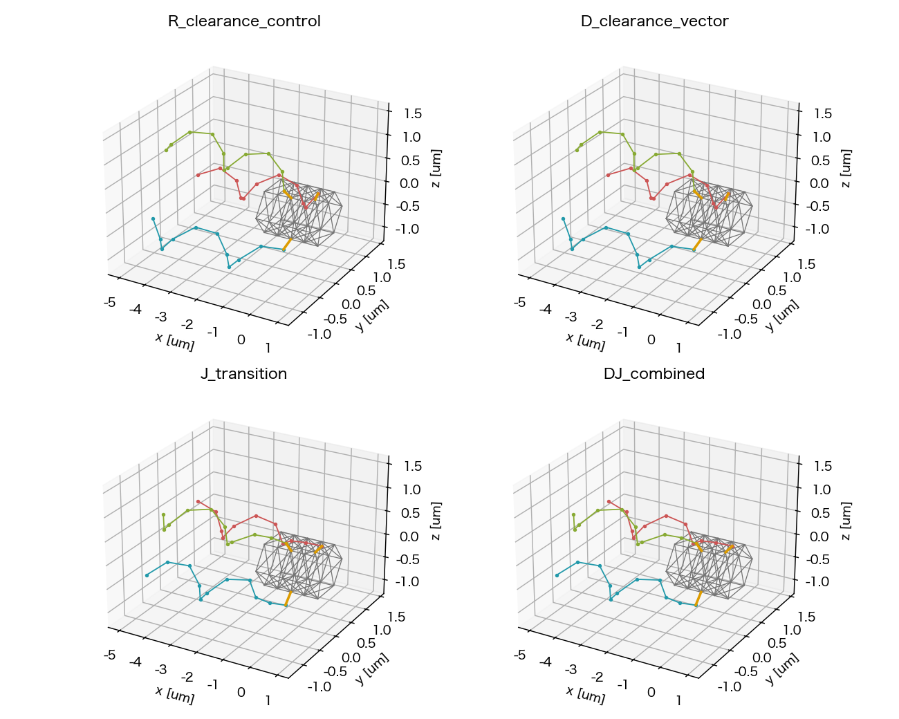

# Issue #263：非重複R/DとD/J 4条件の再実行

2026-11-11追記：[D+Jの阻害要因監査・11月の検証計画案](phase2_263_dj_bundle_cause_and_november_plan.md)。K/Gは未実装・未予約であり、下記の既存計画/承認範囲へ自動追加しない。

2026-11-11結果：main#42は4/4完走、strict QCはR/D/DJ PASS・J FAIL。D+Jは前進/回転が改善したが束形成・定常遊泳は未達。[3.5秒結果](phase2_263_dj_3p5s_result.md)を現在状況の正本とする。

2026-11-04時点の記録：short#41は4/4完走・strict QC4/4 PASS、固定camera replay/保存点幾何を確認し、同じfixed commitのmain#42（各3.5秒）を17:40 JSTに開始した。[短期結果と予約証拠](phase2_263_dj_clearance_1tau_result.md)を短期証拠として保持する。以下は予約前に固定した手順と比較条件。

2026-11-04。ユーザーはR/Dの初期配置を非重複へ修正し、4条件比較を維持する方針を承認した。共通preflight、短期QC/固定camera replayを確認後、3.5秒4条件の予約/開始まで進める。cs10接続・enqueue・必要なdispatcher/job開始は本スレッドで許可済み。既存予約を変更・取消・置換しない。物理採択・mergeは含まない。

## 修正内容と比較の範囲

R/Dに`compact_clearance_rear`を追加した。既存のらせんを剛体並進し、付着点・hook長0.25 µm・全flag bond長0.58 µm・bead数・自然bend/torsion・位相を保持する。hook方向候補を外向きから後方0〜90°の5°刻みで調べ、非重複かつ元配置より狭い候補の中でhook力、束幅の順で選ぶ。今回の選択は35°。候補ごとの自然角を動的形状へ再設定しない。

| 条件ID末尾（prefix `nf03__slots024__`） | motor | geometry |
| --- | --- | --- |
| `R_clearance_control` | 従来segment力対・拡散重み | 非重複compact |
| `D_clearance_vector` | pure-vector有効motor | Rと座標完全一致 |
| `J_transition` | Rと同じ | 既存軸上根元移行部 |
| `DJ_combined` | Dと同じ | Jと座標/自然形状完全一致 |

J/DJは予約#40の初期座標と一致する。R/Dは旧`R_control`/`D_vector`の配置とは異なり、旧結果の時間延長とは扱わない。新R/Dの束半径指標は0.998746 µm（旧compact0.813333、開始C約1.040678）。J/DJは0.761913 µm。幾何因子は自然形状と配置・初期束幅の差を含み、完成した密束の検証と偽らない。

nf3/slots024、T/reference T=2.5e−20 N m/本、dt4 µs、粘性1 mPa s、FF/BF反発ON、解析torsion、Brownian/切替OFFを維持する。motor/frame/hook構成則・反発曲線・材質係数・QC閾値を追加変更しない。

## 非重複preflight

共通`segment_contacts`でruntimeとpreflightの反発対象pair選択を共通化した。共有端点のある隣接pairとbody/bodyを除外し、hookを含む非body segmentを検査する。BF ON/OFFの独立式と既存runtimeの集合一致を回帰testで確認する。FFはこの実行sourceで常時ON。

`development_evaluation.geometry.require_initial_segment_clearance: true`を長短両profileに宣言し、修正済みproduction線分距離で全active pairの距離≥2aを予約前の必須条件にする。最短距離、overlap件数、segment行/端点bead IDのwitness、pair数を記録する。許容差は座標scaleと浮動小数点epsilonから導く丸め誤差だけ。新modeは宣言に関係なく必須検査を適用する。

旧profileは再現性のため配置を変更せず、共通preflightに距離/FAIL情報を追加する。上の必須宣言を持たない旧profileでは診断のみ（`enforced:false`）。旧compactを新4条件のprofileへ差し戻す回帰testは、bead間距離が十分でもroot対edge重複を検出して予約前に拒否する。過去の不適格profileを新しい合格対照として使わない。

さらに新R/Dの候補選択では、菌体中心凸包を包む有限円筒から全flag segmentが離れる保守的下界を検査する。線分内点をsamplingし、1-Lipschitz距離の誤差上界を引くため、端点だけが外側にある貫通を除外できる。hookの付着端は円筒検査の対象外だが、非隣接線分検査には含む。これは初期状態の保証で、全回転位相/動的な保証ではない。

- 新R/D：BF最短距離0.204788 µm、円筒距離下界0.204498 µm > 2a=0.20 µm。
- J/DJ：BF最短距離0.213832 µm。既存の未変形全位相clearance下界0.210912 µmも保持。
- 4条件すべて初期hook力0、反発力0、初期弾性力ノルムは約3e−26 Nの丸め誤差。自然角参照はR/Dで従来値、J/DJで既存の固定近位参照。
- 受動Hessian/RPY（差分幅1/0.5 pm）のdt*lambdaは新R0.101727、J0.850131で<2。非線形精度、接触中の安定性、遊泳成立は別に評価する。

## 固定コミットと実行順

既存の長短campaign/jobを新commitで更新する。過去予約#40の固定commit `51e03231d7c552c992a18616aaec9b2646413aaa`は変更しない。

| Stage | campaign（`conf/phase2_multi_run/`） | job（`conf/phase2_parallel/issue263_initial_bundle/`） | 各条件 |
| --- | --- | --- | --- |
| short | `2010_hex_nf3_dj_1tau_issue263.yaml` | `nf3_dj_1tau_job.yaml` | 1τ=.04秒、10000 step |
| main | `2010_hex_nf3_dj_3p5s_issue263.yaml` | `nf3_dj_3p5s_job.yaml` | 3.5秒、875000 step |

独立4条件・`cs10_qualified`実効4workers・数値thread各1・条件別output。Mac/cs10でsimulationなしdry-run、fixed commit/入力SHA/4 IDの照合後にshortをenqueueする。実予約ID/commit/開始/ETAはローカルreservation manifestとIssue/PR要約を正本とする。

short完走後はportableのみローカルへ同期して集合/件数/全SHAを確認し、run_summary先読→共通development_evaluation strict QC/heatmap→標準固定camera共通視野3D/2D replay/coverage/frame/fps/SHA/視認の順でレビューする。共通の束/材料点spin・body自転/符号付き前進/根元診断と保存点線分距離も記録する。soft反発の接触圧縮と中心線の交差を区別し、保存点だけで未保存stepの非貫通まで保証しない。

QC FAIL、明白な崩壊・貫通/実装異常があればmainへ進まず、具体的根拠を報告する。1τで周期不足だけを理由に止めない。成立すれば追加承認待ちを作らず同じfixed commitの3.5秒4条件を予約する。トルク・dt・粘性・閾値を調整した自動再実行はしない。

初回予算は旧short実測からshort約40〜60分、main約52〜55時間。修正R/Dの実測速度と共有負荷で更新する。Macは32step等の短いcheckとtest/preflightだけに限る。

## 記録と残件

準備正本：`outputs/2026-11-04/164406/issue263_clearance_preparation/`。preflight/witness・初期NPZ/preview・Hessian/RPY・test/dry-run・source SHA・manifest/run.log/review_resultを保存する。動的stageの結果は別のJST outputへ分離する。

[旧短期結果](phase2_263_dj_1tau_result.md)は初期重複を含む過去証拠として保持し、今回のQCへ混ぜない。[D/J修正方針](phase2_263_model_repair_direction.md)・[ADR0029](../adr/0029_phase2_effective_torque_and_root_transition_direction.md)の採否基準とProposed状態を維持する。追加位置復元処理/scale削除はmerge前残件、#271の密集同位相は別Issueのまま。3.5秒の時間長だけで定常性を宣言しない。
