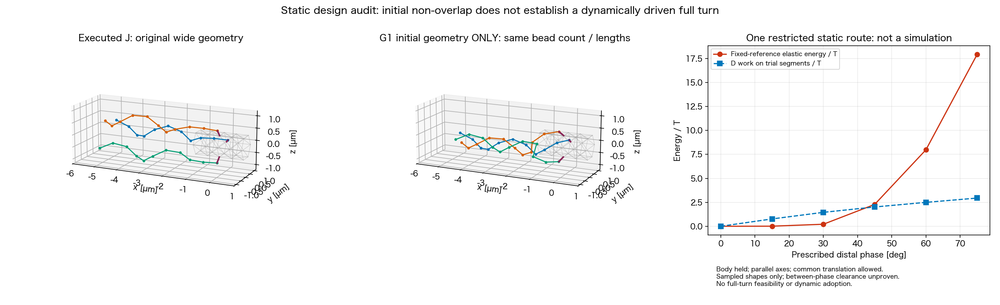

# Issue #263：G1の初期成立と、回転成立に残る制約

2026-11-13。Refs #263 / PR #264。[接続経路計画](phase2_263_connector_repair_plan.md)の静的監査。**同じ点数・長さでも近束の初期配置は一例成立した。ただし、駆動可能な連続1回転は未確認なので、G1のsimulationは予約しない。** 実行中の#46と物理条件を混在させない。

## 初期配置は、点数・長さを増やさずに成立した

以前の個別経路の有限探索では、各鎖が菌体を避けても鎖0/2の接続–遠位区間が干渉した。まず距離下界の保守性を確認した。凸菌体の境界への最近点とsupporting-plane下界を使う静的helperを、120 random segmentの凸QPと、100 segment pairのproduction最近点式で照合した。後者の最大差は6.7e−16µm、supporting-plane上下界の差は3.2e−14µm。閾値2a=.20µmを緩めた変更ではない。

精密化後も同じ6配置の個別経路組合せは未達だった。そこで、既存計画で許した根元0–2の同時変形と遠位らせん全体の小さな共通並進を、一つの制約問題として解いた。各鎖を独立に選んでから組み合わせる制限を外したところ、一例が成立した。

| 保存する条件 | 結果 |
| --- | --- |
| nf3/slots024、body、局所phase各0 | 保持 |
| hook自然長、点数、全bond自然長 | .25µm、11点/本、10×.58µm/本を保持 |
| 遠位8点の形状・長さ・相対位相 | 保持、共通並進のみ |
| 全active線分のBF/FF非重複 | PASS、最短距離は約.2001µm |
| 凸菌体表面に対する全filament線分の下界 | 最短.2001µm以上 |
| bond長誤差 | 最大2.01e−14µm |
| 遠位軸幅 / 軸間最大角 / 後方軸角 | .084616µm / 4.093° / .429° |

個別経路の基準配置は共通横offset .30µm、後方shift−.45µm、hook後方35°。その遠位区間をさらに `[-.026744,+.033866,−.036059]µm` 並進し、根元3点も同時に動かした。最終的なhook方向は各鎖で異なり、最初の35°を保った解ではない。hook長の球面拘束と初期の片側hook曲げ不作動を確認した。これは幾何問題の解であり、受動energy最小の証明ではない。

近位の自然bend/dihedralをこの初期形状から一度だけ固定する仮のG1参照を作り、同じsourceのengineを`step(0)`で検算した。初期のspring/bend/torsion最大bead力はそれぞれ7.2e−27/9.1e−28/1.3e−26N、hookと反発は0。D motor最大bead力は3.30e−14N、全力残差比2.6e−16、全torqueは丸め誤差、RPYは正、散逸率は正だった。時刻/位置は進めていない。

したがって、**初期の近束を置くために、長さや点数の追加が必須という判断はしない。** 一方、自然参照を変えるため初期配置だけの変更でもない。J/G1差には幾何と近位の自然形状が含まれる。

## 初期に無応力でも、回転中の弾性負荷は消えない

同じ自然参照を固定し、遠位の位相を15°ずつ進める静的試行を行った。位相ごとに参照を更新していない。bodyを固定した参照問題で、rootはhook球面上を動ける。共通遠位軸を固定した族では45°までの形状、共通並進を各成分±.15µmまで許す族では75°までの形状が、長さ・実線分非重複・凸菌体clearanceを満たした。後者の90°はsolver未収束かつ制約未達で停止した。

| 遠位位相 [°] | 固定自然形状のbend/torsion/hook energy / T | 試行形状間のDの仕事 / T |
| ---: | ---: | ---: |
| 0 | 0 | 0 |
| 15 | .0082 | .7655 |
| 30 | .2107 | 1.4519 |
| 45 | 2.2764 | 2.0126 |
| 60 | 7.9783 | 2.4930 |
| 75 | 17.9414 | 2.9426 |

仕事は保存した形状同士を直線で結ぶconfiguration上で、同じD力をGauss積分した補助量。8/16点積分の差は4.4e−16Tだったが、**形状間の連続clearance・長さ拘束は未証明**であり、実軌道の仕事や全候補の不可避なbarrierとは呼ばない。非保存のsolver反復も物理軌道ではない。

この試行だけでも、「初期の無応力と近束」を「Dが継続して回せる証拠」と扱うことはできない。共通並進を許すと静的形状の到達範囲は広がったが、1回転を示せていない。bodyを固定し、軸precessionを省く制限も残るので、実際の自由なbody/束で不可能とも断定しない。

以前のG2長さ追加案も初期幾何だけの参照であり、連続回転は未証明。G1初期例が得られた現在、長さ追加を優先修正へ自動昇格させない。G2の初期局所spin参照では同じ係数を使っても抵抗とDの仕事が変わり、単なる点の追加としては扱えなかった。

## 次に切り分ける対象

1. **接触の寄与**：実行中#46のJ×BF ON/OFFを完走・QC/replay後に比較する。接触前からの開きと、その後の増幅を同時刻で分ける。OFFは診断で採択条件ではない。
2. **G1の回転経路**：初期点をさらに密にする探索を増やさず、許容する共通軸の移動/precessionと、固定自然参照の受動moment・入力仕事の整合を先に扱う。自然参照の位相追従更新、T/dt/η変更、人工的な束軸への復元は使わない。
3. **G2の構成則**：必要ならspin・tilt・曲率/材料twistを分ける有限接続の設計へ進む。現行の位置dihedralを、独立な材料twistと同一視しない。入力/出力の位相、全力/torque、端力moment、流体負荷を一つの仕事収支で定義する。既存Dに新しい入力torqueを重ねて二重駆動しない。動的採用は別の具体的モデル判断であり、今回は静的設計まで。

文献は、hookの曲げと駆動spinを分ける設計を支持するが、係数や実装をそのまま採用する根拠ではない。[Janssen/Graham 2011 §II](https://link.aps.org/accepted/10.1103/PhysRevE.84.011910)では、motorからhook rodへtorqueを直接渡すためmotor–hook間のtwist potentialを省いている。これは実在hookのねじり剛性を0とした主張ではない。[Zou/Lough/Spagnolie 2021 §IV.D](https://link.aps.org/accepted/10.1103/PhysRevFluids.6.103102)の単一joint模型は、短いhook・剛体/位相平均filamentの近似を置く。有限長.25µmの現hookと変形filamentを、この近似へ無条件に置き換えない。

材料spinを導入する場合の設計参照は、入力/出力位相差`δ=ψ_out−ψ_in−γ_geometry`に対する固定energy `U_twist=k_twist δ²/2`。両位相が同じだけ進む定常伝達ではδを一定にでき、蓄積energyも一定になる。ただしこれは候補の必要な自由度を説明する式で、現モデルの成功や係数同定ではない。材料/抗力・観測frameと客観性・geometry phase・出力への仕事の対応を静的に検証しなければ実装条件にしない。

G1が回転/仕事の入口まで通った場合だけ、既存計画のJ/G1×BF ON/OFF、4条件short→1秒を構成する。今回の初期例だけではその入口を満たさず、予約枠は#45/#46の2/7のまま。追加の3.5秒、科学的採択、mergeはしていない。

## 再現証拠

固定source `823f81873aa601e7a12ad026c80234db16f7fc2d`。ローカル正本は`outputs/2026-11-13/180742/issue263_connector_execution_preparation/`。

- `G1_joint_translation_feasibility.json` / `G1_joint_translation_initial_geometry_candidate.npz`：初期成立。
- `convex_static_certificate_validation.json`：幾何helperの独立照合。
- `G1_initial_static_force_audit.json`：固定参照での初期力/散逸。
- `G1_translation_spin_reference.json/.npz`：限定した静的形状列、solver停止理由。
- `G1_sampled_path_work_audit.json`：固定energyとDの仕事、積分/適用限界。
- 各script・`manifest.json`・`execution_ledger.json`。新しいsimulation/QC結果ではない。

ADR0029 Proposed。全Goalは継続中。今回文書・静的監査のPASSと、回転成立/科学的採択の未達を区別する。

## 後続監査：どの負荷を修正すべきか

### 既存の自由度を外していないか確認した

前述の試行では軸方向を固定したため、追加の有限試行では共通軸の首振りも許した。これは新しい力ではなく、既存の位置自由度を使った静的検算である。遠位相互角/幅を保ち、実測の後方軸角≤15°、共通並進各成分±.15µm、hook/bond長、全active線分と凸菌体のclearanceを課した。自然参照は初期から固定、hook energyも含めた。

この族では90°の保存形状まで成立したが、105°でsolver未収束・長さ/clearance未達となり停止した。90°時点のenergyは30.88T、後方軸角は15°の境界だった。energy勾配と形状Jacobianを独立差分で確認した。首振りを許すと到達範囲は広がるが、現在の有限試行で1回転の成立を示せたことにはならない。初期位相や係数の探索を増やす前に、受動歪みと駆動仕事の対応を見直す。

### motorの測定区間だけを変えても、この経路は救えない

75°までの同じ試行形状について、Dに加え、既存Mの全11点frameと、遠位8点をframeにする静的参照の仕事を照合した。後者は新しいmotor optionを実装したものではない。仮想仕事、客観性、全力/torque釣合い、位相差と力の線積分の一致を確認した。

| この限定試行の75°時点 | 値 |
| --- | ---: |
| bend/torsion/hook energy | 17.9414T |
| Dの仕事 | 2.9426T |
| 全11点Mの仕事 | 3.1919T |
| 遠位8点frameの静的参照の仕事 | 3.9451T |

従って、この経路の大きな負荷を、出力frameの測定点を変えるだけで解消できるとはしない。これは各motorで新たにsimulationした比較でも、他の全経路についての不可能証明でもない。M/Kの追加sweepを予約しない。

### 静的G1と、実行されたJの原因を混同しない

同じ75°の静的G1試行では、bendが2.5944T、**近位の幾何dihedral項が15.3470T（約86%）**、片側hook曲げは0だった。一方、既存#44のDJ保存状態の1秒時点では、近位bend .1620T、近位幾何dihedral .0933Tだった。旧DJは実行/解析sourceの物理力回帰で同等性を確認した参照であり、#46の新結果として扱わない。

つまり「Jが開く問題」と「新しい近束G1を回そうとすると、この試行では大きな弾性負荷が出る問題」は区別する。静的G1の数値だけから、実行されたJの減速原因をtorsionと断定しない。既存の解析torsion計算法の追加精度比較を行ったのでもない。反発ON/OFFの実接触時刻と受動成分の同時刻比較は、#46の完走後に行う。

そのための保存点energy補助解析は準備した。既存7状態でspring/bend/torsion/hook各力との仕事勾配を照合し、最大相対誤差1.6e−8。FENE力がclipされた状態には保存energyを無条件に割り当てず、未定義として記録する。新しいQC gateにはしない。

## G2を具体化するときの設計境界

**入力spin変数を一つ足すだけでは修正にならない。** 入力位相ψ、客観的な出力位相χ(q)に対して`U=k(ψ−χ)²/2`とし、入力の慣性/抗力を省いて釣合い`T=k(ψ−χ)`を課すと、出力力は`F=T∇χ`になる。これは既存の有効phase-work driveへ戻る。中心線の弾性energyを変えずに補助scalarだけを加えても、上の負荷を除いたことにはならない。

次に設計する対象は、**有限接続での材料spin・曲げと、中心線形状の変化の対応**である。[Vogel/Stark 2012 §2.1–2.2](https://arxiv.org/pdf/1201.0628)は中心線と材料frameを状態とし、曲げ/twist歪みからenergyを定義し、位置と軸回り回転に別の散逸を置く。この構成を検討する根拠にはなるが、その論文のdrag法・係数・自然形状を現在のRPY模型へ移植する根拠ではない。

具体的な設計/静的合格条件は次のとおり。

- 入力frameは既存one-ringのbodyに追従し、出力は同じ物理的な遠位区間で定義する。実験室固定frameや初期位置へ戻す力を入れず、既存の追加位置復元/scaleも再利用しない。
- 中心線と材料frameの歪みから、一つの固定energyを定義する。幾何dihedralを材料twistと同一視せず、曲げの材料方向も含める。自然参照を位相ごとに更新しない。純twistの蓄積が一定でも、曲がったrodの全energyまで自動的に一定になるとはしない。
- T/refT・dt・ηと遠位材料を保ち、受動moment曲線と単位を対応付ける。現hookは片側の作動枝だけ接線剛性20Tで、非作動枝は0。これを同じ20Tの全角度linear tilt springへ変えると、90°のmomentは31.4Tとなるため、同じ係数でも同じ物理応答ではない。新係数の採用は校正/比較条件を示した別判断とする。
- 有限hookの端力lever momentとbody反作用を仮想仕事から一緒に導く。motorの二重加算を避ける。独立な材料回転を導入するなら、回転抵抗と並進–回転couplingの正の散逸/相反性も検算する。流体負荷を持たない仮想点の追加や、抗力未対応のbead追加で済ませない。
- straight-hookの純曲げ/純twist、通常らせんの剛体spin、客観性、gauge、全力/torque、入力/出力仕事、固定4µsでの線形応答・安定性を先に確認する。係数sweepやdt変更で検算を迂回しない。

G2のdynamic profile/条件はまだ作っていない。#46結果とこの静的設計を合わせて、必要な構成則の変更と比較条件を具体化する。G1の既存自由度の有限試行が未達だったことだけで、材料frameの追加が必ず解決すると宣言もしない。
