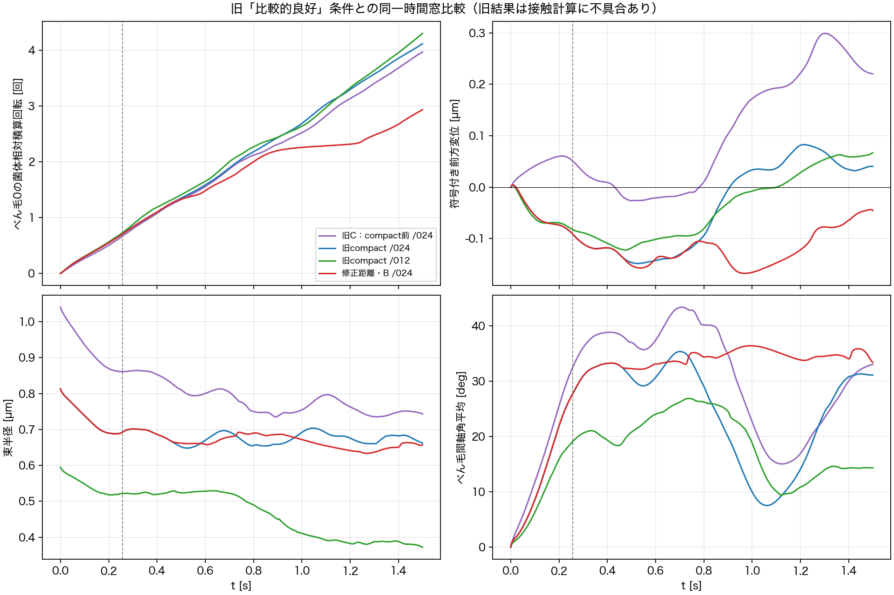
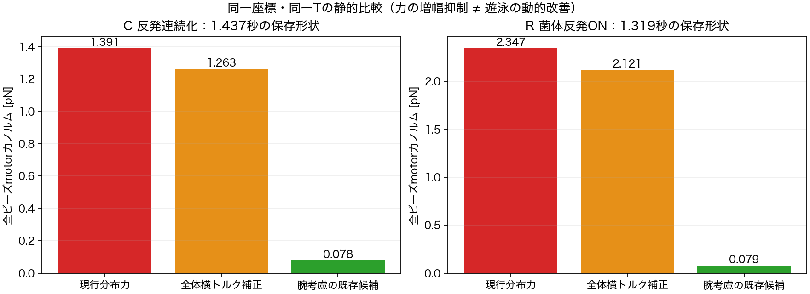

# Issue #263：過去の比較的良好な条件を含む原因考察と次の対照案

2026-10-28。ユーザーは、今回の悪化を過去の比較的良好な条件と照合し、根拠を示して原因仮説と次のステップを検討するよう依頼した。本作業は保存済みarchiveの再解析・静的な力/mobility評価と設計だけで、新規simulation・cs10操作・実行予約・物理実装変更は行っていない。

## 結論の位置づけ

1. 同一0〜1.5秒でも旧compact/024の4.112回転・+0.0402 µmに対し、距離修正後Bは2.929回転・−0.0452 µm。悪化は観測時間の違いだけではない。物理設定・初期座標は一致し、距離修正によって基準の軌道自体が変わっている。
2. 旧「良好」条件にも距離計算の影響がある。旧結果は幾何の手掛かりとして使うが、接触計算・反作用・frame/torsionまで一括で戻して採択しない。
3. 原因候補は、接触による姿勢変化と、根元の回転伝達/分布力の特異性が結合する機構。接触がないnf1にもstop-goがあるため、接触抵抗だけでは共通の前進変動を説明できない。
4. 全体の横トルクを後から打ち消すだけでは、大きい局所力が残る。軸/入力トルク/力の配置/接続自由度を分けて問う。既存の腕考慮候補は「一般的な重み比較」ではなく、今回現れた小さい横方向距離での特異性対照として、必要性を改めて判断できる。
5. 次の実行案は、旧良好幾何2条件と特異性対照2条件の**新規4条件**。既存B/Rの再利用が成立すれば6条件比較になるが、未確定・未実装・未予約であり、Wの追加は今回の根拠をユーザーがレビューして判断する。

## 比較する証拠と再利用の確認

| 証拠 | 固定commit | 使用範囲・限界 |
| --- | --- | --- |
| #32・nf3各3.5秒 | `fbfac59ae2628cbec853377909f39f6844fda513` | 旧C、compact、横トルク補正。共通QC PASSだが旧距離計算を含む |
| #35・本数/付着26条件各2秒 | `71ed7529d362474235b931494af6cafcf3fe2edf` | nf3/012、024 OFFを選択。配置効果の手掛かり。旧距離計算を含む |
| #39・nf3各1.5秒 | `236d6638e7b370183840508c23b8597dff82a483` | 修正距離のB/M/C/G/R、共通strict QC5/5PASS |
| 接触を除外できるnf1 | #35の`nf01__slots0__bfoff` | 修正距離と全step変位上界から自己反発も除外した既存証拠。nf3の束形成と同一視しない |

選択した各条件の`run_summary.json`を先読し、完走・共通QC・archive/summary SHA・source commitを再照合した。base profileは上の3実行commitでbyte一致。旧compact/#32、旧024 OFF/#35、新B/#39はduration/outputを除く全configが一致し、初期座標差0だった。さらに旧#32/#35の0〜1.5秒の全保存座標はbitwise一致し、旧2 runのforce sourceもbyte一致する。

#257の映像は参考になるが、最終2秒はstrict motor FAILを保持したdiagnostic-onlyで、hook初期状態・反作用・frame/torsion等も異なる。現在の基準と独立因果対照として扱わない。#257 closeは採択を意味しない。

## 過去の「うまくいっている」を同じ窓で比較

0〜1.5秒へ揃え、共通の軸/速度/回転診断と終端重複点対策で再集計した。旧Cは**compact前の初期配置**で、今回#39の「C＝反発連続化」とは別物である。

| 条件 | べん毛0の菌体相対回転 [回] | 前方変位 [µm] | 後半0.8〜1.5秒平均前進 [µm/s] | 同窓平均べん毛間軸角 [deg] |
| --- | ---: | ---: | ---: | ---: |
| 旧C・compact前/024 | 3.965 | +0.2201 | +0.2997 | 25.7 |
| 旧compact/024 | 4.112 | +0.0402 | +0.1920 | 19.5 |
| 旧compact/012 | 4.297 | +0.0666 | +0.2102 | 16.0 |
| 修正距離・今回B/024 | 2.929 | −0.0452 | +0.0878 | 35.0 |



旧compactの3.5秒では、後半の約3べん毛周期ごとの前方変位が+0.1523/+0.1532 µmで、各blockの菌体自転が約1回という再現性があった。一方、単一べん毛周期にはほぼ前進しない周期や後退もある。これは「瞬間速度一定」を成功基準にしない根拠であり、密な束やモデル採択の証拠ではない。

旧012は後半1〜2秒の束半径中央値0.375 µm・軸角14.5°・負速度時間11.8%と、旧024の0.665 µm・27.9°・39.9%より良い指標を示した。ただし周期長CV約15.9%など変動も残り、旧距離計算の影響もあるので、修正モデルで再現するかは未検証である。

**評価窓の交絡も残る。**同じB/024でも1.0〜1.5秒だけの平均前進は修正後+0.2411、旧+0.0135 µm/sと順位が逆になる。1.5秒全体の成績は悪化しているが、それだけで長時間平均が必ず負になるとは言えない。今回のBは全時間でも菌体材料点自転0.674回で、初期2べん毛周期を除く完全な後半周期がない。次の採択比較は菌体自転も含む同位相blockで行う。

## 接触修正はどこから軌道を変えたか

旧compactと修正Bの保存座標差が初めて1e−6 µmを超えるのは**0.257秒**、1e−3 µm超は0.464秒だった。旧024の0〜0.30秒を1 msごとに再評価すると、修正距離で最初に反発範囲へ入る時刻も0.257秒。301点中、修正距離で接触5点・旧距離で2点で、力場が異なる3点における差分ノルム最大は0.133 pNだった。

これは距離修正が軌道を分岐させる境目を支持する。全モデルの上流原因を「接触抵抗増加」と確定するものではない。

旧軌道0〜1.5秒の151保存点（10 ms刻み）を、**同じ座標のまま**旧距離と修正距離で再評価した結果：

| 旧条件 | 修正距離で接触する保存点 | 旧距離で接触する保存点 | 修正距離での最小距離 [µm] |
| --- | ---: | ---: | ---: |
| compact前C/024 | 20/151 | 4/151 | 0.0201 |
| compact/024 | 18/151 | 0/151 | 0.0134 |
| compact/012 | 130/151 | 70/151 | 0.00173 |

10 ms点は短い接触を取り逃すため、初回時刻の判定には上の1 ms再評価を用いた。距離修正は接触の見落としだけでなく、最短点・方向・beadへの力配分を変え得る。旧012の「密な束」には、正しく評価すべき強い近接が多数含まれる。

同一形状での`delta v = M(q) (F_rep,fixed − F_rep,old)`も評価した。旧024の力場が変わる10 ms保存点におけるflag0 spin寄与差は−0.820〜+0.871 Hzで、正負の両方があった。従って「修正された反発が常に直接ブレーキになる」という単純な説明は支持しない。接触が姿勢を変え、その後の弾性/流体/駆動の釣り合いを変える経路を調べる必要がある。この分解は静的応答であり、別軌道の予測ではない。

## 根元の力生成にある特異性と、既存の補正が調べていないこと

現行segment力対で、motor軸単位ベクトルをe、segmentベクトルをr_i、軸に垂直な成分の長さをr_perp,i、分配トルクをT_iとすると、

```text
F_i = T_i (e × r_i) / r_perp,i^2
|F_i| = |T_i| / r_perp,i
r_i × F_i = T_i e − T_i (r_parallel,i / r_perp,i^2) r_perp_vector,i
```

軸方向成分はT_iでも、r_perp,iが小さいと力と横トルクが増幅する。#39 C/Rの全step最大横トルク/Tは約29/77、保存点の最小r_perpは約4/2 nmだった。特異性が式にあることと増幅状態が実際に現れたことは確認できるが、それが各停止の主原因かは未確定である。

- **Mが改善しなかったことはこの特異性の反証ではない。**MはBの実全トルクを保存したまま作用点を移すので、生成済みの大きい横トルク自体を取り除く比較ではない。
- **Gも構造的な解決を試していない。**Gは鎖の剛体並進で、各segmentとSVD軸の相対幾何は初期には変わらない。付着点と軸の距離は縮めるが、接続端の回転半径や、時間発展中のhook/軸の伝達構造は残る。
- **全体横トルク補正も、局所力を小さくするとは限らない。**拘束operatorをAとすると、加算補正後は`F_corr = A^+ b_target + (I − A^+ A) F_raw`。合力・合トルクに出ない成分は残る。これは必ず非物理的という意味ではなく、合計トルクの照合だけでは局所の変形励起を制御できないという意味である。

Cの1.437秒の保存形状では、全ビーズmotor力ノルムが現行1.391→全体横トルク補正1.263 pN。べん毛側だけの補正後1.261 pNに対し、同じ目標トルクを満たす全鎖最小ノルム力は0.0428 pNで、差の1.260 pNは合力/合トルク0の成分だった。Rの1.319秒でも2.347→2.121 pNにしか減らず、同種の残存成分を確認した。



既存の腕考慮分配は

```text
T_i = T w_i r_perp,i^2 / sum_j(w_j r_perp,j^2)
F_i = T w_i (e × r_i) / sum_j(w_j r_perp,j^2)
```

となり、他segmentが使用可能なら、1本のsegmentだけが軸に平行になる際の1/r_perp特異性を避ける。同じ保存形状・同じ公称軸方向Tで、力ノルムはC 1.391→0.0779 pN、R 2.347→0.0787 pNへ減った。軸方向トルクと全体の力/トルク釣り合いも静的に確認した。

**これは遊泳改善の証拠ではない。**Rのその形状での瞬時spin寄与差は−2.01 Hz、前進寄与差は−4.82 µm/sであり、力を小さくすれば同じ形状が直ちに前進するとは言えない。初期から同じ退化状態へ入りにくくなるか、別軌道で検証する必要がある。

旧#32の腕考慮がcompactと大差なかったのは重要な負の証拠だが、そのroot r_perp最小は約0.246 µmで、今回の2〜4 nmとは異なる。従前の「一般的な重み3方式比較は低優先度」を維持しつつ、**新しく現れた退化状態に対する限定対照**の必要性を判断する余地がある。新しい重み比較実装を作る必要はなく、候補自体は既存opt-inである。

## 原因仮説と確度

| 仮説 | 根拠 | 未検証・反証条件 |
| --- | --- | --- |
| 接触で姿勢が変わり、根元の力生成の特異性を励起する | 旧/新の分岐開始と接触検出が0.257秒で一致。C/Rに小さいr_perp・大きい力/横トルク。静的な力生成特異性は確実 | どの接触がどの自由度を動かすか、特異性を除いた軌道で停滞が減るかは未検証。B/M/Gにも極端な退化なしで減速がある |
| 偏心した接続とhook自由度が回転を軸方向往復へ流す | 接触を除外したnf1でも0.213 µmの相対往復とstop-go。接続長への回転寄与RMS0.827 µm/sを他運動が相殺し、実長変化RMSは0.0571 µm/s。今回も速度と逆向き相対軸速度の相関0.945〜0.960 | 相関/運動学的相殺は原因の確定ではない。Gは単なる初期並進で構造仮説を反証しない。入力/出力軸、hookの物理自由度を分けた比較が必要 |
| 初期配置・付着配置と流体結合が不利な運動modeへ導く | 旧C初期幾何の前進、旧012の小さい束幅/軸角、旧024の対称性。トルク/本数が同じでも配置で結果が異なる | 旧良好例も接触バグの影響がある。012変更は付着関係・相対位相/流体配置をまとめて変えるため、純粋な位相だけの因果対照ではない |
| 評価窓・body/flag位相の違いが悪化の印象を変える | 0〜1.5秒と1〜1.5秒で旧/新Bの前進順位が逆転。旧compactは3 flag周期/約1 body自転blockで平均前進が反復 | これは解釈上の交絡で、力学的な減速原因の説明ではない。十分な同位相blockがない条件は定常平均を採択できない |

流体相互作用のself/body/他鎖寄与、近接流体モデルや離散化、時間変化する拡散重みも排除していない。今回は粘性・dt・bead数・重み3方式のsweepへ広げず、保存形状のmobility/仕事の監査で優先度を付ける。torsion追加A/Bはユーザー判断どおり再開しない。

## 一次文献が示す設計上の注意

[Watari & Larson (2010)](https://pubmed.ncbi.nlm.nih.gov/20074512/)のFig.2はhook近傍のトルクと、ばねに垂直なトルク/力対への分解を示す。現行の全鎖SVD軸・分布駆動を論文と同一とみなさず、**Tは入力側か出力側か、各軸とhook反力、仕事の対応を説明できるか**を設計上明確にする。横トルクを全て0にすること自体を正しい物理と自動採択しない。

[Riley, Das & Lauga (2018)](https://www.nature.com/articles/s41598-018-28319-8)では柔軟なhookと流体応答が後方集束を可能にし、接続端のらせん半径を0とするモデルを使う。根元の回転接続を見直す物理的な参考になるが、駆動速度指定・剛体らせん・流体近似等が異なるため丸ごと移植しない。単にhookを硬くして初期形状へ戻す方針も採らない。

## 次のステップ案（ユーザー判断前）

まずTの入力/出力定義と、根元の回転伝達の仕様を図/式で詰める。既存モデル内の切り分けを進めるなら、**B/Rを参照に、新規4条件**へ限定する案を推奨する。

| 新規候補 | 比較相手 | 変更点と問い |
| --- | --- | --- |
| P024：旧Cの初期幾何 | B/024 | 修正距離を維持し、compact前の初期配置だけを再現。Cの良さが幾何に由来するか。frame/torsion/反作用を旧式へ戻さない |
| S012：compact/slots012 | B/024 | nf3・物性・motorは同じで付着slotsだけ変更。旧良好配置が正しい接触計算でも有効か |
| W024：既存r_perp考慮分配 | B/024 | nominal拡散状態を保ち、局所1/r_perp特異性を避ける分配だけ変更。位相・初期配置・接触則はBと同じ |
| WR024：W＋菌体反発ON | R/024 | Rから分配だけ変更する1項目対照。body接触下の特異性を避ければ回転/束/推進が改善するか。Wとの比較でbody反発の影響も読む |

全てnf3、T=2.5e−20 N m/本、dt4 µs、粘性1 mPa s、べん毛間反発ON。Cの力曲線は使わず、基準の指数反発を維持する。今回Cはd=0.1 µmで基準0.0758 pNに対し0.0472 pNと約38%弱いため、cutoffの連続性だけの比較ではなかった。同じ連続化を繰り返すことや、反発OFFに戻すことを優先しない。

B/Rは物理実装・全設定・初期座標・入力/provenance/QCが一致する場合に限り既存#39を再利用する。満たせなければ参照も再設計する。新規4条件の実行時間・必要周期・固定commit・job YAMLは未確定。先行1τの共通QC/replayを経た各1.5秒の機序比較が候補で、1.5秒では定常性を採択しない。良好候補の長時間条件は、菌体自転を含む同位相blockを何件観測するかをレビューしてから固定する。参考wallは今回OFF約8時間・ON約23.7時間で、WRが含まれると並列全体も約1日が目安となるが新候補で未測定である。

W/WRは採択案ではなく、従前低優先とした一般の重み比較を広げない限定した特異性対照である。ユーザーが不要と判断すればP024/S012の対照を先にし、根元の軸上接続・先細り区間・hook入力/出力軸を持つ物理接続モデルを設計する。これはGの初期並進とは別のモデル変更で、式・自然長/角度・初期応力・力/トルク/仕事を事前にレビューする。

## 成果物・再現性

ローカル正本：`outputs/2026-10-28/204000/issue263_historical_cause_review/`。

- `same_window_comparison.json` / `same_window_timeseries.csv`：archive/QC/source照合、同一窓と初期/config一致、分岐時刻。
- `frozen_contact_summary*.json` / CSV：旧・修正距離の同一形状での接触力/mobility差。旧forceは固定Git sourceから関数だけを取得し、#32/#35のforce source一致も確認。
- `static_motor_vector_audit.json` / `static_arm_weighted_audit.json`：同一座標/nominal拡散状態の力・トルク・静的応答。合力/合トルクと軸方向トルク、null-space成分のassertを含む。
- `compare_archives.py`、`audit_old_contacts.py`、`audit_motor_vectors.py`等の再現script、図、manifest、run.log、review_result.json。

全て時間を進めない保存状態の評価で、共通QCを置換するIssue専用gateは追加していない。科学的採択・設定実装・予約はこの文書の作成では行わない。
