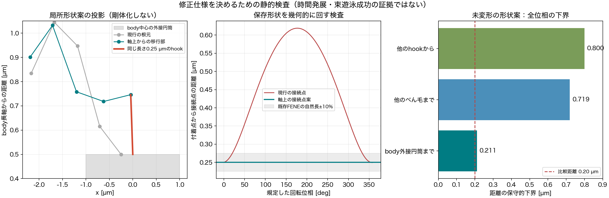

# Issue #263：遊泳モデルの修正方針・採否判定案

2026-11-03 JST。直近の目的は**修正方針の確定**。本書は設計の推奨案であり、物理モデル採択・実装・cs10予約の完了記録ではない。既存の目標で設計できるため、ユーザーへ追加の生物種・速度目標を要求しない。

2026-11-03短期結果：共通strict QC4/4 PASSの一方、R/Dの初期根元が非隣接菌体edge上に重なることを確認し、長期予約を停止した。[1τ結果と次の判断](phase2_263_dj_1tau_result.md)を参照。

2026-11-03実装段階：[D/J runbook](phase2_263_dj_runbook.md)に4条件・初期状態・比較の限界を固定した。両geometryの遠位絶対座標は完全一致せず、Jは自然形状と配置を含む構造因子として扱う。初期近束は従来compactを対照とし、初期から完成した密束とは主張しない。

## 推奨する決定

1. 現行bead-spring/RPYモデルを基盤にする。修正を **D：トルクから力を作る演算** と **J：回転軸上から始まる根元移行部** の2系統に限定する。
2. Dを先に静的な保存則・仕事・特異性試験で完成させる。Jは、付着点・hook自然長・本数・bead数・結合長・遠位らせんを保ち、根元だけを細く立ち上げる形状モデルとして設計する。Gの初期並進を繰り返さない。
3. 主比較は同じnf3/slots024・菌体反発ONで、現行、D、J、D+Jの2×2。物理的な改良に必要な相互作用を、この4条件から一度で判定する。以前提案したP024/S012/W/WRの新規4条件は初回主比較から外す。旧良好配置は根拠/後段の成立範囲確認に使う。
4. 採択するのはQCに加えて束・持続回転・周期平均前進を満たす最小の修正。D単独で満たせばJを追加しない。J単独で良好でも、現行駆動の極端なトルク増幅が残るなら採択しない。
5. パラメータ探索を追加して合格するまで回さない。下の判断表で一回の主比較を評価し、原因系統と未達を確定する。今週の期限から物理的成立を逆算して宣言しない。

## 目標と、現在分かっていること

目標は後方束の維持、束軸と菌体長軸の概ねの整列、各べん毛の持続的な材料点回転、複数周期での平均前進と形状の再現性。瞬間速度一定・厳密な直進・菌体の完全な軸固定は要求しない。分離配置からの自発束形成、実菌体の絶対速度/Hzへの同定、本数別学習データ採択、canonical freezeは本判定に含めない。

| 論点 | 根拠と確度 | 今回の決定 |
| --- | --- | --- |
| 線分距離の単位依存 | 修正済みの実装不具合。旧/新024の分岐と初回修正接触が0.257秒で一致 | 修正を保持。旧良好軌道を現在の合格対照に戻さない |
| 駆動力の増幅 | 個別segmentの横投影が縮むと力が1/r_perpで増える。#39 C/Rで横トルクがTの約29/77倍。数学的な性質と発生事実は確か | Tの全vectorを直接満たす力生成へ修正。全体反作用が釣り合うだけで十分としない |
| 根元の回転・接続長の競合 | 非接触nf1にも相対往復。今回の規定剛体回転でも現行link長が0.250〜0.619 µmへ変わる | 根元の軸上接続/細い移行部を設計。単なる初期位置最適化では終わらせない |
| 多本・接触・流体の結合 | 接触の静的spin寄与は加速/減速の両方。Rはべん毛間接触がなくても悪化。単独原因は未確定 | FF/BFともONを主条件にし、保存形状の寄与と実軌道を分けて記録 |
| 過去の成功例 | 旧C、compact/012は前進/軸角に良さ。ただし距離不具合を含む。#257最終はstrict motor FAIL | 配置の手掛かりに限る。旧モデルの一括復帰や最良映像だけでの採択をしない |
| 観測窓 | 旧/新Bは1〜1.5秒だけだと前進順位が逆。今回Bのbody自転は全区間0.674回 | 秒数だけで定常判定せず、緩和後のflag/body周期を数える |

詳細は[過去条件の監査](phase2_263_historical_cause_review.md)、[非接触nf1](phase2_263_noncontact_mechanism_hypotheses.md)、[#39結果](phase2_263_nf3_physics_1p5s_result.md)。物理QC PASSと、今回定める遊泳の受入判定は別である。

## 手戻りが多かった理由と、以後の進捗の単位

Mは元の全トルクを保つ作用点対照、Gは元の形状を保つ初期並進だった。どちらも「トルクの定義を修正したmotor」や「回転可能な新しい接続構造」の反証にはなっていない。Cはcutoff内の力も約38%弱め、連続性だけの対照ではなかった。1τは実装QCであって、減速事象を試した結果ではない。

今後の進捗は、実行件数ではなく **幾何両立性 → 力/仕事の仕様成立 → 非貫通かつ持続回転 → 束と周期推進 → 摂動再現性** のどこまで通過したかで報告する。各段階で不合格なら、その段階が示す問題を修正し、後続長時間を走らせない。

## D：力を生成する演算を定義し直す

Tは現行projectと同じ「べん毛側へ指定する出力トルク」の大きさ、eは駆動軸。初回Dのeは現行全鎖SVDの向き/符号規約を保持する。**力の作り方と駆動軸の変更を混ぜない**。SVD軸と真のらせん軸は診断上も区別する。根元接線への軸変更や、実motorの入力軸/転向トルクを明示する模型は今回同時採用しない。

各鎖のbead位置をx_i、重心からの位置をr_iとし、

```text
I_F = sum_i (|r_i|^2 Identity - r_i r_i^T)
a = solve(I_F, T e)
F_i = a × r_i
sum F_i = 0
sum r_i × F_i = T e
```

と、**ゼロから**力を生成する。既存のforceに補正を足す方式ではない。各segmentにT_i/r_perpを割り当てることも、力の上限clipも行わない。個別segmentが軸に平行になるだけでは発散しない。鎖全体/反作用supportが縮退する場合は、無次元化したsolver残差/幾何rankを記録して失敗にし、黙って別方式へfallbackしない。

菌体側は既存の付着one-ringへ−T eの全vectorをゼロ合力で返す。支持bead群の最小二乗剛体角速度をomegaとすれば、任意速度場に対し

```text
sum_F F_i · v_i + sum_B F_i · v_i
  = T e · (omega_F - omega_B,support)
```

が成立する。各群の剛体fit残差速度へはユークリッド内積の仕事をしない。**これは推進効率や散逸の正定値分解ではない**。局所forceが満たす仕事の定義である。

このDは「各べん毛を有効な回転体として駆動する粗視化」で、根元から実際の材料ねじれを輸送するKirchhoff rodの再現ではない。ADR0001/0002/0004の拡散状態も、位置・負荷と結合するenergy-based twistではなかった。現行の拡散重みを物理的ねじれ伝達と呼ばず、Dでは力生成に使わない。旧方式は過去config再現用に保持する。一般的な重み3方式比較は再開しない。

静的検査では、5条件×6保存時刻×全鎖/根元3点の60対照で、目標vector・剛体仕事・残差速度への仕事を確認した。最大vector相対誤差3.6e−13。根元3点でも力を生成できるが、過去tripletの伝達失敗と局所過負荷の履歴があるため、まず全鎖の有効driveに限定する。**実装名のminimum_normだけで方式を同一視しない**。

## J：根元から回転可能な形状を作る

現行の点接続は最初のbead自体がらせん軸から約0.287 µm外れている。付着点を固定したまま保存形状を真のscrew軸周りで一回転させると、hook link長は0.2496〜0.6190 µm、Gでも0.1890〜0.5565 µm。現行FENEの許容域0.225〜0.275 µmを大きく外れる。これは実軌道ではなく、相対並進/首振り/変形による補償なしでは回れないという幾何制約である。実際のhookも軸を曲げるので、偏心だけを生物学的なバグと呼ばない。

Jは、最初のbeadを局所らせん軸上に置き、数beadを小さい半径から通常らせんへ移行させる。付着bead、hook長0.25 µm、bead数11、各結合長0.58 µm、遠位normal形状、材料係数を保つ。**根元の自然形状も変える模型**であり、初期配置だけの変更と偽らない。

構成可能性を確かめた一例は、hookを外向きから後方へ10°、根元半径を0/0.035/0.040/0.2865… µmとし、各結合長から軸方向間隔を解く形状。これは根元形状の構成例であり、完成した初期密束ではない。根元以外を全て新しい自然形状へリセットせず、変更prefixに接するbend/torsion参照だけを事前に固定する。遠位の142°/−60°と解析torsionは維持する。

- 規定回転の全位相でhook長0.25 µmが不変。
- 30 body bead中心の凸包を含む半径0.5・半長1 µmの円筒に対し、各flag segmentまでの距離の保守的下界は**0.2109 µm**。比較距離0.20 µmより大きい。
- 3本それぞれの独立位相にも、flag間距離下界**0.7194 µm**、他のhookからflagまで**0.7997 µm**。自分の付着部から出るhook近傍は明示した接続除外。
- 根元三点の直線縮退を避け、最小曲げ角の直線からの距離は約6.70°。ただしconditioningの動的試験は別途必要。

初案（20°、半径0/0.02/0.02/0.2865…）は静的形状条件を満たしても、受動力の平衡点HessianとRPYから得る最大緩和率lambdaに対しdt*lambda=2.226となり、陽Eulerの線形安定条件<2を外れたため棄却した。上の修正案はdt*lambda=0.847（基準0.102）で、差分幅1/0.5 pmの両方で一致した。**dt/物性を変えず形状を見直し、long runへ出す前に不適格案を落とした**。これはmotor/接触を含む非線形軌道の収束保証ではない。

これらは**未変形の形状案だけ**の保証で、動的非貫通・束維持は保証しない。Jで稠密初期束を維持する試験へ進む前に、同じ非貫通/無過大応力条件で初期の束幅/軸角を満たすかを確認する。成立しなければ束維持試験を開始しない。散開状態からの自発束形成を追加目標にして帳尻を合わせない。#271のprestressを含む密集同位相archiveを今回の初期状態として流用しない。



Jに必要な実装は、builderのroot template、近位の自然角配列、engineと共通QC/previewが同じ参照値を読むこと。**QC閾値は緩和しない**。稼働中の形状へ自然角を追従させない。最初のreference geometryを契約として保存する。初期位置へ引き戻す追加復元力/scaleは導入せず、従前のmerge前削除を実施する。

## 根拠となる物理と、採用しない外挿

- [Watari & Larson 2010](https://pmc.ncbi.nlm.nih.gov/articles/PMC2800969/)はhook近傍に入力・出力と転向トルクを配る。現行拡散力や今回DがFig.2の忠実再現であるとはしない。論文の粗い離散化も定量mobilityを厳密には再現しない。本Issueの到達点は有効模型で、原著の完全再現との混同を止める。
- [Riley, Das & Lauga 2018](https://pmc.ncbi.nlm.nih.gov/articles/PMC6048115/)は柔軟なhookと流体応答による後方集束を示す。hookの単純硬化を改善案の既定にしない。
- [Nguyen & Graham 2017](https://pmc.ncbi.nlm.nih.gov/articles/PMC5355544/)の接続端のtaperは、根元でらせん半径を落とす構成の参考になる。ただし剛体・単べん毛・抵抗近似等が異なり、成功/不安定化の閾値を移植しない。
- [Nord et al. 2022](https://pmc.ncbi.nlm.nih.gov/articles/PMC9133114/)は負荷に伴うhookの曲げ剛性変化を測定した。将来の構成則の候補だが、D/Jと同時に追加しない。

J形状と構成らせん軸を固定したRPYの剛体運動reference（24規定位相、時間積分なし）は、T/本・粘性を変えず、平均前進約+0.250 µm/s、相対spin約3.35 Hzを与えた。これは姿勢と相対運動を拘束した別模型で、弾性模型の成功や推進上限ではない。Dの現行SVD軸そのものを使った動的対照でもない。現在の幾何/流体係数が正の推進と両立し得ることの検算に限る。

## 以後固定する条件・仮説

共通：nf3/slots024、T/reference T=2.5e−20 N m/本、dt=4 µs、粘性1 mPa s、Brownian/motor切替OFF、全vector局所one-ring反作用、解析torsion、既存の材質係数、**FF/BFともON**。現在の指数型反発と修正線分距離を保つ。菌体貫通によって得た前進は候補選択の理由にしない。

| 仮説 | 操作 | 観測・反証 |
| --- | --- | --- |
| H_D：力の構成が過剰な局所/横方向駆動を生む | Dで力生成だけを置換。軸定義・初期座標を固定 | 仕様試験でvector/仕事が成立することが必須。軌道で姿勢退化/停滞が減るか。Dでも同じ停滞なら、これだけを共通原因とはしない |
| H_J：点接続と大きい根元半径が回転・長さ拘束を競合させる | Jでroot transitionとその自然形状だけを変更。材質・motorは固定 | 初期位相検査で長さ競合がなく、動的相対軸往復/根元姿勢変動が減るか。幾何合格でも前進が改善しなければ、それだけで推進原因を説明しない |
| H_DJ：接触下の退化と接続の競合が結合 | D+Jを単独2条件と同時比較 | D+Jだけが成立すれば結合を支持。両単独との差を示し、最初から複合案だけを実行しない |
| 代替：現実のbuckling/流体負荷・軸定義 | 上の修正後も残る場合、同じ保存形状の受動剛体referenceと仕事・流体寄与を比較 | referenceが推進し実模型だけ停滞するなら相対運動側、reference自体が停滞するなら幾何/流体/駆動軸側を優先。静的差は別軌道の因果証明とはしない |

## 検証と採否を先に固定する

以下の数値は**工学的な受入案**で、生物学の普遍定数や既存QC閾値ではない。新しい結果を見る前にユーザーのレビュー対象として固定し、結果に合わせて変えない。Issue専用QC evaluatorを追加しない。

| 段階 | 検証・止める条件 |
| --- | --- |
| 0：数式・静的preflight | 並進/回転/長さ単位への整合、T vector/ゼロ合力・全体torque、仕事、縮退失敗、解析勾配、受動平衡点のHessianとdt*lambda。root全位相の長さ・clearance・応力。初期の近束条件が未成立なら束維持のlong jobへ進まない |
| 1：共通short screen | 4条件各1τ、共通strict QC/固定camera replay。QC FAILは閾値を変えず、その機序を直す。1τで束/停滞解消を採択しない |
| 2：機序と一次採否 | 現行/D/J/D+Jの4条件を各3.5秒。0.64〜0.80秒、0.8〜1.5秒、後半を同時刻比較。1.5秒だけの別mainを挟まない |
| 3：周期での目標成立 | 初期の各鎖2完全回転を除き、各鎖6完全周期以上、body材料点2完全自転以上。周期数不足は判定保留で、定常性を採択しない |
| 4：成立範囲 | 合格する最小候補だけ、1本の回転位相+5°/−5°を同じ軸上接続で与えた2条件。局所形状・hook長・物性を変えない。左右1条件ずつは有限の再現性確認で、全配置頑健性と呼ばない |

周期評価の推奨受入値：

- 共通strict QCを全時間PASS。非付着beadの重なり、segment交差、菌体内部への侵入がないことを幾何診断で確認する。有限の指数反発だけで非貫通が保証されるとはみなさない。保存点だけの確認なら未保存の貫通を排除したと記さず、内部step/変位上界のcoverageを示す。
- 束判定は根元の付着点間隔を混ぜず、共通軸方向位置で揃えた**遠位の通常らせん区間**を主対象とする。近位を除いたから隠れた逸脱がないよう、全鎖形状/最近距離も併記する。各べん毛軸のRMS広がりが遠位らせん半径以下、べん毛間軸角20°以下、束軸と菌体軸の角度15°以下を、緩和後時間の90%以上で満たす案とする。
- 各鎖の符号付きspinを材料点から測定。正方向の完全周期を維持し、後半6周期の周期長CV≤10%。低速（後半median spinの10%未満）が0.5代表周期以上継続しない。PCA-frame rollを回転位相に代用しない。
- bodyの2完全自転ごとの符号付き前方変位が共に正で、平均前進・周期/束統計が繰り返す。後半3つの連続した2-flag周期blockの平均前進/周期長/束幅の隣接差が10%以下を目安にする。ゼロ付近の相対差は差分/保存の数値誤差を分母へ混ぜず判定保留にする。瞬間的なU<0だけではFAILにしない。
- spinが増えただけで採択しない。前進/回転、相対軸往復、motor仕事・接触/弾性/mobility寄与を同時に示す。物理秒だけ長くして合格扱いにしない。

3.5秒は旧compactの回転率が回復した場合に約6〜8の緩和後flag周期が見込める機序/一次採否の予算で、body周期まで必ず足りる保証はない。健全だが周期不足の場合、良好候補1種類だけの追加観測長を周期から設計する。悪化候補全てを自動延長しない。最終候補の数値感度は別の限定した確認として、同じ物理モデルのdt/2対照を最大1種類だけ設計する（物性/採択主dtは4 µsのまま、最初の行列をdt sweepへ広げない）。この確認を省略する場合は数値収束未確認を明記し、静的な線形安定だけで代用しない。

| 主比較の結果 | 次の判断（自動予約しない） |
| --- | --- |
| Dだけで目標を満たす | Dを候補として固定。Jは追加せず、摂動を確認 |
| D+Jが通り、単独が通らない | 接続と力生成の組合せを支持。D+Jの仕様を固定し摂動へ |
| Jだけ良好 | Dの出力軸/仕事/流体応答を静的に再監査。旧駆動の増幅を残したまま採択しない |
| D/JともQCは通るが目標未達 | 微調整sweepを増やさず、力学仕様の未達とreference差を記録。一般のweight/torque/dt/粘性変更へ逃げない |
| 初期近束条件・幾何が成立しない | 制約を報告してlong jobを開始しない。必要な付着/根元構造変更をユーザー判断へ提示 |

## 今週の作業予算と完了の意味

設計上の目安は11/3（火）に方針、11/4（水）に最小実装・targeted/静的試験・short screen、11/5〜6に4条件主比較と一次採否、11/7〜8に合格候補だけの周期/摂動確認。固定の完了保証や予約ではない。通常の作業週末11/6までに、少なくとも修正仕様と一次採否を判断できる状態を目指す。

旧nf3実測はOFF約8時間/1.5秒、ON約23.7時間/1.5秒。全ONの3.5秒主比較は最遅約55時間＋待ち行列/解析が目安。short screenの条件別速度・cs10の既存予約から更新する。Macで30分超のsimulationを実行しない。新規複数条件は`cs10_qualified`/max_workers:auto・各数値thread1・条件別outputをdry-runし、fixed commitと範囲を記録する。今回cs10の新規予約は行わない。

今週の「方針確定」はD/Jの式・幾何・参照値・受入基準・判断表が定まること。「モデル候補の確定」はその仕様が動的に目標を満たすこと。「canonical freeze」は別Issueの採択であり、期限だけで前倒ししない。merge前に追加位置復元処理/scaleを削除し、残す研究opt-inと主候補を整理する。

## 今回の検証・成果物

保存済み#39のrun_summary先読、5条件10ファイルのSHA/共通QC/source commit再照合、60静的motor対照、規定剛体位相721点と連続位相の保守的距離下界、24位相の拘束RPY reference、2形状×2差分幅の受動線形安定監査、図を実施した。時間積分・simulation・runtime変更・cs10接続/予約・新規物理source実装は行っていない。

ローカル：`outputs/2026-11-03/164200/issue263_model_direction/`。`static_motor_contract.json`、`static_geometry_feasibility.json`、`phase_clearance.json`、`continuous_clearance_bound.json`、`rigid_reference.json`、`linearized_stiffness.json`と棄却初案の記録、構成例NPZ・再現script・図・manifest/run.log/review_resultを保持する。[ADR0029](../adr/0029_phase2_effective_torque_and_root_transition_direction.md)は**Proposed**。設計文書の完了と、未実装模型の採択を分ける。
