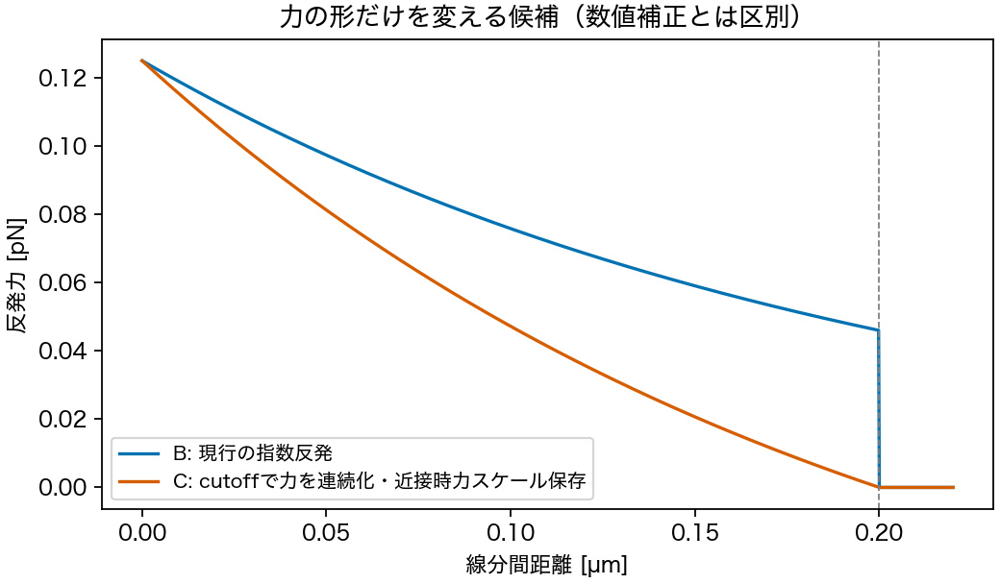
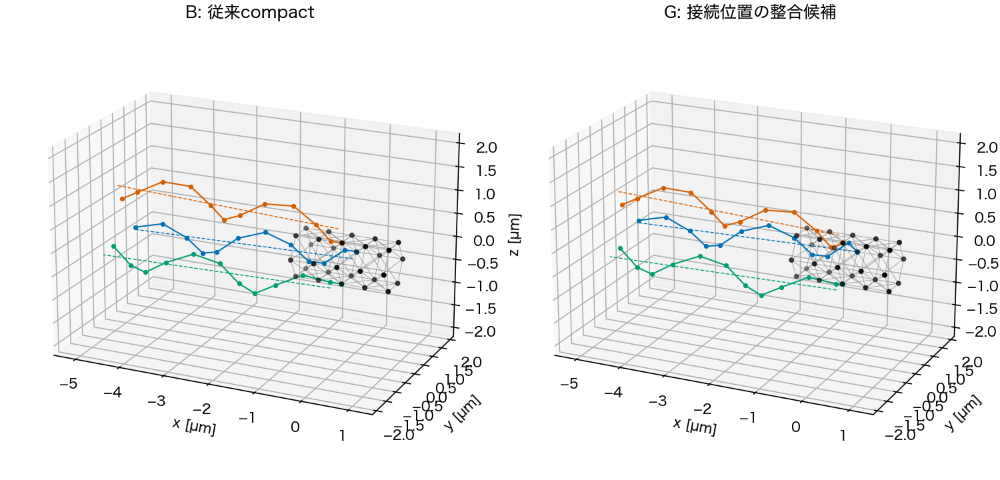

# Issue #263：nf3物理改善の比較目的・有効性・不足する仮説

2026-10-27。ユーザーの「トルク・dt・粘性をなるべく固定し、トルク伝達・力学/排除体積・位置を直接改善する」「nf3・1秒で並行仮説検証」という指定に対応する具体案。**新しい物理候補の設計レビュー用で、production source/configの実装や予約はまだ行っていない。**当初4案はユーザーが設計調整を選び、「各案が目的に対してなぜ有効か・検証漏れ」を求めた。Mは作用点だけの比較へ修正し、菌体反発ONのRを追加する**推奨5条件**を提示する。5条件の比較設計はその後概ね了承されたが、物理モデル採択・予約許可は別である。従前の「新しいhook/motor/相互作用変更は根拠と比較条件を示してユーザー判断を受ける」という合意に従って、実装対象を判断する。

## 予約前の実行条件要約（2026-10-27）

ユーザーは5条件案を概ね了承し、実行条件の一覧を求めた。比較設計の了承であり、物理モデルの採択や実行予約の許可ではない。**今回は予約せず、ユーザーの明示許可後に予約する。**

- 本比較：nf3/slots024、B/M/C/G/Rの**5条件×各1秒（25τ・250000 step）**、合計125万step。
- 共通固定：motor/reference torque各2.5e−20 N m/本、内部dt4 µs、粘性1 mPa s。菌体/べん毛のbead数、hook長0.25 µm、spring/bend/torsion/hook物性、Brownian/motor切替OFF、解析torsion、保存1 msを維持する。
- B：修正距離＋従来compact＋現行分布motor/指数反発。M：同一状態で全トルク/軸/菌体反作用をBと一致させ、べん毛側の力を根元3 beadへ局所化。C：有効べん毛segment対の反発力曲線だけを連続化。G：鎖の剛体並進で初期接続位置だけを変更。R：Bから菌体–べん毛反発だけON。
- べん毛間反発は全条件ON。菌体–べん毛反発はB/M/C/GがOFF、RのみON。M/C/G/Rを重ねない。
- 先行screen：同じ5条件×1τ（0.04秒・各10000 step）、計5万step。共通strict QC・固定camera replayを確認してから1秒比較へ進む。FAIL時にT/dt/粘性を変えたり自動再実行したりしない。
- cs10：`cs10_qualified`、実効最大5 workers、数値thread各1、条件ごとに出力分離。Macではtargeted testとsimulationなしpreflight/preview/dry-runを行う。
- 費用目安：過去OFFのnf3 1秒は約5時間、旧nf3 ON平均速度からRの1秒外挿は約14.7時間。並列本比較の壁時計はRに律速される可能性があり、**約15時間が事前参考値（queue待機を除く）**。新source/各候補は未実測なので先行screenで更新する。
- 本比較後：run_summary先読、portable全件SHA照合、共通strict QC/heatmap/replay、束/各鎖spin/菌体材料点自転/符号付き前進・前進/回転/仕事/接触/根元往復を同じ時刻・可能な同位相で比較する。

**予約可能な固定commitとjob YAMLはまだない。**現PR headは設計資料であり、M/C/Gのruntime実装、1τ/1秒campaignとparallel YAML、targeted test、共通preflight/preview/dry-runが残る。予約許可を求める段階では、これらを済ませた固定commitと実際のjob・範囲を提示する。現在のnf6/dt比較jobを代用しない。

## 目的と実行範囲

後方束への収束/維持、各べん毛の持続回転、周期平均で安定した前進を同時に改善する。1秒は機序比較であり、定常性・モデル採択の最終判定ではない。

- Issue target：`cs10_user_run` / `execution:cs10`、Milestone Phase 2。
- 対象：nf3、slots024。各1秒=25τ・250000 step。当初4条件案は計100万step、Rを追加する推奨5条件案は計125万step。
- parallel：`max_workers: auto` / `cs10_qualified`、4条件なら4 workers、推奨5条件なら5 workers、数値thread各1、condition別出力。
- Mac：今回の設計確認は保存設定・式・`step(0)`だけ。動的simulationは行っていない。
- cs10費用：過去nf3 OFFの1秒5条件は約5時間。Rの参考となる旧#35 nf3 ONは4.718 step/sで、1秒の単純外挿は約14.7時間。Rを含むと最遅条件が変わり得る。新しいmotor/接触/位置・距離修正後の速度は未測定なので、短期screenの実測で更新する。Macで長時間実行しない。
- 固定実行commitとjob/campaign YAMLは、実装・targeted test・dry-run後に確定する。現時点では未予約で、以前のnf6/dt比較jobも保留。

## 共通に固定する条件

| 項目 | 共通値 |
| --- | --- |
| motorトルク/本・reference torque | `2.5e-20 N m`、両者同値 |
| 内部時間刻み | 4 µs、`dt_star=1e-4` |
| 粘性 | `0.001 Pa s`（1 mPa s） |
| 菌体/べん毛の解像度 | 菌体30 bead、各べん毛11 bead |
| 付着位置 | nf3 / slots024 |
| filament形状・phase | 従来compactの各鎖形状と局所phaseを維持。Gも鎖の剛体並進のみ |
| hook長 | 0.25 µm |
| spring/bend/torsion/hook物性 | 現行値を維持、torsionは解析勾配 |
| 排除体積の設定 | べん毛間ON。菌体–べん毛はB/M/C/GがOFF、追加RだけON |
| Brownian / motor切替 | OFF / OFF |
| 座標保存 | 1 ms |

追加位置復元、腕重み、横トルク補正を新たに採用しない。べん毛間反発をOFFにする対照も今回の行列へ入れない。Gによる初期の位置差と、Mによるトルクの作用点、Cによる力曲線の違いは、固定項目へ紛れ込ませず明示する。

## 当初4案と、漏れを埋める追加R

| ID案 | 基準からの変更 | 仮説・主に見る量 |
| --- | --- | --- |
| B `physical_baseline` | 距離修正済みの従来compact。全鎖への拡散重みsegment力対、全ベクトル局所反作用、現行指数反発 | 全比較の対照。過去nf3結果とsourceを混ぜず、新commitで再実行する |
| M `local_motor` | 同じ形状/時刻でBの全トルクvector・分配状態・菌体反作用を保ち、べん毛側の作用点を根元3 beadへ局所化。作用軸はBと揃える | 分布力対から根元伝達への変更で、spin・姿勢・前進が改善するか。実トルク、退化/fallback、仕事も記録 |
| C `continuous_repulsion` | 同じ反発スケール/減衰長/cutoffで、接近極限d→0+の力を保ちながらcutoffで連続して0となる力曲線 | 接触力の切替が減速・周期的抵抗を強めていないか。接触距離/力・最小距離・spinを同時刻で比較 |
| G `root_relocated` | 現行のらせん形状・位相・hook長・付着位置を保ち、鎖全体を剛体並進して根元接続とmotor軸のずれを減らす | 初期の接続幾何が相対往復と低い推進を励起していないか。根元姿勢、相対軸速度、束/周期推進を見る |
| R `body_repulsion_on`（追加推奨） | Bから菌体–べん毛反発だけをON。べん毛間反発と現行の力曲線・幾何・motorは同じ | 菌体の非貫通・接触が根元姿勢と束/推進へ与える影響。元の4案は全てOFFなのでこの仮説を検証できない |

M/C/G/Rを同じarmへ重ねない。単独効果が見えた後に組合せを検討する場合は、交互作用を問う別の比較として設計する。Mは重みなし/あり/腕ありの3方式比較を再開するものではなく、Bと軸/全トルク/菌体反作用を揃え、作用点を絞った伝達構造の候補である。

### M：作用点を局所化する比較へ修正

最初のM0案は既存`compute_hook_coupled_body_reaction_forces`を使い、根元3 beadへの局所化と、SVD軸から根元接線軸への変更を同時に行っていた。これでは改善しても作用点と作用軸のどちらが効いたかを分けにくい。**初回Mは作用点だけを変える**。

同じ座標・同じdiffusive状態でBのべん毛側の実全トルク`T_B`を計算し、根元3 beadで`ΣF_M=0, Σ(r−r_attach)×F_M=T_B`となる力を構成する。菌体側の力はBと同じ配分を保つ。比較する両軌道では形状が変わるためトルク履歴まで一致するとは限らないが、同一状態に対する駆動条件を一致させる。Tのscalar設定は2.5e−20 N mで固定し、Bに含まれる横方向トルクをMだけで除くこともしない。

これは力を与える空間分布を問う機序対照であり、根元接線を軸にした最終的な物理motorや論文全体の採用ではない。局所化の効果が出た場合に、軸/膜側伝達は次の独立比較として設計する。

初期座標で最初の4 µs後に相当するBの分配状態を復元し、力を局所化する静的確認をした。3本の全トルクvectorの差/Tは最大1.24e−15、菌体側の力差は0、全体トルク残差/Tは2.51e−15、座標は不変だった。runtimeのopt-in実装・provenance・動的な退化判定はまだ必要であり、静的確認を共通short-screen QCの代用にはしない。

### C：連続化する力とポテンシャルの案

現行は`F_B(d)=(A/a) exp(−d/a)`（`d<d_c`）、それ以外0である。候補は

```text
F_C(d) = (A/a) [exp(−d/a) − exp(−d_c/a)] / [1 − exp(−d_c/a)]  (d<d_c)
         0                                                    (d>=d_c)
U_C(d) = A/[1 − exp(−d_c/a)] ×
         [exp(−d/a) − exp(−d_c/a) + (d−d_c)/a × exp(−d_c/a)]   (d<d_c)
         0                                                    (d>=d_c)
```

`F_C=−dU_C/dd`、`F_C(0+)=F_B(0+)`、`F_C(d_c)=0`。A、a、d_cと接近極限d→0+での力を保持し、内側の力曲線を変える**物理モデル候補**である。今回a=d_c=0.2 µm、F(0+)=0.125 pN。cutoff直内側の現行力約0.046 pNを候補は連続して0へ落とす。力の導関数まで連続とはしない。



力の形の変更を、単位依存の距離バグ修正と同じものとは扱わない。segment頂点近傍の重複加算や完全な零距離の方向退化は別の仮説として残す。有限の反発なので、べん毛の非貫通を保証するとは主張せず、接触/最小距離も観察する。

### G：固定形状・無応力・クリアランスを保つ位置の候補

各鎖を回転・変形せずに並進し、hook長を0.25 µmに保ちながら、現在のmotor軸（全11 beadのSVD方向とbead平均位置で定義）と付着点の距離を減らす。真の螺旋軸を独立に測定した値とは区別する。後方を向く接続、根元の非内向き、hookの片側曲げ力0、基準のbead–bodyクリアランス、C3対称性を保つ接平面内の有界探索をした。全空間の最適解とは主張しない。

| 初期量 | B | 最終G候補 |
| --- | ---: | ---: |
| 付着点とmotor軸の距離 [µm] | 0.260039 | 0.156806 |
| hook長 [µm] | 0.25 | 0.25 |
| 全bead間最小距離 [µm] | 0.25 | 0.25 |
| 異なるべん毛間segment最小距離 [µm] | 0.823524 | 0.795803 |
| 初期弾性力norm [N] | 2.04e−26 | 1.90e−26 |
| 初期べん毛間反発力norm [N] | 0 | 0 |

Gの鎖全体の並進は約0.168 µm、根元リンクの接平面内の方向差は39.276°。らせん形状・局所phase・本数/付着・自然長/角度・物性は変えない。hookの3点角度は約102.49°で基本hook力は0。最初のbeadのmotor軸に対する半径約0.2696 µmはhook長0.25 µmを超えるため、剛体並進だけで付着点をこの軸へ完全一致させることはできない。

先に試算した軸ずれ約0.055 µmの配置は根元が内向きとなり不採用。非内向き/非重複を追加した候補も、基準の0.25 µmクリアランス未達や対称性の不一致があるものを除外した。上表は追加確認後の最終静的候補であり、初期値の改善を動的な遊泳改善とは扱わない。



このbeadクリアランスは、菌体全体の連続した面/segmentとの非接触を保証しない。B/Gとも菌体–べん毛反発OFFで、body–flag segment最近距離には0近傍が残る。そこを隠して完全な非重複と呼ばず、同一の相互作用設定のもとで評価する。#271の密集・同位相配置はこの比較へ持ち込まない。

Gのruntime導入には、固定座標または決定論的な位置指定を検証付きでopt-inにする実装が必要。既存`phase_aligned_rear` loaderは同位相の別contractなので流用して条件を偽装しない。

## なぜ各案が目的に対して有効か

| 条件 | 問いと目的へのつながり | 支持する観測 / 結論できないこと |
| --- | --- | --- |
| B | 正しい距離計算・同じ新sourceでの基準。旧sourceと新候補を混ぜた比較を防ぐ | B自身の束/回転/前進を測る。単にQC PASSというだけで成功とはしない |
| M | motorの力が全鎖へ直接配られることで根元の変形/相対運動を励起していないか。回転の推進への変換を問う | 同じ駆動条件で軸方向往復が減り、束/回転を維持しつつ前進/回転が増えれば局所化を支持。回転だけ増えて前進/回転が変わらない場合は推進変換改善とは分ける |
| C | 接触力が束の接近・持続回転・推進を妨げる仕方を問う | 接触窓で抵抗やspin停滞が減り、過剰接近/貫通が増えず束が維持されれば候補を支持。力曲線全体が変わるので、cutoff不連続だけが原因とは断定できない |
| G | 接続幾何による往復が、回転しても前進しない現象を生んでいないか | 初期緩和後も往復が減り、同位相で前進が増えれば初期接続幾何の影響を支持。初期だけ差があり後でBへ戻る場合は、持続的問題の解消とはしない |
| R | 菌体への接近/通過を許すことで、根元姿勢や推進変換が変わっていないか | 同じ幾何・駆動でbody接触/貫通指標、根元姿勢、spin、束、前進がどう変わるかを対比較。RとCの複合効果はこの単独対照だけでは分からない |

Cについては、旧#35のnf3/slots024 OFFの0〜1秒・1001保存状態を正しい距離で再計算した。90状態で異なるべん毛のsegment対が0.2 µmの反発範囲内に入り、保存状態内最小は0.001768 µm、最大12対だった。範囲内の最初/最後の時刻は0.257/0.808秒。**nf3でも接触力を検証する機会がある根拠**だが、旧軌道の静的再評価であり、修正後Bの接触時刻や力を予測した結果ではない。

Rは同じ初期幾何で菌体反発だけをONとする静的確認で、座標差0、初期反発力norm約1.04 pNとなった。変える相互作用が実際に作用する条件である一方、初期反発応力が増えることも隠さず記録する。T/dt/粘性を動かしてこの応力を相殺しない。

### 検証漏れ・交絡として残す項目

1. **動的hookの曲げ/ねじれと姿勢自由度**：Gは初期の位置対照であり、構成則や時間発展中の自由度を変えない。重要な未カバー仮説。膜側入力軸とfilament側出力軸の伝達、曲げ/ねじれ仕事を静的に監査し、必要なら有限の物理hookを独立候補Hとして設計する。初期位置への追加復元は採用しない。
2. **接触の数え方と零距離**：Cでも頂点近傍の多重加算、有限の反発によるすり抜け、零距離で方向が定義できない点は残る。接触点/力/距離/通過の観察が必要で、力曲線を変えただけで排除体積を解決したとはしない。
3. **べん毛間の流体結合**：B/M/C/G/R全てで流体相互作用を保持するため、直接のON/OFF因果対照にはならない。作用先ごとのmobility寄与と、同時刻の形状・弾性・接触を別の静的監査で読む。
4. **完全対称な初期状態**：C3対称性で軸一定や回転一致が保たれる。最終候補には小さな非対称摂動を別に行う必要があり、この行列で自発同期/頑健性までは証明しない。
5. **力学計算の整合性**：物性係数の単位、自然長/角度、力とポテンシャルの対応、力/トルク/仕事の整合は候補の前提確認とする。torsion計算法の追加A/Bを再開するものではない。
6. **分配の時間変化・空間粗視化**：Mでも比較のため分配状態を保持する。これらは未カバーの補助仮説として残し、最初から重み3方式やbead数sweepへ広げない。
7. **観測長**：1秒は初期過渡/数周期の機序比較。定常性・長い停滞の頻度・菌体自転とのbeatは、周期不足ならその後の観測が必要。

したがって「全ての原因を5条件で決める」計画ではない。主要な相互作用・作用点・接続位置を、固定条件で並列に絞る一次比較である。R追加は相互作用設定の明確な漏れを埋めるため推奨し、H等を式未確定のまま動的行列へ加えない。

## 比較する観測量と解釈

- 共通strict QC、固定camera同一視野3D/2D replay。
- 各べん毛の材料点spin/位相、菌体材料点自転、符号付き前進、停止/後退の割合・継続。
- 束幅・輪郭長75%位置/先端の広がり・束軸/鎖間軸角、根元の相対往復/姿勢。
- 同じ物理時刻の接触距離/力と弾性力・motor力のmobility寄与、Mの実トルク/退化/fallback。回転数だけでなく、符号付き前進/回転とmotor仕事も比較する。
- 0〜0.2秒の初期緩和と0.2〜1秒を分け、可能な完全回転周期/菌体自転の同位相窓も比較する。周期数不足は未達として示す。

B対Mで作用点、B対Cで接触力曲線、B対Gで接続位置、B対Rで菌体反発の効果を問う。Cで回転が回復しても最小距離が小さくなり貫通が増えた場合は、反発を弱めて押し通した可能性を評価し、単に推進向上として採択しない。Gの効果が初期緩和後に消える場合は、初期位置だけでは持続的な問題を解消しないという結果として読む。

## 準備・実行の順序と判断待ち

1. B/M/C/G/Rの比較設計はユーザーが概ね了承済み。今回の実行条件一覧を確認し、予約前の実装・検証・固定commitを準備する。物理モデルの採択とは区別する。
2. 選ばれた候補をopt-in実装し、Mの力/トルク・provenance、Cのポテンシャル勾配/連続性、Gの形状/長さ/位相/クリアランスのtargeted testを行う。
3. simulationなしの共通preflight/preview、採択した条件数で分離した`cs10_qualified` dry-run、固定commitを確定する。
4. 新しい物理候補なので、まず採択した行列の短期QC/replay（1τ）を行い、レビュー後に同じ行列の1秒比較へ進む。T/dt/粘性を動かしてFAILを回避しない。
5. cs10の予約/開始は固定commitと範囲を示し、明示許可の範囲で行う。今回の設計確認では操作していない。

現時点の行列案にはhook剛性変更、複合M+C/G、Brownian追加、重み3方式、torsion計算法比較は加えない。単一変更の結果を見て次の比較を判断する。

## 設計証拠

ローカル`outputs/2026-10-27/121059/issue263_nf3_physical_matrix_design/`に、`design_preflight.json`、座標NPZ、`body_clearance.json`、力曲線/配置図、設計script、manifest、run.logを保存した。評価は`step(0)`と既存motor force primitiveのみで、時間発展はしていない。動的QC・実行profileのdry-runはまだない。
