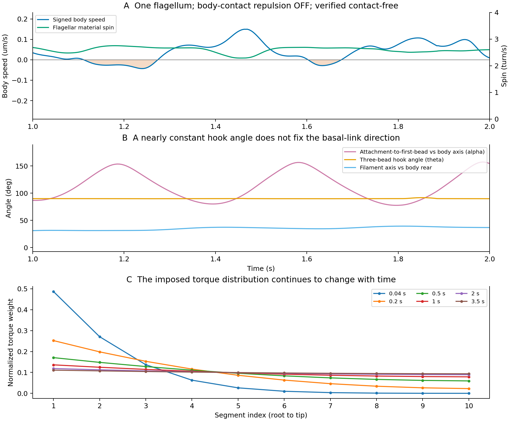

# Issue #263：接触計算とは独立した遊泳変動の原因候補

2026-10-26。接触距離修正の予約#37を待つ間の、保存archiveと実装式・一次文献による診断。**新しい物理実装・動的実行・予約は行っていない**。候補モデルの採択でもない。

## まず区別する現象

1. **菌体の前進が弱まり、停止・後退を繰り返す。**べん毛の材料点回転が継続していても起こる。
2. **べん毛そのものの回転が強く減速する。**旧#35のnf6では0.55〜0.65秒に約0.20回転/秒となった。

2の接触計算への依存は[距離修正の対照](phase2_263_segment_distance_rerun_runbook.md)で調べる。以下の新しい結果は1の独立した反例であり、nf6の減速原因を確定・否定するものではない。

## 接触なしでも前進の停止・後退は生じる

対象は#35・固定commit `71ed7529d362474235b931494af6cafcf3fe2edf`、`nf01__slots0__bfoff`。compact、べん毛1本、菌体–べん毛反発OFF、自己反発の設定はON。`run_summary.json`を先に読み、500001 step完走・全step有限性/形状FAILなしを確認。既存の共通strict QCはPASSで、summary/archive SHAを今回照合した。

修正後の線分距離関数で、productionの全有効45 segment対を全2002保存状態で再計算した。最小距離は**0.56043 µm**、反発範囲は0.2 µm。全internal step集約の最大ビーズ移動量は0.000149188 µm、保存間隔は最大250 stepだった。両segmentの端点移動を最大値で見積もる保守的な下界は

`d_internal >= min(d_saved) − 2 × 250 × max_displacement = 0.48584 µm > 0.2 µm`。

線分内の点は端点の凸結合なので、この端点移動から距離変動を上限評価できる。従って保存間隔の途中でも自己反発域へ入らない。菌体反発はOFF、異なるべん毛も存在しない。この軌道に限れば、旧距離関数が接触を見落としていたという説明を排除できる。旧記録の反発力も全stepで0だった。流体相互作用は残る。

**後半1〜2秒の診断：**

| 量 | 結果 |
| --- | ---: |
| 菌体長軸方向速度 | −0.0430〜+0.1498 µm/s |
| 平均前進速度 | +0.0400 µm/s |
| 長軸方向速度が負の時間割合 | 約23.5% |
| べん毛材料点spin | 2.287〜2.751回転/秒 |
| べん毛平均位置の菌体相対・軸方向往復幅 | 0.213 µm |
| 菌体速度と逆向き相対軸速度の相関 | 0.859 |
| attach→最初のbeadと菌体前方軸の角度α | 77.6〜157.2° |
| hookの3点角度θ | 89.81〜91.74° |
| べん毛主軸と菌体後方軸の角度 | 31.2〜39.4° |

速度・回転は1 ms保存差分、α・θ等は5 ms間隔の401保存状態再評価から得た。最小速度の時刻は約1.240秒。相関は運動学的な結びつきを示し、上流原因の因果証明ではない。

図A：回転が続いても菌体速度は負になる。図B：hookの3点角度θと、菌体に対する根元リンクの方向αは別の自由度。図C：現行motor分配重みは実際の変形・流体負荷によらず時間変化する。

## 直接の機序と、まだ分からない上流原因

現在のoverdampedモデルは`v = M(q) F(q,t)`であり、菌体が慣性で進み続ける仕組みはない。形状・相対姿勢・内部運動が変わると、回転が継続していても菌体の速度が直ちに変わる。一般には、力・トルク釣り合いを解いて得る泳動速度は、べん毛回転とhook/形状の相対運動の双方に依存する。相対運動による応答が回転による推進を打ち消す場合がある。

同じ保存座標の力を修正後engineの`step(0)`で再評価し、座標不変をassertした。`M F`による瞬時菌体速度と保存差分速度の後半RMS差は3.36e−5 µm/s。例えば1.240秒ではmotor、伸縮、曲げ、torsion、hookの菌体速度寄与はそれぞれ−0.1264、−0.1461、+0.0826、+0.0852、+0.0617 µm/s、合計−0.0430 µm/s。反発寄与は0。

これは同一形状での線形分解であり、各力を消した別軌道の予測ではない。**弾性力を消せば改善するという結論にはならない**。変形に応答する弾性力は必要であり、何がその変形・相対姿勢を励起しているかを調べる必要がある。全ビーズの算術平均位置を流体力学的中心や保存される重心とは扱わない。

### 根元の取り付けと回転の幾何整合性

もう一つの上流候補は、**回転軸から外れた最初のbeadを、長さを保つ接続で菌体へつないでいること**である。後半の最初のbeadは現行motor軸から0.198〜0.262 µm離れ、菌体付着点も同じ軸から0.0016〜0.106 µm離れる。ここでのmotor軸の直線は、現行SVD方向とべん毛bead平均位置で定義した診断上の軸であり、独立にフィットした真の螺旋軸ではない。

菌体付着点をA、最初のbeadをP、べん毛中心をCとし、接続方向を `hhat=(P−A)/|P−A|` とする。保存状態の相対角速度のmotor軸成分を `omega_spin` としたとき、剛体的な軸回転の接続長への寄与は

`length_rate_spin = hhat · [omega_spin × (P−C)]`。

Aがこの回転軸上にあればこの項は0になる。軸から外れていると、純粋な回転だけでは接続長を保てず、根元の変形・姿勢変化・相対並進が必要になる。実際の速度を並進、軸回転、その他回転、変形に分けると、この項のRMSは0.827 µm/sに対し、実際の接続長変化率のRMSは0.0571 µm/sだった。大きな成分が他の運動により相殺されている。これは同一状態の厳密な運動学的分解で、分解和誤差は最大7.5e−16 µm/s。

**この相殺の必要性は確認できたが、どの運動へ逃げるか・菌体前進への寄与をこれだけで決定できない。**曲がった実際のhookも異なる軸を接続するため、軸がずれること自体をバグとはしない。改善候補は、接続端での回転半径の縮小や短いhookの姿勢/ねじれ自由度により、入力回転を大きな相対並進なしに伝えられる関節構成である。初期位置復元を足す前に、この幾何学的な伝達条件を確かめる。根元が先細りになり接続点のらせん半径が0となる構成はRileyらのモデルにもあるが、同時に剛体らせん・回転速度指定等も異なるため、モデル全体を採用する根拠にはしない。

## 仮説と改善案の優先順位

| 優先度・仮説 | 根拠・限界 | 単独で検証する改善/対照案 | 支持・反証を見る量 |
| --- | --- | --- | --- |
| **高：取り付けと回転の幾何整合性** | 上記の接続長分解で、軸回転と接続長維持の大きな運動学的相殺を確認。点/3点の接続が大きな相対並進を要求する可能性 | 接続端の回転半径・軸位置・hook長を保つ条件を静的に監査し、短いhookや先細り端などの候補を設計。motorや物性を同時に変えない | 軸回転による接続長変化率、根元の相対並進、周期推進、非重複/初期応力 |
| **高：根元の姿勢・motor伝達の自由度** | θがほぼ90°でもαは約80°変わる。θだけからαは決まらず、motorは全鎖のSVD軸を用いる。根元の動き全てが非物理的とは未確定 | 膜側の入力軸・べん毛側の出力軸・軸の向きを変える反作用を明示し、有限の曲げ抵抗を持つhook/局所伝達の候補を設計。hook変更とmotor変更は別armにする | 根元の同位相姿勢、相対軸速度、周期前進、束幅/軸角。回転数が揃うだけでは支持としない |
| **中：時間変化するmotor分配が緩和を長引かせる** | 内部の拡散変数は実際のねじれ・回転・負荷から独立。最根元重みは0.04秒48.7%、1秒13.6%、2秒11.9%、3.5秒11.1%。総トルク一定でも空間分布は変わる。一方向の緩和だけでは周期的停止の説明は完結しない | 必要性を判断した後に、同じ正規化重みを固定した対照で時間変化の寄与を分離。重みなし/あり/腕あり3方式の比較実装は再開しない | 同位相周期統計のdrift、重み変化と根元姿勢/平均推進の関係 |
| **中：複数べん毛の流体負荷・姿勢/位相の相互作用** | 流体相互作用は排除体積OFFでも残る。nf1は菌体のstop-goの反例だが、nf6の大幅なspin減速には別の相互作用が上乗せされ得る | まず距離修正結果を読む。その後も必要なら同一保存形状でself/body/other-flag mobility寄与を分解し、動的な相互作用変更の必要性を判断 | 束の位相差・接近・hook姿勢と各spin/符号付き前進を同時刻で比較。保存状態で小さい寄与だけを根拠に流体全体を排除しない |
| **次段：離散化と力学係数の対応** | 11 beadの粗いらせん、離散的な力対と局所反作用。保存力の釣り合いが通っても、実際の回転–推進変換が妥当とは限らない | 先に同じ幾何の剛体らせんの抵抗/回転–推進応答を参照計算。解像度比較が必要なら長さ・らせん形状・連続体EI/GJを揃え、bead数だけ変えない | 位相ごとの抵抗/推進応答、変形・根元運動を抑えた極限、解像度/刻み感度 |

**単純なhookの硬化や初期位置への復元は第一案にしない。**前者は束形成の柔軟性を損ない、後者はユーザー指定の「追加位置復元処理/scaleをmerge時に削除」に反する。有限のhook弾性を提案する場合も、自然な曲げと軸回転を許す物理的関節として設計し、初期compact形状へ引き戻す罰則とは区別する。

### 今回は支持が弱かった説明

- **motor仕事の大部分がべん毛自体の変形へ逃げる：**各group（菌体/べん毛全11 bead）の速度を最小二乗剛体運動と残りに分け、motor仕事を射影した。後半の変形仕事/総仕事の平均比は約0.14%。少なくともnf1でこれが支配的とはいえない。全べん毛の首振り・相対並進はgroup剛体運動側へ入るので、それらの抵抗まで否定しない。
- **不要な横トルクだけが主因：**同じnf1の横方向相対回転への符号付きmotor仕事/総仕事は約−0.26%。これは効率でも一般的上限でもない。旧nf3の腕重み/横トルク補正の結果でもcompactとの大差はなかった。追加重み方式は低優先度を維持する。
- **回転停止と翻訳上の停止が同一：**nf1では前進速度が負になる間も回転している。nf6で観測した本当のspin減速と混同しない。

仕事分解はユークリッド最小二乗射影であり、推進効率や散逸の正定値分解ではない。平均値は符号付きで、細かい時刻の相殺を含む。分解和の誤差は最大1.54e−33 W。保存瞬時powerの1〜2秒積分と、全internal stepから記録したmotor仕事の相対差は約2.1e−6で、計算の整合性を確認した。

## 一次文献との対応

- [Watari & Larson (2010), Biophysical Journal](https://pmc.ncbi.nlm.nih.gov/articles/PMC2800969/)：hookの片側のみ働く曲げ近似は論文由来。一方、論文のmotorはhook内・隣接部で入力/出力トルクと転向トルクを構成する。現行の全鎖への拡散重み力対は同一の実装ではない。したがって「論文と同じhookならmotorも同等」とはできない。
- [Riley, Das & Lauga (2018), Scientific Reports](https://www.nature.com/articles/s41598-018-28319-8)：周毛性の束形成・推進にはhookの柔軟性と流体応答の結合が重要で、硬いhookは後方集束を妨げる。現行モデルと駆動/流体近似は異なるので、文献の閾値を直接移植しない。
- [Nguyen & Graham (2018), Physical Review E](https://doi.org/10.1103/PhysRevE.98.042419)：hook/filamentの柔らかさの安定領域は1本と複数本で異なる。nf1は接触からの切り分け用であり、nf1だけで採用物性を決めない。
- [Nord et al. (2022), Nature Communications](https://www.nature.com/articles/s41467-022-30295-7)：実験でhookのねじり負荷に伴う曲げ剛性増加を観測。柔軟性と高負荷安定性を両立する構成則の物理的候補になる。ただし今回は導入せず、まず単純な有限曲げモデルを検証してから必要性を判断する。
- [Reigh, Winkler & Gompper (2012), Soft Matter](https://doi.org/10.1039/C2SM07378A)：固定された2〜6本のべん毛でも、一定トルク下の同期・束化は本数や間隔に依存する。自由遊泳・菌体反作用を含む現行モデルへの定量的な閾値としては使わない。

## 次の判断と、今回の範囲

まず#37の距離修正1τのQC/replay、レビュー後の1秒で接触・刻み依存を切り分ける。その結果と今回の非接触nf1の診断を合わせ、**根元の物理的自由度とmotor伝達のどちらを先に変えるか**を決める。基準と単一変更armを並列化する場合も、hook・motor・分配重み・流体を同じarmで一斉に変えない。

新候補を比較する場合の主対象はIssue目的のnf3/slots024とし、nf1を接触なしの診断、nf6を複数本の負荷/干渉の確認へ使う案とする。新しい実行条件・許容変動・必要周期・予約は未確定。瞬間速度一定は要求せず、初期緩和後の完全な菌体/べん毛の周期ブロックで、正の平均前進・変動幅・後退割合・束維持を合わせて比較する。

現行torsion勾配の追加A/B、密集同位相の#271、新しい物理採択、mergeは行わない。予約#37の固定commit・条件・13:40 JSTの1回確認も変更していない。

## 再現・成果物

ローカル正本：`outputs/2026-10-26/125800/issue263_noncontact_mechanism_audit/`。`evidence_summary.json`、`saved_state_power_velocity.csv`、`motor_weight_evolution.json`、`root_length_constraint.json`、PNG/PDF、`audit.py`/`plot_audit.py`、`manifest.json`、`run.log`。解析sourceは距離修正済み`0017fbbd922997f32dbad4b40aa5af03da974c92`と同じ実装。#35からのengine、motor重み、base configの差がないことも照合した。シミュレーションの時間発展は行わず、保存状態での力評価と解析のみである。
