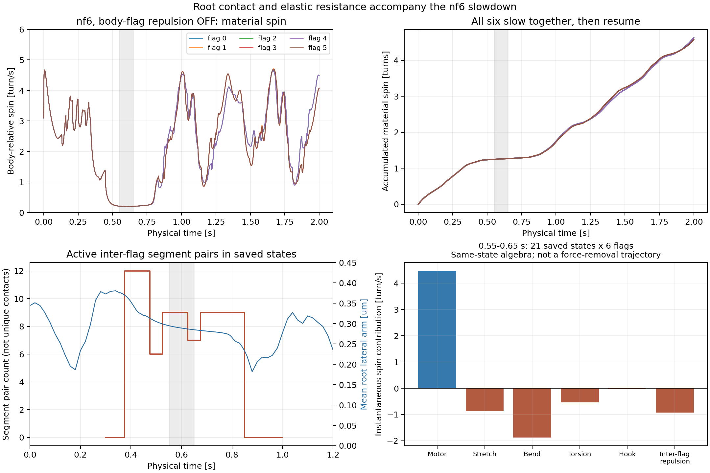
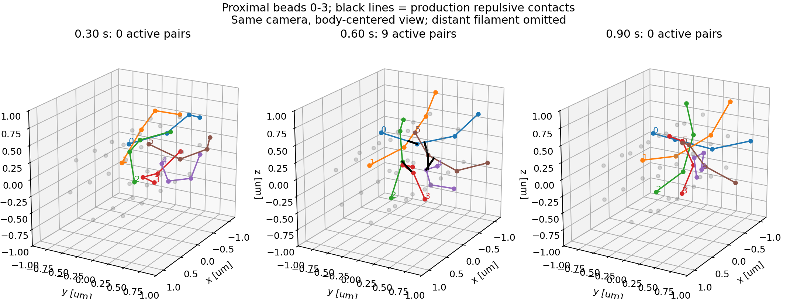

# Issue #263：菌体–べん毛反発OFFでも束が鈍る原因の監査

追記：ユーザー指示により、[距離計算の修正と再実行準備](phase2_263_segment_distance_rerun_runbook.md)まで進めた。以下は修正前#35の原因監査記録。新しい動的対照は未実行・未予約で、軌道に対する寄与の分離は引き続き未完了。

> 接触計算とは独立した菌体のstop-goの証拠と、hook/motor等の次の仮説は[非接触機序の診断](phase2_263_noncontact_mechanism_hypotheses.md)を参照。nf1の結果であり、以下のnf6減速とは区別する。

## 結論と確度

予約#35の保存結果を調べ、**nf6では菌体–べん毛反発OFFでも6本すべての材料点回転が大きく鈍る**ことを確認した。菌体の並進停止やPCA軸の表示だけの現象ではない。0.55〜0.65秒の平均は約0.200回転/秒で、その前後の約2〜4回転/秒より小さい。完全停止ではなく、一時的な強い減速である。

同時刻に、**隣り合うべん毛の根元側bead 0〜2を結ぶsegment同士が接触し、べん毛間反発と変形による弾性力がmotor駆動をほぼ打ち消す**。菌体–べん毛反発をOFFにしても、この接触と流体相互作用は残る。nf1では同程度の減速がなく、本数・配置によって変わることは複数べん毛の相互作用という仮説と整合する。ただし本数間では総motorトルクや付着位置も変わるため、本数比較だけを因果対照とはしない。

さらに**線分間距離の計算に単位依存の不具合**を再現した。反発のカットオフにも力の不連続がある。現状は「物理的に正しい束が自然に詰まった」とは判断できない。接触・弾性抵抗による直接の釣り合いは確認できたが、**物理的な接触抵抗と計算実装の寄与の分離は未完了**である。

## 対象・方法

- 固定実行commit `71ed7529d362474235b931494af6cafcf3fe2edf`、cs10予約#35。26条件完走・strict QC 26/26 PASS・portable照合は[2秒結果](phase2_263_compact_count_contact_2s_result.md)を参照。
- 今回は全13配置の反発OFFの各べん毛を走査。追加の動的simulation、予約、閾値変更はない。解析に用いた`src/sim_swim/dynamics/`、model、paramsは固定実行commitと同じ。
- 回転は共通recorderが4 µsごとに積分し1 msごとに保存した、菌体と共に動く座標系におけるlabel付き鎖のbest-fit axial spin。hook最初のbeadをfitから除く。
- 初期0.2秒を除いた100 ms窓の最小平均を診断する。新しい停止判定やQCゲートにはしない。
- nf1、nf3 slots024、nf4 slots0124、nf5、nf6の保存各177状態で、元のdiffusive重みを再構成し、production engineを`step(0)`で評価。座標が変わらないことをassertした。
- 速度は`v = M F`。各鎖と菌体に対して最小二乗の角速度を線形演算子として求め、鎖の軸へ射影した菌体相対spinを、力成分・力の作用先・流体経由に分解した。べん毛間反発と同一べん毛内反発も分離した。
- 同一座標での力の分解であり、力をOFFにした軌道や安定性の予測ではない。ここでの「寄与」は各力をmobilityに通した速度成分で、独立に測ったmotor回転速度やトルクではない。

## OFF全13配置の減速

各行は全べん毛のうち100 ms平均が最小になる鎖。flag IDは0始まり。

| nf / slots | 最小100 ms平均 [回転/秒] | flag ID | 窓 [秒] |
|---|---:|---:|---|
| 1 / 0 | 2.355 | 0 | 1.402–1.502 |
| 2 / 01 | 1.822 | 1 | 1.067–1.167 |
| 2 / 02 | 1.494 | 1 | 0.795–0.895 |
| 2 / 03 | 2.054 | 0 | 0.947–1.047 |
| 3 / 012 | 1.679 | 0 | 0.831–0.931 |
| 3 / 013 | 1.829 | 2 | 0.428–0.528 |
| 3 / 014 | 1.972 | 2 | 0.825–0.925 |
| 3 / 024 | 2.182 | 0 | 1.531–1.631 |
| 4 / 0123 | 1.152 | 2 | 0.400–0.500 |
| 4 / 0124 | 0.657 | 3 | 0.484–0.584 |
| 4 / 0134 | 1.064 | 1 | 0.799–0.899 |
| 5 / 01234 | 0.456 | 1 | 0.432–0.532 |
| 6 / 012345 | 0.200 | 0 | 0.555–0.655 |

2秒の積算回転が十分でも、nf4〜6の一部では短い窓の減速が大きい。今回走査したOFFの各べん毛では0.2〜2秒の1 ms積算差分も正だった。瞬間的なinternal-step逆行や停止まで否定するものではない。

## nf6：根元側の接触と力の釣り合い

同じcamera・菌体重心を原点とした図で、各鎖の近位bead 0〜3を表示する。黒線はproduction計算で反発が働くsegment間の最近点を結ぶ。

- 0.30・0.35秒：保存状態で異なるべん毛間の反発なし。
- 0.40秒：根元側で12 segment対が反発域へ入る。
- 0.60秒：9 segment対が反発し、全てが近位bead 0〜2のsegment。距離は約0.19985〜0.19999 µmで、カットオフ0.2 µmの直内側。
- 0.90・1.00秒：保存状態でこの反発がなくなり、回転が回復する。

segment対数は接触点数ではない。0.60秒では9対が5組の最近点を共有し、隣接segmentから同じ頂点近傍への反発が加算される。これをそのまま9個の独立した物理接触とは解釈しない。離散segmentポテンシャルとしての加算の妥当性は別の未検証項目である。

0.55〜0.65秒の21保存状態×6本の、瞬時spin寄与の等重み平均：

| 成分 | 回転への寄与 [回転/秒] |
|---|---:|
| motor | +4.470 |
| 伸縮弾性 | −0.880 |
| 曲げ弾性 | −1.872 |
| torsion弾性 | −0.532 |
| hook曲げ | −0.025 |
| 異なるべん毛間の反発 | −0.928 |
| 合計 | +0.232 |
| 保存された1 ms平均spin | +0.200 |

合計と記録spinは同じ時間分解能の量ではない。保存状態から計算した瞬時値の平均と、全internal stepから記録された1 ms平均である。反発が切り替わるため、特定の鎖・特定時刻では一致しない。今回5条件全時間の再計算値と1 ms記録値の差のRMSはnf1約0.00008、nf3約0.011、nf4約1.05、nf5約2.57、nf6約0.67回転/秒だった（0.05〜1.95秒）。**瞬時再計算を時間平均の完全な再現として扱わない**。成分和の数値誤差最大は1.49e−14回転/秒、微小仮想変位による共通rigid-fitとの線形化照合誤差は最大0.000113回転/秒である。

この窓の根元横腕は平均0.289 µm。極端な横腕縮退は必要条件ではなく、motorもOFFになっていない。他のべん毛の力が対象鎖へ直接流体を通して作るspin寄与はこの窓の保存状態平均で約−0.073回転/秒だった。流体相互作用は上流の形状形成や菌体反作用にも影響するため、これだけで全体の役割を排除しない。

ここで負のtorsion寄与があることは、解析勾配への変更が誤りという証拠ではない。変形に抵抗する既存の力成分として観測したもので、合意済みの「torsion方式の追加比較不要」は維持する。

## 接触計算で確認した問題

### 線分間距離が単位に依存する

`src/sim_swim/dynamics/forces.py::_closest_points_on_segments`は`a*c-b*b <= 1e-20`を平行扱いする。左辺の次元は長さの4乗であり、SIのµm程度の線分では非平行でもこの絶対閾値を下回る。端点から相手線分への距離にフォールバックし、内部どうしの最近点を見落とす場合がある。

再現例（座標の単位はµm）：線分1は`(-1,0,0)→(1,0,0)`、線分2は`(0,-1,0.1)→(0,1,0.1)`。

| 計算 | 最近距離 [µm] |
|---|---:|
| 幾何学的な正解 | 0.100 |
| production関数にmへ変換して入力 | 1.005 |
| 同じ関数にµm座標を入力 | 0.100 |

正解では0.2 µmの反発範囲内だが、m入力では範囲外と判定する。不具合は静的な再現例で確認できたが、**この誤りがnf6減速の全てを生んだと証明したわけではない**。距離の過大評価は接触を見逃す方向にも働き、修正後の回転の改善・悪化を事前には決められない。

### カットオフで有限の力が急にゼロになる

現行式は`d < cutoff`で`F = (A/a) exp(-d/a)`、それ以外で0。今回の係数では0.2 µm直内側の力は約**0.0460 pN/segment対**、境界では0になる。減速中の接触距離が境界直内側に集中するため、切り替えと時間刻みの影響を確認する必要がある。不連続が存在することと、その不連続が減速の主因であることは区別する。

## 次の比較案（未実装・未予約）

まず距離計算の単位依存だけを対象にし、カットオフ・hook・motor・torsion・初期配置を同時に変えない。nf6、菌体–べん毛反発OFF、べん毛間反発ON、同じcompact初期配置で以下の3条件を提案する。

1. 現行距離計算、dt=4 µs（既存#35の0〜1秒を対照として再利用可能）。
2. 単位に依存しない線分間距離、dt=4 µs。
3. 2と同じ距離計算、dt=2 µs。

0.4〜0.8秒の接触・減速・0.9秒以降の回復を含む**1秒の機序screen**とし、共通strict QC、固定camera replay、各べん毛spin、接触位置/距離/力、根元横腕を比較する。新規計算を行う場合はcs10の固定commit・parallel-job dry-run・所要時間見積りを提示する。半dtで内部step数が倍になり、条件あたり数十時間の可能性があるためMacでは動的計算しない。まず単位共変性・交差/平行/端点のtargeted testを整える。

3条件の設計・修正についてユーザー判断待ち。カットオフを滑らかにする変更やべん毛間反発OFFの動的対照はこの案に混ぜない。#271の初期配置検証、モデル採択、mergeも含めない。

## 成果物・再現

ローカル正本：`outputs/2026-10-25/221000/issue263_off_spin_audit/`。`spin_scan.json`、`force_spin.csv`、`linearization_check.json`、`contacts.json`、`evidence_summary.json`、図PNG/PDF、解析script、`manifest.json`、`run.log`を保存。解析はPR #264のworktreeのsourceを明示的に使用し、別タスクのモデルを混在させていない。生産モデルのソース変更・新しいQC・動的再実行は行っていない。
