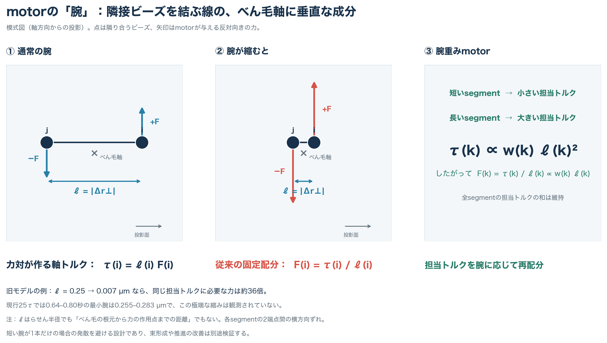
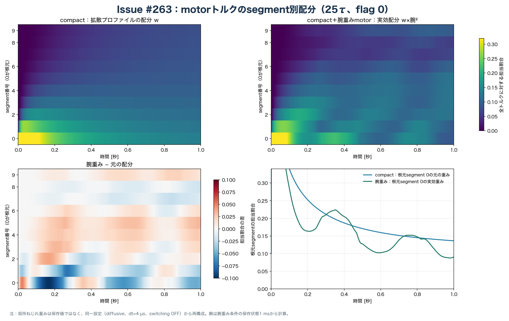

# Issue #263：束遊泳を目標にした並列仮説と次の比較

## 目的と判定の単位

第一の対象は`nf03__slots024`で、初期緩和後も後方の密な束、菌体軸との概ねの整列、べん毛の持続回転、菌体の前方推進が同時に続くことを目指す。共通`development_evaluation`のfinite/body/hook length/flag/motor QCは必要条件であり、遊泳成立の証拠とは分ける。分離配置からの自発的束形成とcanonical採択は今回の判定に含めない。

回転はflag 0の菌体相対best-fit axial spinを周期時計にする。各条件で完全周期5件以上を観測目標とし、先頭2周期を緩和、後半3周期を比較する。後半の束半径、輪郭長75%位置・先端の広がり、べん毛間軸角、束軸対後方軸角、各べん毛の積算位相差、周期平均の菌体軸方向変位・速度、菌体材料点の長軸自転を同じ時刻・周期境界で並べる。周期間の束幅または75%位置・先端広がりの変化が5%を超えたら観測延長のレビュー旗を立てる。これは物理QCの新しいFAIL閾値ではない。密な束の絶対幅、許容軸角、最低推進速度は未確定なので、現時点の結果から自動採択しない。

## 旧排除相互作用実験と現行Cの違い

先行する[#257の菌体–べん毛排除相互作用比較](phase2_257_body_flagella_contact_contract.md)は、菌体–べん毛反発のON/OFFを13配置・2秒で調べ、べん毛間反発は維持した。26条件のstrict QCは当時のmotor残差でFAILし、40 ms窓のstall候補は両群とも0で、この比較から排除OFFの遊泳改善は判定できなかった。現行#263のCとcompactは、その後の#255で評価した**菌体–べん毛反発OFF**を共通に継承する。#257の旧archiveと現行Cでは初期hook配置、motor反作用、frame・torsionの力計算も異なり、両者のreplay差を排除体積だけの効果とは解釈できない。

旧#262と現行#263は、べん毛間反発だけを変えた比較ではない。#262の2秒ON/OFFは**両方とも菌体–べん毛反発OFF**で、べん毛同士の反発だけをON/OFFにした。旧基準には有限差分torsionとlegacy frame反作用が含まれた。#255で現行Cに使う解析torsionとenergy-gradient frame反作用を導入し、局所one-ring全ベクトルmotor反作用を維持した。今回のPR #264が追加した比較候補は、Cから初期幾何だけを変えるopt-in `compact_rear`と、compactを基準にsegmentトルク配分だけを変えるopt-in腕重みmotorである。frame復元1.25と横トルク補正は#255からある設定を独立した対照として使い、排除体積の相互作用は今回変更していない。現行5条件はいずれも**菌体–べん毛反発OFF・べん毛間反発ON**である。#262の反発ON/OFF差、#255の基準モデル変更、#263の初期配置差を混ぜて滑らかな回転の原因とはしない。

**#257の実行済みモデルとCの作用上の差：**#257ではべん毛側のsegment力対が作る実トルクの軸方向成分だけを、菌体全体へ逆向きに配った。Cでは実トルクの全3成分を、付着ビーズと周囲1 ringの計5ビーズへ逆向きに配る。両者のべん毛側は拡散重みのsegment力対で、Cのmotor横方向補正はOFFである。#257の追加frame位置復元はscale 1.25なので有効だったが、Cはscale 1.0、追加tangentも1.0で、追加frame力は**ゼロ**である。Cは`energy_gradient`を設定しているものの、この条件ではその計算法と`legacy`の差は軌道へ作用しない。Cと#257のframeの実効差は追加位置復元力の有無である。torsionは同じポテンシャルを#257では有限差分、Cでは解析勾配で力へ変換する。#257のstrict motor FAILをtorsionやframeだけの効果とは解釈しない。

[#262の原因監査](https://github.com/Kenta-morimori/prj-flagella-estimation/pull/265)は、旧有限差分torsion・legacy frameを含む旧局所反作用モデルの`nf03__slots024`で、0.64–0.80秒に根元segmentの最小横方向lever arm中央値がON 0.0073 µm、OFF 0.0076 µmとなり、菌体自転が約0.16秒鈍化したと報告する。反発OFFでも起きるため、反発の有無だけでは説明できない。ただし、現行#263のCとはframe・torsionが異なる。

現行Cの保存済み#255四方式1秒archiveを、`run_summary.json`がcompleted・250,000 stepsであることを確認してからread-only再解析した。入力は`outputs/2026-10-15/161410/issue255_nf3_bundle_execution/long_source/conditions/nf03__slots024__C/state_archive.npz`（SHA-256 `e4d62670a739cda62fed9163b2d2ee387d449c0504609792d531da37f895d294`）。各保存状態の11ビーズ/べん毛からSVD第一主軸を求め、根元segment `(bead 0 − bead 1)`の主軸垂直成分の長さを3本で最小化した。10 msごとの既存`diagnostic_samples.csv`の駆動診断とも照合した。

| 現行Cの時間窓 | 最小腕の時刻別中央値 [µm] | 窓内最小 [µm] | raw横方向トルク比中央値 | 駆動力norm中央値 [N] |
|---|---:|---:|---:|---:|
| 0.40–0.60 s | 0.257 | 0.251 | 0.219 | 3.42e-14 |
| 0.64–0.80 s | 0.335 | 0.277 | 0.127 | 2.98e-14 |
| 0.86–0.95 s | 0.248 | 0.238 | 0.168 | 3.33e-14 |

したがって、旧基準の16τで見た約0.007 µmへの腕の崩壊と大きな横方向トルクは、**現行Cの同じ時刻には現れていない**。これは現行Cの長時間安定性やcompact配置での再発を保証しない。#262はmotor設計上の潜在的な特異性を示す独立証拠とし、現行候補の失速原因とは決めつけない。保存間隔1 msの腕長と10 msの駆動診断はinternal step全件の極値ではない。

## 独立に検証する仮説

| 仮説 | まず固定する対比較 | 予測・識別する量 | 現在の証拠と制限 |
|---|---|---|---|
| G：初期幾何が束維持を助ける | 同じnf3・slots024・C物理設定で旧C対compact rear | 緩和後の75%位置・先端広がり、軸角、周期形状、前進 | 1τではcompactの幅が狭いが、完全周期0。Cの1秒archiveは再利用可能。 |
| M：根元の小さい腕でmotor力が過大化し回転を阻害する | **同一のcompact初期座標**で現行segment分配対、腕が縮んでも力を発散させないopt-in分配候補 | 最小腕、segment別力、横方向トルク、菌体自転とべん毛回転、時間刻み依存 | 旧基準では有力。現行Cの16τには同じ崩壊がない。既存`minimum_norm`横トルク補正だけでは局所大力を解消しない。新候補の物理設計・数値検証が先。 |
| F：attachment frame/hookの拘束が束を開く | 同一compact初期座標でframe復元scale 1.0対1.25。必要ならhook変更を別対照にする | 根元向き・hook曲率/力、束の横方向広がり、motor腕 | #255の分離初期配置では追加frame復元が束の接近を抑えた。compact配置にも同じ効果かは未検証。hookとframeを同時変更しない。 |
| R：べん毛間反発が束の形と推進に効く | 同一の**現行候補**・初期座標で反発ON対OFF。body–flagella反発等は一致 | 反発実作用数・力、束/回転/自転/前進の同時刻差 | #262の旧ON/OFFは旧基準の自転鈍化を両armで確認しただけ。現行候補への結論ではない。OFF設定はPR #265で実装され、今回の固定実行条件には入れていない。 |
| N：観測された差が数値刻み/初期対称性に依存する | 選ばれた単一候補の`dt_star`を半減、または真のらせん位相/配置を小摂動 | QC、腕長極値、周期統計、位相差drift | 旧`phase5`は根元固定の菌体軸まわり剛体回転であり真のらせん位相ではない。感度試験は候補絞り込み後に行う。 |

Mの候補として`motor.segment_torque_distribution: arm_weighted_minimum_norm`をopt-in実装する。segmentの既存重みを`w_i`、主軸垂直腕を`r⊥,i`とし、各segmentへ配る軸トルクを`τ_i = τ w_i |r⊥,i|² / Σ_j w_j |r⊥,j|²`に変える。各segmentの力対は従来式で計算するので、**一つの腕だけがゼロへ近づく場合**はそのsegmentの力がゼロへ近づき、他の腕がトルクを受け持つ。全segmentの有効腕が失われたら明示的に失敗させる。これは重み付き力normを最小にする分配の一候補で、総軸トルクと力対のゼロ合力を保つが、横方向トルクの消失や良い遊泳を保証しない。既定`fixed_weights`、frame、hook、反発、QC閾値は変更しない。既存`minimum_norm`横トルク補正との同時指定は比較を混ぜるため拒否する。

ここでいう「腕」`ℓ_i`は、らせん半径や菌体付着点からの距離ではなく、**隣接する2ビーズの位置差をmotorが使う主軸に垂直な面へ投影した長さ**である。motor主軸はその時刻の**hook側を含む全11ビーズ**に対するSVD第一主成分であり、実際の回転運動から求めた瞬間回転軸ではない。形状診断の`estimate_flag_helix_axis`もSVD方向を用いるが、hook側の最初の1ビーズを除いた10ビーズから推定するため、変形時にはmotor主軸とずれ得る。理想的ならどちらも螺旋中心軸に概ね沿う。

図はmotor主軸方向からの投影で、2ビーズへ反対向きの力`±F_i`を置くと軸方向トルクは`τ_i = ℓ_i F_i`となる。固定重みのまま`ℓ_i`だけが小さくなると、必要な力は`1/ℓ_i`に比例して大きくなる。旧#262モデルで報告された約0.007 µmは通常の約0.25 µmに対し、同じ担当トルクなら概算で約36倍の力を要する。腕重み方式は各segmentの担当トルクを`w_i ℓ_i²`に比例させるため、**他のsegmentの腕が有効なとき**短い腕への力は小さくなる。

旧#262反発OFFの2秒archive（`outputs/2026-10-19/023732/issue262_hex_repulsion_off_2s/conditions/nf03__slots024/state_archive.npz`、SHA-256 `d4231f095b6bae36e2b2dd3245b9513728d00a8c90a32e4891242966c5482dea`）は`run_summary.json`で500,000 step完走を確認してから保存状態を再計算した。0.750秒のflag 2根元segmentは`ℓ=0.00459 µm`でも、**3Dビーズ間距離は0.56968 µm**、軸方向成分は0.56967 µmであった。2点はmotor主軸からそれぞれ0.21595、0.21796 µm離れ、方位差だけが約1.09°だった。螺旋の投影が軸を囲んでいても、隣接頂点の方位差が局所的に小さくなれば、その辺の横方向長さは短くなる。`ビーズ間距離² = 軸方向成分² + 腕²`であり、腕の縮みはビーズ間距離の縮みを意味しない。現行25τの0.64–0.80秒では最小腕が0.255–0.283 µmで、旧モデルの極端な縮みは観測されていない。模式図は実際のべん毛形状・力の絶対値を縮尺どおりには示さない。

共通QCを通ったarchiveの`bundle_rotation`には、保存状態ごとの各べん毛根元segmentの主軸垂直腕とその最小値、菌体前方軸への符号付き速度、完全回転周期ごとの前方変位を追加する。これはread-onlyの診断で、固定commitのsimulation力学やQC判定を変更しない。前方変位は各時刻の菌体前方軸へ速度を射影して積分した量で、世界座標での直線変位とは異なる。

一つのrunで物理変更を重ねない。複数armを同じ`cs10_qualified` jobで並列実行しても、各armはC/compact基準から**一項目だけ**変えた対照とする。交互作用を問う必要が出たときだけ、明示的な2因子比較を追加する。nf4～6のcompact配置は探索的な本数展開であり、nf3のG/M/F/Rの因果対比較を代替しない。

## 実行順と分岐

最初の共通ゲートは`conf/phase2_multi_run/2010_hex_nf3_mechanism_1tau_issue263.yaml`の5条件で行う。C、compact、compact+arm-weighted motor、compact+frame scale 1.25、compact+既存minimum-norm横トルク補正を同じnf3/slots024で比較する。C以外はcompactから一項目だけ変える。新しい反発OFFはPR #265の設定が現branchに入るまでは実行契約へ混ぜない。`conf/phase2_parallel/issue263_initial_bundle/mechanism_1tau_job.yaml`は独立5出力の`cs10_qualified` parallel jobで、Macのsimulationなしdry-runでは実効5 workers、数値thread各1、全条件のgeometry preflight成立を確認した。#26のnf3実測9分/armを基に、cs10の同時5条件は約10～20分を目安とするが、新motor候補の速度は未測定である。

1τのQC・replayをレビューした後の25τ checkpointとして、同じ5条件を保ちdurationだけを1秒・250,000 stepへ変えた`conf/phase2_multi_run/2010_hex_nf3_mechanism_25tau_issue263.yaml`と`conf/phase2_parallel/issue263_initial_bundle/mechanism_25tau_job.yaml`を準備した。Macのsimulationなしdry-runは5条件分離・実効5 workers・幾何成立。#255のnf3四方式1秒の実測約4時間45分を並行実行時間の粗い下敷きとするが、新motor armとcs10負荷によって変わる。これは16τの事象を覆う機序観測であり、5完全周期・定常遊泳の採択stageではない。

### 1τの共通ゲートと25τへの判断（2026-10-19）

cs10 queue #30は固定simulation commit `949560e7d339234bd7c3b788341ddc8f5814ee5c`で5/5条件・各10,000 step（0.04 s）を完走した。portable 60ファイルの集合とSHA-256をローカル同期時に照合し、各`run_summary.json`の完走を先に確認した。共通`development_evaluation`のfinite/body/hook length/flag/motor QCは5/5 PASS。固定camera 3D・2D replayは各41 frame、束・回転診断は全5条件で有効だが、完全回転はすべて0回だった。短期の最終3D frameに大きな形状破綻は見えない。証拠manifestは`outputs/2026-10-19/121100/issue263_mechanism_screen/manifest.json`、replayと診断は同directory内にある。

| 条件 | 前方軸への積分変位 [µm] | 終端前進速度 [µm/s] | 最小motor根元横腕 [µm] | flag 0回転数 |
|---|---:|---:|---:|---:|
| C | +0.02228 | +0.36079 | 0.3268 | 0.1146 |
| compact | −0.01441 | −0.81678 | 0.3382 | 0.1352 |
| compact + 腕重みmotor | −0.01376 | −0.80899 | 0.3374 | 0.1343 |
| compact + frame復元1.25 | +0.00893 | +0.01596 | 0.3386 | 0.1112 |
| compact + 横トルク補正 | −0.00964 | −0.72738 | 0.3381 | 0.1353 |

前進速度は各時刻の菌体前方軸への符号付き射影で、積分変位は保存状態1 ms刻みの台形積分である。compact・腕重みmotor・横トルク補正は約0.01 s後に後退へ転じ、frame復元は終端でほぼ停止した。速度の大きさだけではこの差を見落とす。いずれも初期過渡であり、持続的な後退、定常推進、M/F仮説の採否は判定できない。この窓のmotor横腕は全条件で0.32 µm以上で、#262旧基準の約0.007 µmへの崩壊もまだ観測していない。

このQC・replayと限界を踏まえ、ユーザーは同じ5条件の25τ並列観測を選択した。25τでは速度の符号、根元腕・駆動力・トルク、菌体自転、回転位相、束幅・軸角を同じ時刻で比較し、特に旧基準の16τ付近と後半の挙動を確認する。結果を見て2秒以上の継続条件を決める。

25τのMac/cs10双方のsimulationなしdry-runは、job SHA-256 `10ef80c16724a607b131dc463510c1b3ad34a1ae0c52d769ac76cde051ee379e`、multi-run config SHA-256 `3394cced62d315a93e91e397069b35387d6379774be37cf8ccde6f32cab611c7`で一致し、5出力・実効5 workers・各thread 1・幾何preflight成立を確認した。cs10 queue #31は固定commit `86730223478058e002c9ac5fe9947fa96ff22d32`、`mechanism_25tau_job.yaml`で予約され、2026-10-19 12:18 JSTにはrunningだった。既存dispatcherを利用する。2秒stageは25τのQC・replayと機序診断をレビューするまで未予約とする。

### 25τの観測結果（2026-10-19）

queue #31は予約した固定commitで5/5条件・各250,000 step、1.0秒を完走し、job集約もcompleted、失敗条件0だった。cs10からportable 60ファイル（19,988,647 bytes）をローカルへ同期し、ファイル集合・SHA-256全件一致を確認した。各`run_summary.json`の完走・オンラインfinite/body/nonbodyを先に読み、共通`development_evaluation`のfinite/body/hook length/flag/motor QCは**5/5 PASS**。固定camera 3D/2D replayは各41 frameで、3D中間・終端を目視した。終端の3本はなお広がっており、2D投影は菌体像が支配的で、2Dだけから束形状は判定できない。根拠のmanifest、replay、周期別CSV、菌体材料点の自転時系列は`outputs/2026-10-19/171000/issue263_mechanism_25tau/`に保存した。

| 条件 | flag 0積算回転 | 完全周期1・2の前方変位 [µm] | 全1秒の前方変位 [µm] | 終端束半径 [µm] | 終端べん毛間平均軸角 |
|---|---:|---:|---:|---:|---:|
| C | 2.519回 | +0.0111, −0.0211 | +0.1722 | 0.755 | 22.7° |
| compact | 2.685回 | −0.1194, −0.0026 | +0.0335 | 0.692 | 10.0° |
| compact + 腕重みmotor | 2.647回 | −0.1202, −0.0034 | +0.0306 | 0.695 | 10.9° |
| compact + frame復元1.25 | 2.274回 | −0.0762, +0.0417 | +0.0465 | 0.651 | 28.5° |
| compact + 横トルク補正 | 2.691回 | −0.1232, −0.0064 | +0.0359 | 0.704 | 9.8° |

前方変位は各時刻の菌体前方軸への符号付き速度を積分した量である。全条件で後半0.8–1.0秒は前進したが、この区間は1周期未満である。Cの全1秒変位は大きいものの、完全周期2件の変位は符号が揃わず、最後の不完全周期の寄与が大きい。compact系はCより終端束半径と軸角が小さい条件もあるが、周期前進がまだ一定でない。2周期の境界で輪郭長75%位置の広がりも大きく変わり、目標の「緩和後5完全周期・後半3周期比較」に届かない。

| 条件 | 完全周期1・2の周期 [秒] | 0.8–1.0秒の軸角中央値 | 1秒の菌体材料点自転 [回] |
|---|---:|---:|---:|
| C | 0.373, 0.370 | 34.8° | 0.776 |
| compact | 0.362, 0.372 | 20.0° | 0.836 |
| compact + 腕重みmotor | 0.365, 0.383 | 20.9° | 0.833 |
| compact + frame復元1.25 | 0.399, 0.439 | 36.9° | 0.711 |
| compact + 横トルク補正 | 0.349, 0.379 | 19.8° | 0.841 |

終端1時点の軸角だけでは後半の束形状を代表できない。特にframe復元条件は終端束半径が最小でも、後半の軸角中央値は最大である。

| 条件 | 0.64–0.80秒の最小motor根元横腕 [µm] | 同窓の菌体材料点自転 [回] | 同窓の前方変位 [µm] |
|---|---:|---:|---:|
| C | 0.277 | +0.131 | +0.0289 |
| compact | 0.275 | +0.145 | +0.0449 |
| compact + 腕重みmotor | 0.261 | +0.146 | +0.0423 |
| compact + frame復元1.25 | 0.255 | +0.140 | +0.0384 |
| compact + 横トルク補正 | 0.283 | +0.147 | +0.0446 |

菌体自転は保存状態1 msごとに、菌体中央ringのbead 0を同ring中心から見た材料ベクトルとして取り、ring 0→4中心軸に垂直な平面へ投影し、lab y基準の角度をunwrapして求めた。ring 0・2・4で全1秒の積算自転は各条件とも0.02回以内で一致した。各条件の0.64–0.80秒の自転は正方向に継続し、同窓の保存状態のmotor根元横腕は0.25 µm以上だった。旧#262モデルの約0.007 µmへの腕崩壊と0.16秒の自転停滞は、この現行5条件では再現しない。ただし1 ms保存間隔より短い内部stepの極値は見えない。

この5条件では腕重みmotorと横トルク補正はcompact単独からの大きな改善を示さず、frame復元は回転を遅くしつつ、終端の軸角を大きくした。この結果だけで物理候補を採択しない。次の観測時間・対照を決める前に、束の分離、周期前進の変動、frame/hook拘束、反発ON/OFFをどう切り分けるかをレビューする。反発OFFはPR #265の設定が現行モデルへ入った後、同一モデル・初期条件で単独比較する。

#### segmentトルク配分の時系列可視化

queue #31のcompact単独とcompact＋腕重みmotorの保存済み1 ms状態、各`run_summary.json`の完走を入力とした。共通の局所ねじれ重み`w_i`はarchiveに保存されていないため、同じ`diffusive`規則・内部刻み4 µs・switching OFFから再構成した。腕重み条件の保存座標から各時刻の主軸垂直腕`ℓ_i`を求め、実効担当割合`q_i = w_i ℓ_i² / Σ_j w_j ℓ_j²`を計算した。図の左上はcompactの`w_i`、右上は腕重み条件の`q_i`、左下は`q_i-w_i`、右下は根元segment 0の担当割合である。異なるrunの保存形状を使うため、この差は**配分方式に加えて軌道差も含む**。直接記録された内部stepごとの力ではなく、保存状態からの再構成値である。

flag 0の根元segment 0の平均担当割合はcompact単独0.214、腕重み条件0.187で、差は−2.69百分率ポイント。10 segment全体の担当割合の時刻別total variationは中央値0.075、最大0.138。腕重み条件の根元腕の保存状態最小は0.246 µmで、旧#262の約0.007 µmへの崩壊はこの1秒にない。**compact単独でも**flag 0は1秒で2.685回転、菌体材料点は0.836回自転し、1 ms保存間隔では回転方向の反転が見えなかった。腕重み条件は2.647回転、0.833回自転で、持続回転のために腕重みを加える必要性はこの窓から示せない。一方、両条件の完全周期別前方変位は安定して正になっておらず、滑らかな回転を定常遊泳の成立と同一視しない。再構成したCSV・要約・入力/出力SHA-256のmanifestは`outputs/2026-10-19/171000/issue263_mechanism_25tau/weight_visualization/`に置く。

#### べん毛間の排除体積に相当する反発

この25τの5条件と続く3.5秒の5条件では、`conf/sim_swim_2010_hex.yaml`の`spring_spring_repulsion`（`A_ss_over_T=1.0`、`a_ss_over_b=0.2`、`cutoff_over_b=0.2`）を共通に使う。`b=1.0 µm`なのでcutoffは**0.2 µm**。multi-runのoverrideは`body_flagella_enabled=false`だけである。実装のsegment pair選別ではbody–bodyを除外し、body–flagellaを無効化し、**flagella–flagellaを有効**にする。hookを含む非body segmentもこの分類に入る。したがって「べん毛間反発ON・菌体–べん毛間反発OFF」が5条件共通の実行設定であり、現行5条件の差は反発ON/OFFの効果を示さない。

| 条件 | 全stepの異なるべん毛のbead間最短距離 [µm] | 近接bead pair数の最大値 | flag bead平均の実反発力・全step最大 [pN] |
|---|---:|---:|---:|
| C | 0.199955 | 3 | 0.0290 |
| compact | 0.199982 | 3 | 0.0290 |
| compact + 腕重みmotor | 0.199986 | 3 | 0.0290 |
| compact + frame復元1.25 | 0.199958 | 3 | 0.0290 |
| compact + 横トルク補正 | 0.199978 | 3 | 0.0290 |

数値は各`run_summary.json`の全step極値で、同時刻の値とは限らない。`flag_flag_close_pair_count`は**異なるべん毛のbead間**でcutoff未満の数、`F_repulsion_mean_flag`は実際に計算したsegment反発力のflag bead平均であり、後者はべん毛間成分だけに分解されていない。力はcutoff未満で有限の指数関数型となる**軟らかい反発**で、幾何学的な非貫通を厳密に保証するhard-core制約ではない。接触が持続した時間や反発の遊泳への因果効果は、この極値とON共通の5条件からは判定できない。反発OFFの単独対照は、同じ現行モデル・初期条件・他の相互作用設定で別途比較する。

### 次の複数周期観測と定性replay

25τの結果を踏まえ、ユーザーは十分な回転周期の観測と定性replayの生成を指示した。最も遅かったframe復元条件の第2完全周期は0.4395秒だった。先頭2周期を緩和として除いて後半5周期程度まで余裕を持つよう、**3.5秒＝87.5τ、875,000 step**を次の固定長checkpointとする。この周期外挿が成立すれば約8回転だが、周期が変化すれば達成周期数を実測し、足りない場合は延長をレビューする。時間延長だけで束形成を期待・採択せず、同一時刻の束幅、軸角、周期前進、菌体自転、根元腕を確認する。

`conf/phase2_multi_run/2010_hex_nf3_mechanism_3p5s_issue263.yaml`と`conf/phase2_parallel/issue263_initial_bundle/mechanism_3p5s_job.yaml`は25τと**同じ5条件・同じ物理設定・同じ初期配置**を保ち、時間とそれに伴う評価契約だけを延長する。C、compact、compact＋腕重みmotor、compact＋frame復元、compact＋横トルク補正はそれぞれ独立出力で、`cs10_qualified`を用いる。25τの実測14.6–14.9 step/sから並列wallは約16.3–16.7時間、負荷余裕を含め17時間以上を見込む。Macではsimulationなしdry-runのみ実施する。

25τarchiveから既に101 frame・100 fps・固定camera・共通視野の3D grid replayを`outputs/2026-10-19/171000/issue263_mechanism_25tau/qualitative_replay/grid_swim3d.mp4`に追加した。平均べん毛軸を重ね、回転と束の開閉を目視しやすくする。3.5秒の完走後もまず各`run_summary.json`、共通QC、標準の固定camera 3D/2D replayを確認する。QC-PASS archiveには同じ共通視野の**176 frame・50 fps（約0.02秒/描画frame）**の3D/2D replayを別途生成する。さらに各条件単独の3D replayで交差・接近・絡みを確認し、映像が示す幾何と数値上の接触・軸角を区別する。2D投影は現状では菌体像が支配的であり、べん毛が見えない場合は3Dの補助に留める。映像は科学的採択の代わりにしない。

1. 既存archiveのprovenance・診断を再利用し、現行Cの1秒と今回のcompact 1τを基準にする。現行Cでは旧16τ腕崩壊が再現しなかったため、compactを少なくとも25τ（1秒）観測し、腕長・駆動力・トルク・菌体自転・束形状・推進を同時刻で確認する。Mのopt-in候補は静的力対と1-stepのtargeted testを通したうえで1τへ進め、Rの設定はPR #265との重複実装なしに取り込む方法を確定する。
2. 新しい物理armを含むbounded `short_screen`では、各armの静的preflight、共通strict QC、固定camera 3D/2D replayを先にレビューする。新候補のFAILを隠すためにQC閾値を緩めない。#262の16τ事象を検査するdynamic windowは**25τ以上**とし、1τだけの結果からM/Rを否定しない。必要なら1τの数値ゲートを別に置く。
3. short-screenで問題のないarmだけを長時間stageへ進める。2秒＝50τは最初の観測checkpointであり、5完全周期に届かない、後半の形状が変化し続ける、または自転・推進の停止が残る場合は達成を宣言しない。次の延長時間は実測周期から決める。

既存`2010_hex_nf3to6_bundle_2s_issue263.yaml`は未予約の候補として保持する。上の仮説対比較と25τの診断条件を定める前に、それを自動的に開始する根拠にはしない。Issue targetは`cs10_user_run`、Macで長時間simulationを行わない。独立2条件以上はcondition別出力の`cs10_qualified` parallel jobとdry-runを使い、固定commit・範囲・実測に基づくwall timeを記録する。

## 3.5秒・約8〜9回転の観測結果（cs10予約 #32）

予約 #32 は固定commit `fbfac59ae2628cbec853377909f39f6844fda513`、5条件各875,000 stepで2026-10-20 18:28 JSTに正常終了した。job集約もcompleted、failed 0。portable 60ファイル（68,216,676 bytes）をローカルへ同期し、cs10とのファイル集合・SHA-256全件一致を確認した。各`run_summary.json`を先に読み、5条件とも3.5秒完走、step連続、オンラインfinite/body/nonbodyにFAILなし。共通`development_evaluation`のstrict QCは**5/5 PASS**。標準固定camera 3D/2D replayは各41 frame、定性評価用の共通視野3D/2Dと条件別3Dは計7本、各176 frame・50 fpsを生成し、実frame数・SHA-256を確認した。2D投影は今回も菌体像が支配的なので、べん毛の形状判断には3Dを使う。

| 条件 | flag 0回転数／完全周期 | 菌体材料点自転 | 全3.5秒の符号付き前進 [µm] | 後半6周期の周期長平均・CV [s, %] | 後半束半径中央値 [µm] | 後半べん毛間軸角中央値 [°] | 根元腕最小 [µm] |
|---|---:|---:|---:|---:|---:|---:|---:|
| C | 9.259／9 | 2.997回 | +0.566 | 0.383, 4.9 | 0.689 | 29.8 | 0.215 |
| compact | 9.487／9 | 3.050回 | +0.344 | 0.370, 2.2 | 0.661 | 27.4 | 0.250 |
| compact＋腕重みmotor | 9.408／9 | 3.035回 | +0.339 | 0.373, 3.2 | 0.674 | 27.7 | 0.246 |
| compact＋frame復元1.25 | 8.130／8 | 2.827回 | +0.358 | 0.432, 7.3 | 0.605 | 22.9 | 0.182 |
| compact＋横トルク補正 | 9.495／9 | 3.059回 | +0.345 | 0.370, 2.1 | 0.671 | 27.7 | 0.253 |

後半はflag 0の第3〜8完全回転を共通比較した。終端archiveが通常の最終sampleと約`7e-11 s`差で同じ位相を再記録しており、従来の周期診断はこれを停止と誤判定して周期表を空にした。解析器を、同位相・ほぼ同時刻の重複だけ除外するよう修正し、targeted test後にarchiveだけを再解析した。物理計算と予約条件は変えていない。

べん毛が約3回転する間に菌体材料点がほぼ1回転し、前進も3周期程度で繰り返す。そのためflag 0の第3〜5周期と第6〜8周期を、それぞれ約1回の菌体自転を含む同位相に近いブロックとして比較した。前方変位はcompactで`+0.1523→+0.1532 µm`、腕重みで`+0.1476→+0.1497 µm`、横トルク補正で`+0.1589→+0.1551 µm`と近い。各ブロックの菌体材料点自転は0.96〜0.97回。Cは`+0.2047→+0.1815 µm`で束半径平均が`0.739→0.661 µm`へ変わり続けた。frame復元は`+0.2784→+0.1151 µm`、束半径平均`0.660→0.560 µm`、周期CVも7.3%で、この窓では同じ繰返しに収まっていない。

**単一べん毛周期の前進は常に正ではない。**compactの第3〜8周期の前方変位は`+0.1572, +0.0010, -0.0059, +0.1518, +0.0009, +0.0006 µm`で、3周期単位の平均推進が正である。腕重み・横トルク補正はcompactと束幅・周期・平均推進に大差がなく、この観測から追加motor補正の必要性は示せない。全条件で根元腕は旧#262の約0.007 µmまで縮まず、菌体材料点自転も継続した。

固定camera 3Dの中間・終端では各べん毛が後方に伸びつつ色別の鎖として分かれて見え、密な一本の束、接触・絡みの持続は確認できない。軸角と75%輪郭位置の広がりも残る。初期対称性があるため、3本の回転数が揃うことを自発同期の証拠にしない。compact系は後半の**約2回の菌体自転**で形状・3周期平均推進が比較的近いが、この長さだけで長時間定常性やモデル採択を宣言しない。追加位置復元の計算処理とscale設定はユーザー判断に従いPRマージ前に削除し、歴史的profileへの影響を整理する。新たな物理変更・次のjobは結果のユーザーレビュー後に決める。証拠の正本は`outputs/2026-10-20/184200/issue263_mechanism_3p5s/manifest.json`、周期・菌体自転・符号付き推進は同rootの`bundle_rotation/`と`analysis/`に置く。

### 軸一定と進行・停止・後退の原因監査

ユーザーは回転数を十分と判断し、軸が一定のまま進行と停止を繰り返す挙動の原因調査を指示した。Cとcompactの保存座標各351状態を使い、元の拡散motor重みを復元し、時間を進めずに各力とRPY mobilityを再評価した。新しいsimulation・torsion計算法比較は行っていない。[監査図](figures/issue263_stop_go_audit.png)と、ローカルroot内`stop_go_audit/manifest.json`に入力・出力hashと再実行scriptを保存した。

**軸一定の原因は初期・駆動条件の完全な120°対称性である。**3本がslots024・同位相・同トルク、Brownianとmotor切替はOFF。compact全archiveの120°回転＋ビーズ番号交換の対称誤差は最大RMS `1.15e-13 µm`、菌体軸の横成分は最大`1.12e-13`だった。コードに軸固定の拘束はなく、この決定論的な対称条件では横方向の力・首振りが相殺され続ける。自然な揺れや非対称初期条件への頑健性はこの実行では評価していない。

**停止に見える挙動は実際の重心速度変動で、回転は止まっていない。**compactの1〜3.4秒では菌体軸方向速度が`−0.626〜+1.037 µm/s`、べん毛の菌体相対best-fit spinは`2.03〜3.58 Hz`、菌体材料点自転は`0.399〜1.238 Hz`だった。根元腕の崩壊やmotorのON/OFFはない。べん毛群の平均位置は菌体に対して軸方向に0.176 µm往復し、その相対速度の逆向きと菌体速度の相関は0.939。全ビーズ平均位置の速度変動の標準偏差0.141 µm/sに対して、菌体単独では0.365 µm/sで、内部の相対運動による菌体の押し引きが速度変動を大きくしている。ただし全ビーズ平均は診断用の算術平均であり、物理的な流体力学中心とは解釈しない。

保存状態での線形分解`U_body = body平均(M F)`は、compactの保存座標差分速度を絶対誤差中央値`4.05e-5 µm/s`で再現した。これは同じ形状・mobilityに対する成分分解であり、個別力を消した動的対照ではない。compactの2.83秒ではmotor・spring・bend・torsion・hookの速度寄与がそれぞれ`+0.072, +0.026, −0.521, +0.334, +0.088 µm/s`となり、合計`−0.0013 µm/s`へ相殺した。1.92秒は`+1.033 µm/s`、2.64秒は`−0.603 µm/s`。この3状態の反発力の速度寄与は0で、停止を単純にべん毛衝突で説明することはできない。剛体回転・並進を加えた6状態では総力の回転共変誤差が最大`8.2e-13`、軸方向速度差は最大`5.6e-14 µm/s`であり、世界座標での菌体の向きだけを変えても速度は変わらなかった。

直接の機序として、**べん毛群が形状と根元姿勢を変え、弾性力と流体応答が周期的に菌体を押し引きしている**ことを支持する。compactのattach→first対菌体軸角は1〜3.4秒に93.7〜175.8°、根元の軸方向相対位置は−0.247〜−0.015 µmを動いた。初期90°は時間発展中の拘束ではない。未束化の各らせんの首振り・変形、hookの自由度、分布motor力による変形励起が上流候補だが、どの要素がこの大きな往復運動を生むかの独立した因果分離はまだない。腕重み・横トルク補正でも同様の速度変動が残るため、これらの追加だけで解消したとはしない。今後は時間延長よりこの共通機構の検証を優先し、hook/motor/離散化の変更は根拠と単独対照を示して判断する。約3周期での再現性は現象の記述であり、その挙動が目的に適うという採択根拠にはしない。
