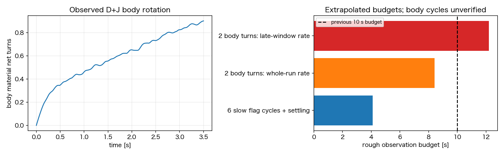
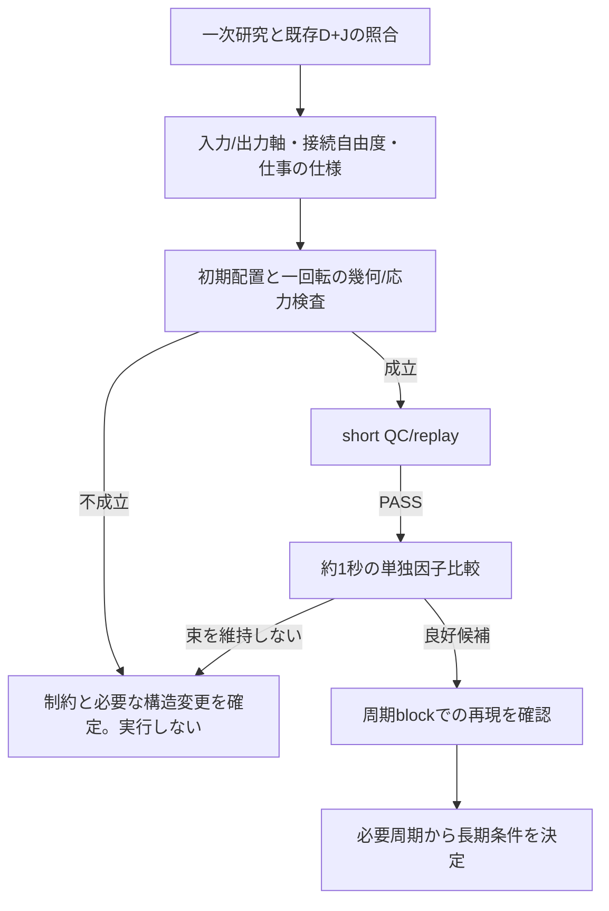

# Issue #263：観測長の根拠、外部研究、次の検証方針

2026-11-11 research完了後：[接続researchの統合・具体的修正案・次の比較条件](phase2_263_connector_research_synthesis.md)を最新の設計正本とする。相対位相の仕事から導くMと内部変形Kの2×2を未採択案として具体化した。同じJの独立軸spin幾何は成立したが、近束Gは未成立のまま。以下の「動的条件未凍結」は当時の状態で、最新案もproduction解析力・共通QC/replay・ユーザーレビュー前には実行しない。新規予約は保留。

2026-11-11後続調査。**10秒を既定の実行長にしない。先に接続の回転成立性と、全体の軸整列/内部変形を区別する静的benchmarkを完成させる。K×Gの4条件は、その成立後に凍結する候補枠であり、今すぐ予約できる計画ではない。** 新規の時間積分、cs10接続/予約/開始、物理source/config変更・モデル採択は行っていない。

この文書を今回の方針の正本とし、[直前のK/G案](phase2_263_dj_bundle_cause_and_november_plan.md)は根拠と設計経緯として保持する。D+Jを比較基準とし、過大な局所力を持つ旧segment力対へ戻さない。T、dt、粘性を使った探索、torsion方式の追加比較、一般的な重み3方式比較は増やさない。

## なぜ10秒としたのか、何に必要なのか

前案の8〜10秒は、D+Jの全3.5秒における菌体材料点net回転.902回から、2菌体回転へ粗く外挿した**計算予算**だった。論文由来の普遍的な条件ではなく、束が崩れている候補を10秒まで延ばす理由にもならない。

| 観測量 | 既存D+Jの値 | 解釈 |
| --- | --- | --- |
| 初期2flag周期を全鎖で終える時刻 | .644秒 | 既存候補の緩和除外目安であり、新候補で固定しない |
| 後半の最も遅いflag完全周期 | 最大.576秒 | 同じ周期なら6周期は約3.46秒、緩和分を含む目安は約4.1秒 |
| 全区間の菌体net回転率 | .258回/秒 | 2回の外挿は約7.76秒、緩和分を含めて8〜10秒と見積もった根拠 |
| 1.5〜3.5秒の菌体net回転率 | .173回/秒 | 同じ外挿では約11.56秒、緩和分を含め約12.2秒へ変わる |

菌体の位相は単調でなく、後半にも負の増分がある。後者2行は**測定済み周期ではない**。単一のnet回転率から十分な観測長を決めた前案は粗く、10秒の十分性は保証できなかった。新候補の周期/遅い変動を測ってから長さを決める。

非単調な瞬間増分だけで周期なし/FAILとはしない。周期抽出は材料点の正味巻き数と同位相への復帰を使い、閾値近傍の小さな往復を重複周期に数えない。現在のD+Jは3.5秒全体でも菌体net自転が1回未満で、そもそも2完全周期分のcoverageがない。今後の候補にも「全sampleで位相が単調であること」を新しい採択要件として加えない。



| Stage | 長さの決め方 | 何を判定するか |
| --- | --- | --- |
| 実装QC | 従来の1τ=.04秒 | 共通strict QC、初期崩壊/交差/実装異常。成功模型の採択はしない |
| 機序比較 | 初回は約1秒を候補予算とする | .217/.650秒付近の軸逸脱・接続負荷の時系列。1秒で定常性は判定しない |
| 候補の周期比較 | まず約3.5〜4秒級を周期率から見積もる | 近束維持・各鎖の緩和後完全周期・周期block推進が成立する候補を絞る |
| 最終の長期確認 | 成立候補1種類だけ、最も遅い有意な周期から再設計 | 束/周期/推進の反復性、初期摂動、数値感度。10秒固定や自動延長をしない |

既存の「各鎖6周期・菌体2自転」はprojectの受入**案**で、自然法則ではない。今回勝手に削除して合格扱いにはしない。周期が成立する候補で、概念上は `t_end >= t_settle + max(6 P_flag, 2 P_body)` を基準にし、もっと遅い変動がある場合は追加の根拠を示す。菌体が単調に回らず周期自体を定義できない場合は、net率の逆数を周期と呼ばない。要求を別の長時間統計へ置き換えるなら、理由を示した上でユーザー判断とする。

## 外部研究は何に有効だったか

専用の外部researchサービスへ依頼したものではなく、一次論文を横断して、境界条件・自由度・構成則・駆動方式を現行codeへ照合した。paperの成功値をそのまま輸入する用途には使わない。

| 一次研究 | 確認した要点 | 今回の判断への反映 |
| --- | --- | --- |
| [Watari & Larson 2010](https://pmc.ncbi.nlm.nih.gov/articles/PMC2800969/) | hook近傍に入力/出力/転向torqueを配置する有効模型 | Dの純出力torqueだけで接続の転向作用を表したとはみなさない。片側hook自体をバグと呼ばない |
| [Reichert & Stark 2005](https://www.damtp.cam.ac.uk/user/gold/pdfs/teaching/FDSE/ReichertStark05.pdf) | 2剛体helixの同期には有限の固定端complianceが重要。硬い固定の極限では同期が消える | 軸を固定して映像を揃える対処は採択しない |
| [Rileyら2018](https://www.damtp.cam.ac.uk/user/lauga/papers/151.pdf) | hook弾性と流体応答の結合が姿勢/推進を変える | hook/接続の安定性を流体と切り離して判断しない。論文の回転速度指定や剛性閾値を移植しない |
| [Ishimoto & Lauga 2019](https://pmc.ncbi.nlm.nih.gov/articles/PMC6545053/) | 回転が支配的で推進が乏しいmodeと、並進を伴うmodeを区別 | 回転数の増加だけを成功にしない |
| [Chamolly & Lauga 2020](https://arxiv.org/html/2011.08716v1) | 直接の鎖間流体結合に加え、菌体運動を介する結合が束化に寄与。広い分離では後者が重要になり得る | 前回のmotor-only・他鎖寄与の小ささだけで「流体結合不足」と結論しない。swimming frame・body応答を含むbenchmarkを優先する |
| [Tătulea-Codrean & Lauga 2022](https://www.damtp.cam.ac.uk/user/lauga/papers/210.pdf) | 同期の速さはcomplianceに対して単調でなく、モデル内で最適域を持つ | Kを「硬くすれば正しい」という修正として採択しない。近位変形への限定対照とする |
| [Olson, Lim & Cortez 2013](https://www.math.tulane.edu/~cortez/Prints/OlsonLimCortez2013.pdf) | 自然形状と材料のbend/twist応答を分けたdirector付きrod模型 | 近位の自然角と応答を分けて仕様化する根拠。ただし今すぐ全模型をrodへ置換する案ではない |

[Doniniら2026 preprint](https://www.biorxiv.org/content/10.64898/2026.05.26.727843v1)もspinとprecessionの区別を示す追跡対象にした。本文を取得できずabstractのみで、査読済みの結論や変更の唯一の根拠にはしない。周期的な首振りを全て異常とすることも避ける。

これらは各々、固定端・剛体helix・球状菌体・SBT/特異点法・速度指定等が現行と異なる。とくに2022の無次元complianceを現行kbやKの倍率へ直接代入しない。文献調査が有効なのは、**捨てるべき短絡と、動的実行前の検算を具体化できるため**である。

## 今回追加した静的検証：Kの役割を限定する

既存D+J初期形状で、1本のflag全体を最初のbeadの回りに±.1°/±1°傾けた。3本それぞれについて、共通production線分clearanceがPASS、hook/反発力0、受動力ノルムは丸め誤差の約2.5〜5.1e−26Nだった。Kの正規化曲げ式を加えても同様だった。時間積分はしていない。

これは、剛体回転では内部のbond/bend/torsionが変わらず、hookが片側抵抗の非作動域にいるためである。**Kは近位の変形を変えるが、flag全体の傾きに対して新しい復元力を生まない。** 前回の接線剛性1/28という数学的結果は正しいが、それだけから「全体首振りの原因」「Kが主要解決策」とは言えないことを、有限の仮想変位で確認した。

この自由度の存在を直ちにバグとはしない。柔軟なhookと流体の結合が整列を作る可能性があるため、必要なのは自由度を消すことではなく、**保持すべき自由度とtorque/流体による安定化が整合するかの検証**である。新しい軸固定力や初期frame復元力は加えない。

## Gの幾何検証：初期成立と一回転の成立を分ける

近位3区間・各.58µmで、付着点・最初のbead/hook長・遠位らせん/位相を保持し、遠位軸半径.24/.26/.28µmと軸方向並進−.1〜−.4µmの12幾何族を探索した。第一関節を球面、第二関節を二球の交線上に置くためbond長は構成上維持する。body非侵入の保守的距離下界と角度の非縮退を検査した。

局所探索ではflag0/1の経路は得たが、flag2を含む全3本の初期候補は得られなかった。SLSQPの3初期seedによる再探索、body中心凸包の支持平面下界への変更でも全3本は未成立。**有限の探索/保守的証明条件で見つからなかった結果であり、G全体の不可能証明ではない。** globalなpreflight合格や候補完成を報告しない。

さらに、曲がった近位部を含むflag全体を遠位軸回りに剛体回転させる解釈では、根元が軸から外れる。根元の軸からの距離A、付着点の軸からの距離B、軸方向差Dを使うとhook長の範囲は

```text
L_min = sqrt(D^2 + (A-B)^2)
L_max = sqrt(D^2 + (A+B)^2)
```

となる。このG族では最短.250µm、最長は軸半径.24/.26/.28µmに対し**.767/.727/.688µm**。現行FENE域.225〜.275µmを大きく外れる。これは**Gを剛体回転する曲がった一本の軸と解釈する案を除外**する検算で、柔軟な接続による回転伝達そのものの不可能証明ではない。

従って、初期だけ近づいた形状を作ってlongへ出すと、J以前の偏心hook長競合を再導入し得る。Gには「初期非重複/幅」に加え、「回転中も長さ/応力を両立できる接続機構」が必要。必要なら付着位置、prefixの離散化/長さ、局所転向torqueの定義を個別に見直す。これらをGという名前の中へ隠して一括変更しない。#271の同位相配置を自動で取り込まない。

## 修正後の優先順位と動的比較への入口



1. **接続と姿勢のbenchmarkを優先する。** body側入力軸、flag側出力軸、転向torqueをどこへ返すか、spin/首振り/仕事の定義を固定する。Dの特異性回避は維持し、全体の横トルクを0にすることと、物理的な転向作用を欠かしてよいことを混同しない。
2. **幾何は初期と360°の両方を検証する。** 付着/長さ/位相を固定した条件で成立するかを先に調べ、成立しなければ必要な変更を明示する。自然角を実行中の形状へ追従させない。
3. **Kは内部変形への因果対照として保持する。** 必要性はglobal tiltの無抵抗方向を踏まえて判断する。最初から正しい模型として組み込まない。
4. **bodyを介する流体応答を含める。** motor-only forceのblock分解と、force/torque-freeな全体系の間接相互作用は別である。body blockや力成分を消した値を実軌道と呼ばず、拘束/力学referenceとして検算する。

動的条件を凍結する前に、接続の360°回転、保存則と仮想仕事、bodyを含む流体referenceを検算する。現DのTはflag側への出力torqueであり、新しい入力/転向模型でもT固定の意味を黙ってmotor入力へ変更しない。入力/出力/転向torqueの和が0になるだけでは十分でなく、仕事と接続自由度まで説明できる候補を使う。

将来の比較枠は最大4条件：既存DJ、K単独、成立した接続候補単独、必要な場合の組合せ。ただしGの動的仕様が未成立のまま4枠を埋めない。別の変更を混ぜて条件数だけ維持しない。対照のbaselineを再利用する場合は、source/設定/初期座標一致を証明する。

共通固定値はnf3/slots024、T=2.5e−20Nm/本、主dt4µs、粘性1mPa s、FF/BF ON、Brownian/切替OFF、解析torsion。物理変更は単独因子とし、共通strict QCを緩めない。受動Hessianの安定性は動的成功・数値収束の代用にしない。

## 手戻りを抑える採否と、不在中の進め方

| 項目 | 自走する範囲 | 次へ進めない条件 |
| --- | --- | --- |
| 一次研究・仕様照合 | 自由度/駆動/構成則/境界条件の比較表、設計根拠と反証を更新 | 異なるモデルの係数を根拠なく移植しない |
| 既存archive・静的prototype | global tilt/根元変形を分離し、幾何・保存則・仕事・剛体不変性・初期接線応答を検算 | 初期形状だけの合格を回転可能性に代用しない |
| 実装準備 | 変更候補の式、入力、対照、必要test、共通preflight/dry-run条件を具体化 | 未決定のhook/motor/接触の変更を採択済みにしない |
| 動的検証 | 承認済みの具体的候補が用意できた後、short→機序→候補長期の順に設計 | 以前の「まだ予約せず」を今回の不在連絡だけで撤回したとみなさない |
| 月内の確定 | nf3に限定し、根拠のある候補/未達/必要な構造変更をまとめる | 期限のために束/周期/QCの要件を緩めない |

新しいcs10予約/開始は今回行わず、既存queueも変更しない。model採択・merge・canonical freezeは別判断のまま。追加位置復元code/scale削除はmerge前残件。今回の依頼を無制限の物理変更/遠隔実行の一括許可とは扱わないが、調査と静的検証は承認待ちを作らず進めた。

11/20は成功を約束する日ではなく、「月末の長時間検証に進める成立候補があるか」の予算判断点とする。10秒/約185hというwallは旧#42からの外挿にすぎず、今回のbody後半率からはより長い観測を要する可能性もある。新候補の実測周期・計算速度・予約待ちで再設計する。数値感度dt/2は候補1種類の収束確認として別枠にし、主dtを調整して成功を作らない。

## 検証記録

固定source `59890c05460ba3032d50813afaa488ed3440f271`、PR headのsrc/conf/testsは同一。portable37件の全SHAを再確認し、過去のrun_summary/QCを先読した上で既存結果を再利用。今回の正本は`outputs/2026-11-11/193118/issue263_research_and_geometry/`。

`primary_sources_review.json`、`observation_budget.json`、`global_tilt_zero_mode.json`、`G_geometry_feasibility.json`、`G_refined_feasibility.json`、`G_hull_refined_feasibility.json`、`G_rigid_spin_necessary_test.json`、再現script・manifest/run.log/review_resultを保持する。有限探索の失敗を全域不可能と呼ばない。長時間simulation・cs10操作・物理source/config変更・新しいacceptance evaluatorはない。K/G案を科学的に採択していないため[ADR0029](../adr/0029_phase2_effective_torque_and_root_transition_direction.md)はProposedのまま。
