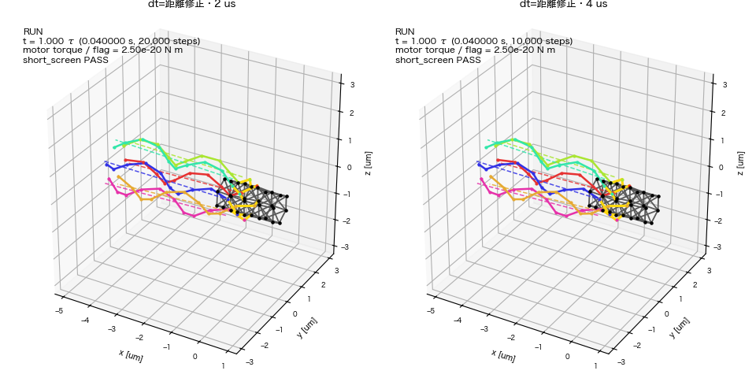

# Issue #263：距離修正1τ screenの結果（予約#37）

## 結論と次の判断

**2条件とも完走し、共通strict QCは2/2 PASS。固定camera replayと定量診断を生成・照合した。**4 µsと2 µsの初期挙動はほぼ一致する。

ただし1τ=0.04秒、べん毛の回転は約0.167回転で、完全周期は0。この窓ではべん毛間反発が設定ONでも全stepの反発力は0だった。**距離修正による0.4〜0.8秒の減速解消、持続回転、定常遊泳は未判定**。初期過渡の符号付き変位は両条件とも負であり、QC PASSを遊泳成立とは扱わない。

次は[実行計画](phase2_263_segment_distance_rerun_runbook.md)の1秒対照をレビューする段階。1秒stage・26条件×2秒は未予約で、新たな物理変更、torsion方式比較、採択、mergeは行っていない。

## 固定条件・完走照合

- cs10 queue #37、固定commit `0017fbbd922997f32dbad4b40aa5af03da974c92`。jobは`nf6_segment_distance_1tau_job.yaml`。
- nf6/slots012345、従来compact、菌体–べん毛反発OFF、べん毛間反発ON。距離修正以外のhook/motor/torsion/初期幾何は維持。比較はdt 4 µs / 2 µsのみ。
- 2026-10-26 12:36:53 JST開始。4 µsは13:03:36、2 µsは13:31:47に終了し、queue/jobはsucceeded、failed configs 0。
- 4 µsは10000 step、2 µsは20000 step。両方step連続、実終端は丸め誤差内で0.04秒。
- `cs10_qualified`の実効2 workers、数値thread各1。job/campaign/base config/force sourceのSHAが予約証拠・local・remoteで一致。
- portableのみ31ファイル・646080 bytesをローカル同期し、ファイル集合・件数・SHA-256全件一致。operational log/credential/partial artifactは同期していない。

10月26日の自動確認は指定13:40 JSTに対して22:40 JSTに起動し、cs10名前解決失敗で完了未確認となった。追加確認を予約せずautomationを削除した。10月27日のユーザーによるVPN復旧連絡・操作許可後に今回の確認と評価を完了した。接続障害をsimulation失敗とは判定していない。

## 共通strict QC

`run_summary.json`を先に読み、固定commitの共通`development_evaluation`で解析した。finite/body/hook length/flag/motorの既存閾値を維持し、hook角診断を新たなQCへ戻していない。

| 最大値 | 4 µs | 2 µs |
| --- | ---: | ---: |
| hook長の相対誤差 | 0.068837 | 0.068837 |
| べん毛bondの相対誤差 | 0.047525 | 0.047525 |
| べん毛曲げ角誤差 [°] | 3.8652 | 3.8648 |
| べん毛torsion角誤差 [°] | 3.6079 | 3.6078 |
| 菌体springの相対伸縮 | 0.058399 | 0.058396 |
| motor総力残差比 | 4.25e−16 | 4.18e−16 |
| motor総トルク残差比 | 3.45e−16 | 3.69e−16 |
| 共通strict QC | PASS | PASS |

## 回転・前進・束の初期診断

| 診断：0〜0.04秒 | 4 µs | 2 µs |
| --- | ---: | ---: |
| べん毛材料点回転・6本の範囲 [回] | 0.166858307〜0.166858307 | 0.166857672〜0.166857672 |
| 完全回転周期 | 0 | 0 |
| 菌体材料点自転 [回] | 0.08256305 | 0.08256267 |
| 菌体長軸への符号付き積分変位 [µm] | −0.04100640 | −0.04100647 |
| 終端の符号付き前進速度 [µm/s] | −1.815052 | −1.815010 |
| 束半径：初期→終端 [µm] | 0.813333→0.778707 | 0.813333→0.778707 |
| 終端べん毛間平均軸角 [°] | 3.495606 | 3.495616 |
| 終端束軸と菌体後方軸の角度 [°] | 0 | 0 |
| 根元motor横腕の保存状態内最小 [µm] | 0.344175 | 0.344176 |
| 異なるべん毛間segment距離の保存状態内最小 [µm] | 0.412191 | 0.412190 |
| 全internal stepのべん毛間反発力最大 [N] | 0 | 0 |

回転は共通recorderが全internal stepで積算した、菌体と共に動く座標系のlabel付き材料点best-fit axial spin。菌体自転もlabel付き材料点のbest-fit spinで、オンラインPCA frame rollではない。どちらも有限の剛体fitを用いる診断であり、独立したmotor shaftの計測ではない。菌体fitの保存間隔内残差最大は約0.01185 µm。束の幅/角度・根元腕・接触距離は1 ms保存座標から計算した。

6本の回転一致と束軸角0は対称初期条件下の結果であり、自発的な位相同期や摂動安定性の証拠とはしない。0.2 µmの反発範囲より保存状態のsegment距離は大きく、内部stepの反発力記録も全て0だった。

### 時間刻みと旧対照

- 修正4 µsと2 µsの、同じ物理時刻における最大ビーズ位置差は9.00e−6 µm。終端ビーズ位置のRMS差は1.32e−6 µm。
- 旧#35・固定`71ed7529d362474235b931494af6cafcf3fe2edf`の`nf06__slots012345__bfoff`を、既存QCとsummary/archive SHA照合後に0〜0.04秒だけ再利用した。旧4 µsと修正4 µsの最大ビーズ位置差は2.18e−14 µm。
- この初期窓では反発が作用しないため、距離修正前後に実質的な軌道差がない。接触を含む後続窓への結論にはしない。異なるduration/条件IDの旧archiveを新campaignのQC入力へ混ぜていない。
- 2つのdtの初期一致は、接触発生後の刻み収束や長時間安定性の証明ではない。

## 固定camera replay

条件別3D/2D計4本と、2条件を横並びにした比較3D/2D計2本を作成した。**全6本が41 frame・25 fps、物理時刻0〜0.04秒の全範囲を含む**する。再生は約40倍のslow replay。manifest・ffprobe実frame数/fps・SHA-256・source coverageを照合し、初期/中間/終端frameを目視した。日本語タイトルはinstalled Hiragino Sansを使う描画設定で生成した。

cameraは固定・campaign全体の共通視野で、描画中に条件ごとへ追従/拡大しない。3Dに大きな形状破綻や目立つdt差は見えないが、6本は色別のらせんとして分かれており、この短時間から密な束の維持は判断できない。2Dでは菌体像が支配的である。動画の選択はローカル`replay_index.md`を参照。

解析は実行commitの`git archive`から展開したsource snapshotを`PYTHONPATH`で明示した。snapshotには`.git`がないためrendererの生manifestはgit unknownとなるが、別添`code_provenance.json`とjob manifestで、固定commit・各解析sourceのSHAを記録している。PR headの変更を実行sourceへ混在させていない。

## 費用と残作業

子runの実測は4 µsが約26.7分・6.237 step/s、2 µsが約54.9分・6.073 step/s。単純なstep数外挿では1秒stageは約11.1/22.9時間、並列wall約23時間となる。ただし今回の計測は接触前の初期形状であり、接触・形状・共有負荷で変化する。予約判断時の概算として扱い、終了時刻の保証にしない。

1秒stageへ進む前に、このQCとreplayをユーザーがレビューする。以降の主な比較窓は0.55〜0.65秒のspin/接触/弾性抵抗と0.9〜1秒の回復。今回の科学的未達は、減速の原因分離と後方束・持続推進の成立評価がまだ終わっていないこと。追加位置復元処理/scaleの削除は既存のマージ前残作業である。

## 成果物・再現

ローカル正本：`outputs/2026-10-27/094100/issue263_distance_1tau_review/`。

- `remote_inventory.json`、`sync_verification.json`、`summary_first_read.json`、`code_provenance.json`。
- `evaluation/summary.csv`、共通heatmap、条件別固定camera replay、`bundle_rotation/`。
- `condition_diagnostics.json`、`body_material_rotation.csv`、`contact_geometry.csv`、`comparison_replay/`、`replay_index.md`。
- `replay_verification.json`、`manifest.json`、`run.log`、再評価/検証script。

既存の共通evaluatorと診断を使い、新しいQC evaluator・閾値やsimulation coreの変更は行っていない。
